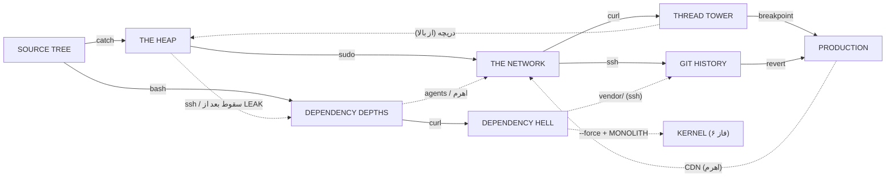

# 08 · طراحی دنیا: فاز ۴ و ۵

**نتیجه:** شش منطقه‌ی تازه (THE HEAP، THE NETWORK، THREAD TOWER، GIT HISTORY، DEPENDENCY HELL، PRODUCTION) با ۱۰۶ اتاق تازه، ۱۰ باس، ۲۳ اتاق مخفی و ۸ تکه‌ی حافظه‌ی تازه (روی هم ۱۶، جون تا ۹). هر منطقه حداقل به سه منطقه‌ی دیگه وصله و بعد از SOURCE TREE ترتیب بازی آزاده. این سند فقط طراحیه؛ پلن پیاده‌سازی بعد از تأیید Zakaria نوشته می‌شه.

نقشه‌ی تعاملی (همه‌ی اتاق‌ها، درها و قفل‌ها): https://claude.ai/artifact/3idnat2P5utcSquVZ7oSyp

جای همه‌ی اتاق‌ها (مختصات کاشی در دنیا) و درها با اسکریپت چک شده: هیچ دو اتاقی روی هم نیستن، هر در با درِ اتاق کناری دقیقاً هم‌ردیف (یا هم‌ستون) ـه و زیر هر در جای ایستادن هست. داده‌ی خام: [`world-phase45.json`](world-phase45.json).

## ۱. اصول طراحی

1. **دنیای پیوسته، نه زنجیر.** هر منطقه حداقل به سه منطقه‌ی دیگه وصله. بازیکن هیچ‌وقت فقط یه راه جلوش نداره و از چند طرف به هر جا می‌رسه.
2. **اول ببین، بعد برس.** هر مانعی که یه توانایی بازش می‌کنه، قبل از گرفتن اون توانایی دیده می‌شه. بازیکن تو ذهنش نقشه‌ی «برمی‌گردم» می‌کشه.
3. **میان‌بر از طرف دور باز می‌شه.** هر منطقه یه میان‌بر داره که از سمت عمیقش باز می‌شه (اهرم، دریچه، کابل). نیمکت‌ها کنار میان‌برها هستن.
4. **هیچ رازی بدون سرنخ نیست.** هر در مخفی یه نشونه داره: پروانه، ردیف توکن، تابلوی TODO، یا جای خالی روی نقشه. راز منصفانه‌ست، نه شانسی.
5. **مکانیک = مفهوم.** مکانیک هر منطقه خودِ مفهوم برنامه‌نویسیشه: سیل حافظه‌ی HEAP، پورت‌های NETWORK، ریسه‌های TOWER، شاخه‌های GIT.
6. **دنیا عوض می‌شه.** هر باس چیزی رو تو دنیا برای همیشه تغییر می‌ده (HEAP خالی می‌شه، حلقه‌ی while شکسته می‌شه، آتش PRODUCTION خاموش می‌شه). برگشتن ارزش داره.
7. **سفر سریع فقط از ترمینال.** فقط یه نیمکت در هر منطقه «ترمینال» ـه و سفر سریع داره. بقیه‌ی نیمکت‌ها فقط ذخیره و شفا. پس میان‌برها و پیوستگی معنی دارن.
8. **co-op بدون گیر.** هر مانعی رو یه نفر تنها هم حل می‌کنه. بعضی‌ها با دو نفر سریع‌ترن (یکی کلید رو نگه می‌داره، یکی می‌دوه).

### زبان سرنخ‌ها (برای درهای مخفی)

- **پروانه:** پروانه‌ها (باگ اول، ۱۹۴۷) دور دیوارهای dead code می‌چرخن. پلاگین --verbose این دیوارها رو برق‌دار نشون می‌ده.
- **ردیف توکن:** توکن‌ها یه قوس یا خط می‌سازن که به سمت یه دیوار، سقف یا کف می‌ره.
- **تابلوی TODO:** تابلوها با کامنت‌هایی مثل «// TODO: remove this wall» یا «Disallow: /backup» اشاره می‌کنن.
- **شکل نقشه:** نقشه‌ی توقف یه جای خالی نشون می‌ده که هیچ اتاقی پرش نکرده (مثل بین gc.log و free.c).
- **رنگ و شکل ثابت موانع:** هر مانع توانایی همیشه همون شکل رو داره: لبه‌ی sudo، حلقه‌ی GET، آجر قرمز فایروال، پیستون، کلید فشاری، کف package-lock، کابل اسپاگتی، کلید شکاف.

## ۲. نقشه‌ی کلی

| منطقه | مسیر | ساعت | فاز | ورودی | باس → جایزه | اتاق |
|---|---|---|---|---|---|---|
| THE HEAP | `/proc/heap` | 04:20 | 4A | از R11 (پشت دروازه‌ی catch) | THE LEAK (آرنای H09) → sudo | 16 |
| THE NETWORK | `/net` | 04:47 | 4B | از HEAP (H11، با sudo) یا از DEPTHS (D07، با agents) | WEB CRAWLER (N09) → curl؛ THE FIREWALL (N15) → ssh؛ THE REVIEWER #2 (کف هاب، اختیاری) | 21 |
| THREAD TOWER | `/dev/threads` | 05:12 | 5A | از NETWORK (airgap، با curl) | RACE CONDITION (T06) → breakpoint؛ INFINITE LOOP (T10) → opus | 17 |
| GIT HISTORY | `.git` | 05:33 | 5B | از NETWORK (22/tcp، با ssh) | REGRESSION (G12) → revert | 16 |
| DEPENDENCY HELL | `~/node_modules/**` | 03:59 | 5C | از DEPTHS (گودال D02، با curl). منطقه‌ی اختیاری | DEPENDENCY HELL (X08) → --force | 12 |
| PRODUCTION | `/var/prod` | 05:51 | 5D | از TOWER (busy_wait، با breakpoint) یا GIT (revert.sh، با revert) | THE REVIEWER #3 (P10)؛ THE MONOLITH (P12) → پایان | 17 |

**ترتیب بازی:**

- **ضروری:** NULL → REVIEWER #1 → THE LEAK (sudo) → WEB CRAWLER (curl) → [مسیر TOWER: RACE CONDITION (breakpoint) → INFINITE LOOP] یا [مسیر GIT: FIREWALL (ssh) → REGRESSION (revert)] → REVIEWER #3 → THE MONOLITH
- **اختیاری:** MERGE CONFLICT (agents)، THE REVIEWER #2، باس مسیرِ دیگه‌ی PRODUCTION، DEPENDENCY HELL (--force)
- **انتخاب‌ها:** بعد از catch: اول DEPTHS یا HEAP. تو NETWORK: اول خزنده یا فایروال. بعد از NETWORK: TOWER، GIT یا HELL به هر ترتیبی. PRODUCTION از بالا (TOWER) یا پایین (GIT).

## ۳. منطقه‌ها

### THE HEAP (`/proc/heap`، ساعت 04:20، فاز 4A)

> «حافظه‌ای که گرفته شد و هیچ‌وقت پس داده نشد.» یه محله‌ی غرق‌شده در مایع سبز نشتی: ساکت، نمور، پر از اشیای رهاشده و فلش‌هایی که به هیچ‌جا اشاره نمی‌کنن.

- **فعل اصلی:** catch (برگردوندن «اشاره‌گر» به شیرهای free()) و خوندن سطح سیل
- **سیستم امضا:** سطح سیل سه‌مرحله‌ای کل منطقه رو عوض می‌کنه: سطح ۲ (اول کار)، سطح ۱ (بعد از شیر free.c)، سطح ۰ (بعد از مرگ THE LEAK). هر سطح درهای تازه‌ای کنار چاه هاب باز می‌کنه.
- **تله‌ها:** مایع نشتی، چکه‌کن (Dripper)، پاندول، کاشی فروریز، سیل بالارونده‌ی stack_overflow.c
- **دشمن‌ها:** Slime (allocation؛ با مرگ دو تا می‌شه)، Lint، SEGFAULT (جدید: منفجر می‌شه و ترک ضخیم رو می‌شکنه)، STACK OVERFLOW (جدید: برجی از باگ‌ها که روت می‌افته)، EXCEPTION (برای catch)
- **رنگ:** نیلی تیره + فیروزه‌ای نشتی؛ آدرس‌های هگز (0x7ffd…) روی دیوارها
- **موسیقی:** w3 (آبکی و آروم) + صدای چکه؛ زیر آب صداها خفه
- **نشانه‌ها:** فانوس GC که نورش از چند اتاق پیداست؛ «لیست پیوندی» بلوک‌های شناور هاب؛ دریاچه‌ی سبز از لبه‌ی brk.c
- **صدای تابلوها:** خروجی دیباگ malloc و لاگ GC: «free(): invalid pointer»، «cannot free: still referenced by THE LEAK»
- **شکل روی نقشه:** یه بلوک فشرده با یه چاه عمیق وسطش که تا سقف DEPTHS پایین می‌ره
- **باس:** THE LEAK (آرنای H09) → sudo
- **ورودی:** از R11 (پشت دروازه‌ی catch)

**ریتم مسیر اصلی:** H01 (آرام، منظره) → H02 (آموزش) → H04 (چالش) → H03 (استراحت، هاب) → H07 (پازل) → H05 (دشمن تازه) → H06 (اوج: سیل بالارونده) → H08 (استراحت) → H09 (باس) → H10 (جایزه) → H11 (گذر)

| اتاق | اسم | اندازه | جا در دنیا | نقش | طراحی |
|---|---|---|---|---|---|
| H01 | `brk.c` | 32×16 | [768, -20] | مسیر | آستانه‌ی HEAP. از پشت دروازه‌ی catch در R11 بیرون می‌آی روی یه لبه‌ی بلند؛ زیر پات دریاچه‌ی سبز حافظه‌ست و دور، نور فانوس GC روی دیوارها می‌چرخه. یه حلقه‌ی GET بالای سرته که هنوز بهش نمی‌رسی (راز curl). |
| H02 | `malloc.c` | 194×16 | [800, -20] | مسیر | کانال اصلی (مرحله‌ی 3-1 بازی JS، ویرایش‌شده). یاد می‌ده: ریتم چکه‌کن‌ها، Slimeهایی که با مرگ دو تا می‌شن، پاندول‌ها و چاله‌های مایع. سقف یه جا ترک داره و توکن‌ها یه قوس به سمتش ساختن (راز bash). روی حوض بزرگ یه پل ریخته هست که بعدها با revert ازش رد می‌شی. |
| H04 | `dangling_ptr.c` | 122×20 | [994, -20] | مسیر | چالش قبل از هاب (3-2، کوتاه‌شده): سکوهای «اشاره‌گر معلق» که زیر پات فرو می‌ریزن، خار و Lintهای عمودی. آخرش به بالای هاب می‌رسی. بعداً یه دریچه‌ی سقفی از H10 اینجا می‌افته (میان‌بر برگشت بعد از باس). |
| H03 | `free_list.h` | 32×60 | [1116, -15] | هاب | هاب و ترمینال HEAP: یه چاه عمیق که یه «لیست پیوندی» از بلوک‌های شناور با فلش تا ته‌اش می‌ره. نیمکت بالاست؛ پایین رو سیل پوشونده. هر بار سطح سیل پایین بیاد، درهای تازه‌ای کنار چاه پیدا می‌شن: free.c (سطح ۲)، segfault.c (سطح ۱)، core_dump و دریچه‌ی کف به D04 (سطح ۰). کنار نیمکت پروانه‌ها دور یه دیوار می‌چرخن. دیوار غربی پایین آجر فایروال به D03 ـه. |
| H13 | `use_after_free.c` | 64×14 | [1148, -20] | مخفی | راز dead code، درست کنار نیمکت هاب. اتاقی که «آزاد شده» ولی هنوز هست؛ اشیای رهاشده هنوز حرف می‌زنن («I was freed. Why can I still hear you?»). اولین دیدار با پروانه. جایزه: صندوق توکن و lore. |
| H07 | `free.c` | 64×16 | [1148, -6] | پازل | پازل شیر free(): یه EXCEPTION گلوله‌ی زرد («اشاره‌گر») پرت می‌کنه؛ با catch برگردونش تو دهنه‌ی شیر. سطح سیل کل HEAP از ۲ به ۱ می‌آد (غرش، و آب همه جا پایین می‌ره). دیوار شرقی dead code ـه و مستقیم به وسط stack_overflow.c باز می‌شه (میان‌بر مخفی). |
| H05 | `segfault.c` | 64×16 | [1148, 12] | مسیر | راهروی پایینی (بعد از سطح ۱). دشمن جدید SEGFAULT: سمتت می‌دوه، قرمز چشمک می‌زنه و منفجر می‌شه؛ انفجارش دیوار ترکِ خیلی ضخیم رو هم می‌شکنه. پازل: یه SEGFAULT رو تا دیوار ضخیم بکشون. |
| H15 | `core_dump` | 64×16 | [1148, 29] | مخفی | بعد از مرگ THE LEAK و تخلیه‌ی کامل (سطح ۰) پیدا می‌شه: پروسس‌های کرش‌کرده که وسط کار یخ زدن، مثل یه موزه. تکه‌ی حافظه و lore. درِ قفل یه باس اختیاری فاز ۶ (FORK BOMB) اینجاست. |
| H08 | `gc.log` | 64×16 | [1148, -36] | نیمکت | نیمکت قبل از باس، اتاق فانوس GC. لاگ‌های GC روی دیوار داستان رو می‌گن: «cannot free: still referenced by THE LEAK». |
| H06 | `stack_overflow.c` | 26×64 | [1212, -29] | مسیر | صحنه‌ی امضای HEAP (3-3): وقتی پات به کف چاه می‌رسه مایع شروع به بالا اومدن می‌کنه («It is rising. Go UP»). صعود با پرش دیواری و سکوها، و STACK OVERFLOWها که روت می‌افتن. بالا به gc.log می‌رسی. بعد از مرگ LEAK دیگه بالا نمی‌آد. |
| H09 | `THE LEAK` | 24×14 | [1124, -34] | باس | آرنای THE LEAK (24×14، همون 3-B). سیل تو هر فاز بالا می‌آد و سکوهای بالا جای امنن؛ پهپاد GC گاهی رد می‌شه و زدنش سطح سیل رو یه کم پایین می‌آره. جایزه: sudo. |
| H10 | `sudoers` | 64×16 | [1060, -36] | جایزه | اتاق جایزه: آموزش پرش دوم روی لبه‌هایی که ۵ کاشی بالان و دیوار ندارن. یه دریچه در کف به H04 می‌افته (میان‌بر برگشت به هاب)، و یه دریچه‌ی سقفی که فقط از پایین و با sudo باز می‌شه به mmap.c. |
| H11 | `mmap.c` | 200×16 | [1060, -52] | مسیر | راهروی بالایی به NETWORK: لبه‌های sudo و پهپادهایی که بالای سرت شناورن. از پنجره‌ها کل HEAP زیر پاته. سقفش یه دریچه داره که فقط از بالا باز می‌شه (پای THREAD TOWER). |
| H12 | `alloca.h` | 24×14 | [920, -34] | مخفی | اتاق کوچیک بالای malloc.c (از ترک سقف). تکه‌ی حافظه. دیوار شرقیش آجر فایروال نازکه: یه راز داخل راز. |
| H16 | `memory_pool.c` | 56×14 | [944, -34] | مخفی | انبار پنهان پشت دیوار فایروال H12: صندوق توکن و پلاگین gzip (توکن‌ها ×۱.۵). |
| H14 | `heap_top` | 32×14 | [768, -34] | مخفی | بالای HEAP، با curl از حلقه‌ی H01. پلاگین sourcemap (نقشه چیزهای جمع‌نشده‌ی اتاق‌های دیده‌شده رو نشون می‌ده). |

### THE NETWORK (`/net`، ساعت 04:47، فاز 4B)

> «سیم بین ماشین‌ها.» شهر روترها: کابل‌های نوری که نور توشون می‌دوه، بسته‌هایی که مثل قطار رد می‌شن، پورت‌هایی که باز و بسته می‌شن و دیوارهای آتش.

- **فعل اصلی:** مسیریابی؛ جایزه‌ها: curl (قلاب به حلقه‌های GET) و ssh (عبور از آجر فایروال نازک)
- **سیستم امضا:** یه هاب (core_router) با دو بال: بال خزنده (شمال، WEB CRAWLER) و بال فایروال (شرق، FIREWALL). حلقه‌ی token_ring پشت هاب دو بال رو به هم وصل می‌کنه: از بالا با curl، از پایین با ssh. دو ورودی: از HEAP (sudo) و از DEPTHS (agents).
- **تله‌ها:** پورت‌های زمان‌دار، تارهای لیزری خزنده، بسته‌های متحرک روی مسیر
- **دشمن‌ها:** SCRAPER (جدید: از قلاب‌های شبیه حلقه‌ی GET آویزونه؛ یاد می‌ده لنگرها چه شکلی‌ان)، WORM (جدید: توی دیوارهای نازک حرکت می‌کنه؛ یاد می‌ده این دیوارها قابل‌عبورن)، DDOS (جدید: گله‌ی بسته‌های ریز)، SPYWARE (جدید: چشم با لیزر ردیاب)، Drone، FIREWALL GUARD
- **رنگ:** سرمه‌ای + فیروزه‌ای و سرخابی؛ LEDهای چشمک‌زن روترها
- **موسیقی:** آهنگ جدید: الکترونیک تند با ضرب بسته‌ها
- **نشانه‌ها:** روتر مرکزی (هاب)، «شکاف هوایی» airgap به سمت برج، دیوارهای آتش با شماره‌ی پورت
- **صدای تابلوها:** کدهای HTTP، خروجی ping و traceroute، فایل robots.txt
- **شکل روی نقشه:** ستاره: هاب وسط، دو بال، یه حلقه پشتش
- **باس:** WEB CRAWLER (N09) → curl؛ THE FIREWALL (N15) → ssh؛ THE REVIEWER #2 (کف هاب، اختیاری)
- **ورودی:** از HEAP (H11، با sudo) یا از DEPTHS (D07، با agents)

**ریتم مسیر اصلی:** N01 (ورود) → N04 (سرنخ) → N05 (آموزش SCRAPER) → N08 (صعود) → N09 (باس) → N10 (جایزه) → N11 (اوج: airgap) → N03 (هاب / REVIEWER #2) → N12 (ریتم پورت‌ها) → N13 (WORM) → N14 (استراحت) → N15 (باس) → N16 (جایزه) → N17 (پایین رفتن)

| اتاق | اسم | اندازه | جا در دنیا | نقش | طراحی |
|---|---|---|---|---|---|
| N01 | `eth0` | 48×16 | [1260, -52] | دروازه | دروازه‌ی HEAP: پل فیبر نوری با بسته‌های نور. یه دریچه در کف مستقیم به بالای هاب روتر می‌افته. |
| N04 | `robots.txt` | 32×16 | [1308, -52] | مسیر | تابلو: «User-agent: * / Disallow: /backup». سرنخ اصلی NETWORK: جایی که خزنده‌ها رو منع کرده دقیقاً جاییه که یه چیزی قایم شده. |
| N19 | `/backup` | 32×14 | [1400, -72] | مخفی | راز dead code (سرنخ robots.txt): تکه‌ی حافظه و نسخه‌ی پشتیبان یه تابلوی قدیمی. |
| N05 | `sitemap.xml` | 120×20 | [1340, -58] | مسیر | اتاق تارهای WEB CRAWLER: خط‌های نور مثل تار عنکبوت. SCRAPERها از قلاب‌هایی شبیه حلقه‌ی GET آویزونن. سقفش یه جا dead code ـه (/backup) و کفش یه جا (404). از اینجا خط CI در آسمان پیداست. |
| N20 | `404` | 32×14 | [1380, -38] | مخفی | اتاقی که روی نقشه ثبت نمی‌شه: نقشه به‌جاش «404 Not Found» می‌نویسه. lore و صندوق توکن. |
| N08 | `crawl_queue` | 26×72 | [1460, -110] | مسیر | چاه عمودی صف خزنده: صعود با پرش دیواری بین تارها، SCRAPERها از بالا پایین می‌آن. یه شکاف curl به token_ring باز می‌شه. |
| N09 | `WEB CRAWLER` | 32×20 | [1428, -112] | باس | آرنای WEB CRAWLER (32×20، بلندتر برای بازی روی سقف): عنکبوت روباتیک از سقف آویزون می‌شه و تار لیزری می‌کشه؛ فقط وقتی روی سقفه آسیب‌پذیره، پس باید بالا بری. طعمه‌هایی هست که پرتو indexing اول اونا رو هدف می‌گیره. جایزه: curl. |
| N10 | `GET.http` | 88×20 | [1340, -112] | جایزه | اتاق جایزه: آموزش curl روی حلقه‌های GET بالای شکاف‌ها، از تکی تا زنجیره‌ای. |
| N11 | `airgap` | 100×46 | [1240, -104] | مسیر | صحنه‌ی امضای NETWORK: «شکاف هوایی» بین ماشین‌ها. با زنجیره‌ی لنگرهای curl از روی خلأ پایین می‌ری تا پای THREAD TOWER؛ برج بالای سرته و HEAP زیر پات. یه دریچه‌ی سقفی (با کابل اسپاگتی) میان‌بر برگشت از بالای برجه. |
| N03 | `core_router` | 32×48 | [1290, -36] | هاب | هاب و ترمینال NETWORK: روتر مرکزی. بالای اتاق سکوهایی تا eth0، پایینش آرنا. وقتی با اولین توانایی NETWORK (curl یا ssh) برگردی، THE REVIEWER #2 منتظره («second review»). اگه هیچ‌وقت با توانایی به کف هاب نیای، می‌شه ازش رد شد. |
| N06 | `traceroute` | 52×16 | [1238, -3] | مسیر | راه هاب به loopback، با تابلوهای hop: «1 router 2 ms… 2 * * *…». |
| N07 | `ttl` | 24×32 | [1260, 13] | مسیر | چاه عمودی بین loopback و traceroute؛ فقط با پرش دیواری (بدون sudo، چون بازیکنی که از DEPTHS می‌آد شاید sudo نداشته باشه). |
| N02 | `loopback` | 48×16 | [1236, 45] | دروازه | در پشتی DEPTHS: از D07 (پشت دروازه‌ی agents در D06) به اینجا. یه اهرم دروازه‌ی D06 رو از این طرف هم باز می‌کنه، تا حلقه‌ی SOURCE TREE ← HEAP ← NETWORK ← DEPTHS برای هر ترتیبی بسته بشه. |
| N12 | `port_scan` | 64×16 | [1322, -2] | مسیر | درهای پورت (22، 80، 443) که با زمان‌بندی باز و بسته می‌شن؛ ریتم رو یاد بگیر. در co-op یکی می‌تونه پورت رو باز نگه داره. |
| N13 | `iptables` | 80×24 | [1386, -12] | مسیر | دشمن جدید WORM که توی دیوارهای نازک حرکت می‌کنه. آجرهای فایروال همه جا که هنوز ازشون رد نمی‌شی (vista). کفش یه جا ترک داره (honeypot). |
| N21 | `honeypot` | 48×16 | [1400, 12] | مخفی | طعمه: یه گنج پشت شیشه. وارد که بشی درها قفل می‌شن و موج DDOS می‌آد. جایزه: پلاگین rate_limit (گلوله‌های دشمن کندتر). |
| N14 | `dmz` | 32×16 | [1466, -4] | نیمکت | نیمکت قبل از FIREWALL. سقفش آجر فایروال token_ring ـه. |
| N15 | `FIREWALL` | 24×14 | [1498, -2] | باس | آرنای THE FIREWALL: سپر جلوش؛ فقط از پشت یا وقتی سپر رو پرت کرده آسیب می‌خوره. چهار «پورت» روی دیوار که بستنشون سپر رو می‌اندازه؛ هر چهارمین فرصت ضربه، ضدحمله می‌کنه (rate limiter). جایزه: ssh. |
| N16 | `ssh_tunnel` | 40×16 | [1522, -6] | جایزه | اتاق جایزه: آموزش ssh (رو به دیوار نازک ۰.۳ ثانیه بمون تا رد بشی). دیوار شرقی به 22/tcp باز می‌شه. |
| N17 | `22/tcp` | 26×82 | [1562, -6] | مسیر | چاه پورت ssh به سمت پایین (GIT HISTORY). وسط چاه یه درِ بی‌دستگیره به شرق هست که از طرف PRODUCTION باز می‌شه (CDN). |
| N18 | `token_ring` | 24×76 | [1486, -80] | حلقه | حلقه‌ی دور هاب: بسته‌ها روی یه مسیر دایره‌ای می‌چرخن. ورودی بالا با curl، ورودی پایین با ssh؛ با هر دو، دو بال NETWORK بی‌واسطه به هم وصل می‌شن. |

### THREAD TOWER (`/dev/threads`، ساعت 05:12، فاز 5A)

> «همه‌ی ریسه‌ها با هم اجرا می‌شن.» برج ساعت برنجی با چرخ‌دنده و تیک‌تاک؛ سه ریسه‌ی عمودی موازی که گاهی با هم می‌دوَن و گاهی منتظر هم می‌مونن.

- **فعل اصلی:** زمان‌بندی و هم‌گامی؛ جایزه‌ها: breakpoint (فریز) و opus
- **سیستم امضا:** سه ریسه‌ی عمودی (thread_0/1/2) که دو طبقه‌ی افقی قطعشون می‌کنه؛ بازیکن انتخاب می‌کنه کدوم ریسه رو بالا بره. درهای mutex، اتاق while(true) که تموم نمی‌شه، آرنای RACE CONDITION دقیقاً «بین دو ریسه».
- **تله‌ها:** بلوک‌های await (نصف وقت هستن)، چرخ‌دنده‌ی ثابت و غلتان، پاندول، پیستون busy-wait
- **دشمن‌ها:** Racer، Heisenbug (فقط وقتی نگاهش نمی‌کنی حرکت می‌کنه)، Gear، Drone
- **رنگ:** برنجی و ماسه‌ای، نور گرم
- **موسیقی:** w4 با تیک‌تاک ساعت
- **نشانه‌ها:** ساعت بزرگ scheduler.c بالای برج، سه ستون برج که از airgap دیده می‌شن
- **صدای تابلوها:** thread dump و پیام‌های همزمانی: «waiting on lock 0x2a…»
- **شکل روی نقشه:** سه ستون بلند با طبقه‌های افقی (خودِ نقشه شبیه یه برجه)
- **باس:** RACE CONDITION (T06) → breakpoint؛ INFINITE LOOP (T10) → opus
- **ورودی:** از NETWORK (airgap، با curl)

**ریتم مسیر اصلی:** T01 (استراحت) → T02 (ریتم await) → TA1 (انتخاب ریسه) → T04 (استراحت میانی) → TB2 (mutex) → T06 (باس) → TC2 (جایزه + صعود) → T08 (ترمینال) → T09 (پازل حلقه) → T10 (باس) → T11 (جایزه) → T16 (میان‌بر)

| اتاق | اسم | اندازه | جا در دنیا | نقش | طراحی |
|---|---|---|---|---|---|
| T01 | `pthread_create.c` | 64×20 | [1176, -72] | نیمکت | پای برج و نیمکت. از airgap می‌رسی و برای اولین بار سه ریسه‌ی برج رو بالای سرت می‌بینی. |
| T02 | `async_await.ts` | 86×20 | [1090, -72] | مسیر | طبقه‌ی پایه (4-1، کوتاه‌شده): بلوک‌های await که نصف وقت هستن. یه دریچه در کف که فقط از بالا باز می‌شه به mmap.c (میان‌بر TOWER ↔ HEAP). |
| TA1 | `thread_0.c` | 26×44 | [1090, -116] | مسیر | ریسه‌ی ۰، پایین: بلوک‌های چشمکی (async) در صعود عمودی. |
| TB1 | `thread_1.c` | 26×44 | [1138, -116] | مسیر | ریسه‌ی ۱، پایین: Heisenbugها که فقط وقتی نگاهشون نمی‌کنی حرکت می‌کنن. یه دیوار ترک‌دار به heisenbug.log. |
| TC1 | `thread_2.c` | 26×44 | [1190, -116] | مسیر | ریسه‌ی ۲، پایین: چرخ‌دنده‌های ثابت و غلتان؛ زمان‌بندی. |
| T15 | `heisenbug.log` | 26×14 | [1164, -110] | مخفی | اتاق چالش اختیاری: چند Heisenbug که باید با نگاه کردن نگهشون داری تا از یه راهروی باریک رد بشی. جایزه: پلاگین hot_path (dash با ضربه به دشمن دوباره پر می‌شه). |
| T04 | `race_condition.go` | 150×20 | [1090, -136] | مسیر | طبقه‌ی میانی (4-2، کوتاه‌شده) که هر سه ریسه رو قطع می‌کنه: Racerها و نیمکت وسط برج. از اینجا انتخاب می‌کنی کدوم ریسه رو بالا بری. |
| TA2 | `deadlock.rs` | 26×62 | [1090, -198] | مسیر | ریسه‌ی ۰، بالا (4-3): صعود با sudo. یه دیوار dead code به volatile.h. |
| TB2 | `mutex.c` | 26×62 | [1138, -198] | مسیر | ریسه‌ی ۱، بالا: درهای mutex که فقط تا وقتی کلید فشرده‌ست بازن. تنها: کلید رو بزن و بدو؛ دو نفره: یکی نگه داره. درِ آرنای RACE CONDITION پایین همین ریسه‌ست. |
| TC2 | `semaphore.h` | 26×62 | [1190, -198] | جایزه | ریسه‌ی ۲، بالا (بعد از RACE CONDITION): آموزش breakpoint روی پیستون‌ها و سکوهای متحرک؛ لبه‌های sudo. بالاش به while_true.js می‌رسه. |
| T06 | `RACE CONDITION` | 26×14 | [1164, -150] | باس | آرنای RACE CONDITION، دقیقاً بین ریسه‌ی ۱ و ۲: دو ریسه‌ی سریع که اول هم‌گامن و هر فاز بیشتر از هم جدا می‌شن؛ زدن یکی اون یکی رو تندتر می‌کنه. جایزه: breakpoint. |
| T14 | `volatile.h` | 24×14 | [1066, -170] | مخفی | راز dead code کنار ریسه‌ی ۰: تکه‌ی حافظه. |
| T08 | `scheduler.c` | 76×20 | [1090, -218] | هاب | بالای برج، ترمینال: ساعت بزرگ زمان‌بند که عقربه‌هاش سکوهای چرخانن. از پنجره‌ها کل دنیا پیداست. |
| T09 | `while_true.js` | 64×20 | [1166, -218] | پازل | اتاقی که تموم نمی‌شه: از شرق بیرون بری، از غرب همون اتاق برمی‌گردی؛ هر دور یه چیز کوچیک عوض می‌شه (شمارنده‌ی i روی دیوار، دشمن‌ها). باید `break;` رو پیدا کنی (کلیدی که فقط تو دور سوم پیداست) تا درِ شرقی به آرنا باز بشه. |
| T10 | `INFINITE LOOP` | 24×14 | [1230, -214] | باس | آرنای INFINITE LOOP: مار حلقه‌ای که فقط دُمش آسیب می‌خوره؛ یه کلید «break» تو آرنا ۳ ثانیه فریزش می‌کنه؛ فاز ۲ دو مار تودرتو. جایزه: opus. |
| T11 | `busy_wait.c` | 48×20 | [1254, -218] | جایزه | اتاق جایزه‌ی opus. یه پیستون خیلی تند (busy-wait) راه شرق به PRODUCTION رو بسته؛ با breakpoint فریزش کن. کف اتاق یه دسته کابل اسپاگتیه که با opus می‌بُری (میان‌بر goto). |
| T16 | `goto` | 26×94 | [1270, -198] | میان‌بر | چاه میان‌بر از بالای برج تا airgap و پای برج. بعد از بریدن کابل با opus، برگشت از بالای برج به NETWORK چند ثانیه‌ست. |

### GIT HISTORY (`.git`، ساعت 05:33، فاز 5B)

> «هر نسخه‌ای از کد هنوز این پایین هست.» آرشیو سپیا؛ کامیت‌ها مثل سنگ‌نوشته، و نسخه‌های قدیمی اتاق‌های آشنای SOURCE TREE.

- **فعل اصلی:** نسخه‌ها؛ checkout (عوض کردن بلوک‌های + و −) و در آخر revert
- **سیستم امضا:** شاخه و merge: منطقه دو شاخه می‌شه (feature/a و feature/b) که هر کدوم یه کلید دارن؛ درِ merge فقط با هر دو باز می‌شه. پازل git bisect. خودِ نقشه‌ی منطقه یه git graph ـه.
- **تله‌ها:** پل‌های فروریز، بلوک‌های diff (سبز = هست، قرمز = نیست) که با اهرم checkout جابه‌جا می‌شن
- **دشمن‌ها:** ZOMBIE PROCESS، POLYMORPHIC (جدید: با هر ضربه نوعش عوض می‌شه)، نسخه‌های قدیمی دشمن‌های SOURCE TREE (Bug v0.1)
- **رنگ:** سپیا و قهوه‌ای + سبز (+) و قرمز (−)
- **موسیقی:** موتیف‌های w1، آهسته‌تر و گاهی برعکس
- **نشانه‌ها:** نمودار git روی دیوارها، تگ‌ها مثل پرچم (v0.1، v1.0)، آسانسور rollback
- **صدای تابلوها:** پیام کامیت‌ها و blame: «Clawd, 3 days ago: fix typo»
- **شکل روی نقشه:** یه git graph: خط اصلی، دو شاخه، merge، و پایین رفتن به گذشته
- **باس:** REGRESSION (G12) → revert
- **ورودی:** از NETWORK (22/tcp، با ssh)

**ریتم مسیر اصلی:** G01 (ورود) → G02 (lore) → G03 (هاب، انتخاب شاخه) → G04 (پازل checkout) → G09 (کلید A) → G06 (دشمن‌های قدیمی) → G07 (پازل bisect) → G08 (merge) → G11 (استراحت) → G12 (باس) → G13 (جایزه) → G14 (پازل آخر)

| اتاق | اسم | اندازه | جا در دنیا | نقش | طراحی |
|---|---|---|---|---|---|
| G01 | `HEAD` | 48×16 | [1540, 76] | دروازه | ورودی و نیمکت: «HEAD -> main». زیر پات زنجیره‌ی کامیت‌ها پایین می‌ره؛ شرقش ماشین‌آلات آسانسور rollback پیداست. |
| G02 | `git_log` | 140×24 | [1400, 80] | مسیر | پلکان کامیت‌ها: هر سکو یه کامیته با پیامش (lore). یه کف ترک‌دار به old/hello_world.py. |
| G16 | `old/hello_world.py` | 46×24 | [1404, 104] | مخفی | راز: نسخه‌ی سپیای اتاق اول بازی «سه کامیت پیش»، با یه تابلوی حذف‌شده («TODO: add a boss»). پلاگین. |
| G03 | `branch` | 40×40 | [1360, 96] | هاب | هاب و ترمینال GIT: شاخه می‌شه. غرب feature/a، پایین feature/b؛ هر دو آخر به merge می‌رسن. |
| G04 | `feature/a` | 90×20 | [1270, 104] | مسیر | اهرم‌های checkout: بلوک‌های سبز (+) و قرمز (−) با هر کشیدن جاشون عوض می‌شه. سقفش dead code ـه (stash). دیوار غربیش آجر فایروال به vendor/ (DEPENDENCY HELL). |
| G05 | `stash@{0}` | 40×14 | [1270, 90] | مخفی | راز: چیزی که یکی stash کرد و یادش رفت. پلاگین nohup (یه بار ضربه‌ی کشنده رو با ۱ جون رد می‌کنی، تا نیمکت بعدی). |
| G09 | `checkout` | 30×60 | [1270, 124] | مسیر | چاه پایین feature/a با پازل checkout وسط سقوط. کلید شاخه‌ی A. |
| G06 | `feature/b` | 90×20 | [1360, 136] | مسیر | شاخه‌ی دوم: ZOMBIE PROCESSها و نسخه‌های قدیمی دشمن‌های اول (Bug v0.1). |
| G07 | `bisect` | 64×48 | [1450, 128] | پازل | پازل git bisect: هر دوراهی یه انتخاب good/bad؛ انتخاب غلط برت می‌گردونه نصفه‌ی قبل. سرنخ‌ها روی تابلوها. کلید شاخه‌ی B. |
| G08 | `merge` | 60×24 | [1300, 170] | پازل | اتاق merge: دو در از دو شاخه. خروجی پایینی فقط با هر دو کلید باز می‌شه («Merge branch feature/a»). |
| G10 | `cherry-pick` | 154×16 | [1360, 176] | مسیر | راهرو از bisect به merge؛ یه «کامیت» (صندوق) رو می‌چینی. |
| G11 | `regression_test` | 40×16 | [1300, 194] | نیمکت | نیمکت قبل از REGRESSION. |
| G12 | `REGRESSION` | 24×14 | [1340, 196] | باس | آرنای REGRESSION: سایه‌ای که ۵ ثانیه‌ی آخر حرکتت رو تکرار می‌کنه؛ فاز ۲ دو سایه (تو co-op سایه‌ی هر دو بازیکن). جایزه: revert. |
| G13 | `reflog` | 60×20 | [1364, 192] | جایزه | اتاق جایزه: آموزش revert (نشانگر بذار، بعد برگرد بهش). یه کلید فشاری که نشانگر روش در رو باز نگه می‌داره. |
| G14 | `revert.sh` | 188×20 | [1424, 192] | مسیر | پازل آخر GIT: پل‌های فروریز و کلیدهای فشاری با هم. ته اتاق آسانسور rollback به PRODUCTION. یه کف package-lock هم داره. |
| G15 | `initial_commit` | 40×16 | [1460, 212] | مخفی | راز --force: عمیق‌ترین نقطه‌ی GIT، «Initial commit». تکه‌ی حافظه و lore (اولین باری که پروانه دیده شد). |

### DEPENDENCY HELL (`~/node_modules/**`، ساعت 03:59، فاز 5C)

> «node_modules تا ته.» جعبه داخل جعبه، نسخه‌هایی که با هم دعوا دارن، وابستگی‌هایی که به خودشون برمی‌گردن.

- **فعل اصلی:** باز کردن بسته‌ها و شکستن چرخه؛ جایزه: --force
- **سیستم امضا:** اتاق‌های دوقلوی peer deps (هر کدوم نصف کلید)، حلقه‌ی عمودی circular_dep، اتاق تودرتو که الگوش کوچیک‌تر تکرار می‌شه.
- **تله‌ها:** بسته‌هایی که باز می‌شن، کف‌های package-lock (فعلاً نشکن)
- **دشمن‌ها:** Mimic، Noodle، Logger، FORK، RANSOMWARE (جدید: «بسته‌ی مخرب» که dash رو چند ثانیه قفل می‌کنه و فرار می‌کنه)
- **رنگ:** قهوه‌ای و نارنجی DEPTHS + بنفش سمی
- **موسیقی:** w2 تیره‌تر و آهسته‌تر
- **نشانه‌ها:** یادبود left-pad، چاه بسته‌ها
- **صدای تابلوها:** «npm WARN deprecated…»، «ERESOLVE unable to resolve dependency tree»
- **شکل روی نقشه:** پله‌پله پایین، با جعبه‌های تودرتو
- **باس:** DEPENDENCY HELL (X08) → --force
- **ورودی:** از DEPTHS (گودال D02، با curl). منطقه‌ی اختیاری

**ریتم مسیر اصلی:** X01 (ورود) → X02 (دوقلو) → X04 (هاب) → X05 (پازل حلقه) → X06 (تودرتو) → X07 (استراحت) → X08 (باس) → X09 (جایزه)

| اتاق | اسم | اندازه | جا در دنیا | نقش | طراحی |
|---|---|---|---|---|---|
| X01 | `npm_install --deep` | 26×60 | [952, 21] | دروازه | ورودی: از یه طاقچه زیر لبه‌ی گودال D02 (فقط با تاب خوردن روی curl) پایین می‌افتی تو چاه بسته‌ها. کف چاه بسته‌ست تا peer depها حل بشن. |
| X02 | `peer_deps@1` | 62×20 | [890, 61] | پازل | دوقلوی چپ (v1): آینه‌ی X03. نصف کلید. |
| X03 | `peer_deps@2` | 62×20 | [978, 61] | پازل | دوقلوی راست (v2): آینه‌ی X02. نصف دیگه‌ی کلید. وقتی هر دو حل بشن، کف چاه باز می‌شه. |
| X13 | `.cache` | 62×14 | [890, 81] | مخفی | راز dead code غرب left-pad: تکه‌ی حافظه. |
| X04 | `left-pad` | 40×20 | [952, 81] | هاب | هاب و ترمینال: یادبود «۱۱ خطی که اینترنت رو شکست». نیمکت. |
| X05 | `circular_dep` | 26×56 | [992, 81] | پازل | وابستگی دایره‌ای: از ته اتاق بیفتی، از بالای همون اتاق می‌افتی (حلقه‌ی عمودی)، تا وقتی با کلید dedupe چرخه رو بشکنی؛ بعد درِ شرقی باز می‌شه. |
| X06 | `node_modules/node_modules` | 108×20 | [1018, 117] | مسیر | اتاق تودرتو: همون الگو سه بار کوچیک‌تر تکرار می‌شه. Mimicها و RANSOMWARE. |
| X07 | `package-lock.json` | 40×20 | [1126, 124] | نیمکت | نیمکت قبل از باس؛ کف‌های package-lock همه جا (هنوز نمی‌شکنی). |
| X08 | `DEPENDENCY HELL` | 24×14 | [1166, 128] | باس | آرنای DEPENDENCY HELL: بسته پرت می‌کنه که باز می‌شه و دشمن یا بسته‌ی کوچیک‌تر ازش درمی‌آد؛ جعبه‌های خالی روی هم سکو می‌شن؛ اینکه کدوم «allocation» زنده بمونه حمله‌ی بعدی رو تعیین می‌کنه. جایزه: --force. |
| X09 | `--force` | 48×20 | [1190, 124] | جایزه | اتاق جایزه: آموزش slam (کف package-lock رو از دو کاشی بالاتر بشکن). یه دریچه‌ی سقفی (sudo، فقط از پایین) به vendor/. کفش یه قفل کرنل داره که تا مرگ MONOLITH باز نمی‌شه. |
| X12 | `vendor/` | 144×20 | [1126, 104] | میان‌بر | راهروی «node_modules رو کامیت کردن!»: از DEPENDENCY HELL تا GIT (دیوار فایروال، ssh). از طرف GIT فقط تا بالای دریچه‌ی X09 می‌رسی؛ نور آرنا از لای توری پیداست. |
| X11 | `/boot` | 48×16 | [1190, 144] | دروازه | (فاز ۶) دروازه‌ی KERNEL: مُهر شده تا MONOLITH بمیره و --force داشته باشی. |

### PRODUCTION (`/var/prod`، ساعت 05:51، فاز 5D)

> «سرورهای زنده، جمعه‌شب. همه جا آتیشه. This is fine.» قفسه‌های سوزان، آژیر قرمز، داشبوردهای قرمز.

- **فعل اصلی:** فشار و زمان؛ رسیدن به deploy
- **سیستم امضا:** دو ورودی که به هاب load_balancer می‌رسن: از بالا خط CI/CD در آسمان (از بالای TOWER)، از پایین آسانسور rollback (از GIT). پایان: REVIEWER #3، فرار DEADLINE، THE MONOLITH.
- **تله‌ها:** فواره‌ی آتش، هشدارهایی که وضعیت اتاق رو عوض می‌کنن، نوار نقاله، دیوار ددلاین
- **دشمن‌ها:** Drone (پهپاد hotfix)، BLOATWARE (جدید: بزرگ و کند و پرجون)، DDOS
- **رنگ:** قرمز، مشکی، نارنجی آتش
- **موسیقی:** w5، بعد final
- **نشانه‌ها:** خط CI در آسمان (از NETWORK دیده می‌شه)، load balancer، تابلوی «This is fine»
- **صدای تابلوها:** هشدارهای incident: «SEV-1: checkout is down»
- **شکل روی نقشه:** یه نوار در آسمان، یه خوشه‌ی بلند، و یه خط فرار به شرق
- **باس:** THE REVIEWER #3 (P10)؛ THE MONOLITH (P12) → پایان
- **ورودی:** از TOWER (busy_wait، با breakpoint) یا GIT (revert.sh، با revert)

**ریتم مسیر اصلی:** P01 (نقاله) → P02 (تست‌ها) → P03 (منظره) → P04 (استراحت) → P05 (پایین رفتن) → P06 (هاب) → P09 (آتش) → P10 (باس) → P11 (اوج: فرار) → P12 (باس نهایی) → P13 (پایان)

| اتاق | اسم | اندازه | جا در دنیا | نقش | طراحی |
|---|---|---|---|---|---|
| P01 | `build.yml` | 100×20 | [1302, -218] | مسیر | اولین مرحله‌ی خط CI/CD در آسمان: نوار نقاله‌ی build. اگه ضربه بخوری «build failed» و به اول همین مرحله برمی‌گردی. |
| P02 | `test.yml` | 100×24 | [1402, -212] | مسیر | مرحله‌ی تست: سه دروازه‌ی unit، integration و e2e، هر کدوم یه چالش کوتاه. |
| P03 | `deploy.yml` | 88×36 | [1502, -204] | مسیر | مرحله‌ی deploy: نوار نقاله‌ها پایین می‌رن به سمت PRODUCTION؛ کل NETWORK و HEAP زیر پاته. |
| P04 | `staging` | 40×20 | [1590, -190] | نیمکت | نیمکت؛ دروازه‌ی بالایی خوشه‌ی PRODUCTION. |
| P05 | `release_queue` | 26×100 | [1630, -190] | مسیر | چاه پایین‌رونده به هاب، با لنگرهای curl و لبه‌های sudo. دیوار غربیش dead code ـه. |
| P16 | `backup.tar.gz` | 24×14 | [1606, -150] | مخفی | راز dead code: تکه‌ی حافظه. |
| P06 | `load_balancer` | 48×32 | [1656, -104] | هاب | هاب و ترمینال PRODUCTION: سکوهایی که مثل load balancer تو رو بین چند مسیر پخش می‌کنن. هر دو ورودی PRODUCTION اینجا به هم می‌رسن. |
| P08 | `incident.log` | 26×80 | [1638, -72] | مسیر | چاه پایینی: هشدارها (آژیر قرمز) هر چند ثانیه وضعیت اتاق رو عوض می‌کنن (فواره‌های آتش روشن و خاموش). یه آژیر دائمی هست که با breakpoint ساکتش می‌کنی (راز). |
| P18 | `pagerduty.log` | 26×74 | [1638, 8] | مسیر | نیمه‌ی پایینی چاه، با نیمکت. درِ CDN (به NETWORK) و بالای آسانسور rollback اینجاست. |
| P17 | `on_call` | 32×14 | [1664, -30] | مخفی | راز breakpoint: پلاگین on_call (سفر سریع از هر نیمکت، نه فقط ترمینال‌ها). |
| P15 | `cdn` | 50×16 | [1588, 20] | میان‌بر | میان‌بر به NETWORK: اهرمش این طرفه؛ وقتی کشیدیش، درِ بی‌دستگیره‌ی 22/tcp باز می‌شه. |
| P07 | `rollback.sh` | 26×174 | [1612, 40] | دروازه | آسانسور طولانی rollback: از ته GIT HISTORY تا وسط PRODUCTION سوارش می‌شی. |
| P09 | `hotfix_friday.sh` | 225×18 | [1704, -96] | مسیر | (5-1) فواره‌های آتش، پهپادها و تابلوی «This is fine». نیمکت آخرش. |
| P10 | `THE REVIEWER #3` | 24×14 | [1929, -94] | باس | آرنای THE REVIEWER #3: بازبینی نهایی قبل از deploy. همه‌ی حرکت‌های قبلیش، تندتر، به‌علاوه‌ی یه حرکت تازه که catch رو امتحان می‌کنه. |
| P11 | `deadline` | 160×24 | [1953, -104] | مسیر | فرار DEADLINE: دیوار قرمز ددلاین از پشت دنبالت می‌آد و باید تا آخر اتاق بدوی و بالا بری. آخرش یه نیمکت، تا اگه پیش MONOLITH مردی فرار رو تکرار نکنی. |
| P12 | `THE MONOLITH` | 24×14 | [2113, -96] | باس | آرنای باس نهایی THE MONOLITH: هر فاز یه توانایی می‌خواد؛ فاز آخر «refactor»: به چهار میکروسرویس تقسیم می‌شه. |
| P13 | `exit_0` | 32×16 | [2137, -100] | پایان | پایان: 06:00، «343 tests passing • 1 moth relocated • exit code 0». |

### اتاق‌های مخفی تازه در مناطق ساخته‌شده

| اتاق | اسم | اندازه | جا در دنیا | طراحی |
|---|---|---|---|---|
| R12 | `.vscode/` | 32×14 | [276, -16] | بالای R02 (با sudo از بالای چاه R02): پلاگین --verbose (دیوارهای dead code نزدیک برق می‌زنن). یه راز اول بازی که بقیه‌ی رازها رو پیدا می‌کنه. |
| R13 | `tests/` | 32×14 | [40, -14] | بالای R01: کلید catch پشت شیشه که از همون صفحه‌ی اول بازی پیداست؛ یه EXCEPTION کنارشه. تکه‌ی حافظه. |
| R14 | `.gitignore` | 40×14 | [150, 16] | زیر R01 (کف package-lock نزدیک آخر R01، --force): «فایل‌هایی که نادیده گرفتی». پلاگین. |
| R15 | `docker-compose.yml` | 40×14 | [460, -14] | بالای R03 (کلید شکاف agents): انبار. پلاگین. |
| R16 | `cron.d/` | 32×14 | [624, -14] | بالای R07 (پیستون، breakpoint): لونه‌ی CRON (باس اختیاری فاز ۶)، درِ قفل. |
| R17 | `pre-commit` | 40×14 | [560, 16] | زیر R04 (کلید فشاری؛ با نشانگر revert باز می‌مونه). پلاگین. |
| R18 | `spaghetti.js` | 40×14 | [420, 16] | زیر R03 (کابل اسپاگتی، opus). پلاگین. |

## ۴. همه‌ی درهای تازه

ستون «ردیف/ستون در دنیا»: برای درهای شرق و غرب، ردیف‌های y در دنیا؛ برای درهای بالا و پایین، ستون‌های x. ردیف محلی هر اتاق = عدد دنیا منهای جای اتاق.

| از | سمت | به | ردیف/ستون در دنیا | چی بازش می‌کنه | یادداشت |
|---|---|---|---|---|---|
| R11 | شرق | H01 | -11..-8 | catch (کلید/دروازه‌ی زرد) |  |
| H01 | شرق | H02 | -11..-8 | باز |  |
| H02 | شرق | H04 | -11..-8 | باز |  |
| H04 | شرق | H03 | -11..-8 | باز |  |
| H03 | شرق | H13 | -11..-8 | dead code (در مخفی) |  |
| H03 | شرق | H07 | 3..6 | باز |  |
| H03 | شرق | H05 | 21..24 | سطح سیل ۱ |  |
| H03 | شرق | H15 | 38..41 | سطح سیل ۰ (بعد از LEAK) |  |
| H03 | غرب | D03 | 38..41 | ssh (آجر فایروال نازک) |  |
| H03 | پایین | D04 | 1130..1133 | سطح سیل ۰ (بعد از LEAK) | drop |
| H05 | شرق | H06 | 21..24 | باز |  |
| H07 | شرق | H06 | 3..6 | dead code (در مخفی) |  |
| H08 | شرق | H06 | -27..-24 | باز |  |
| H08 | غرب | H09 | -27..-24 | درِ آرنا (قفل وسط مبارزه) |  |
| H09 | غرب | H10 | -27..-24 | بعد از کشتن باس |  |
| H10 | پایین | H04 | 1100..1103 | یک‌طرفه (سقوط) |  |
| H10 | بالا | H11 | 1110..1113 | sudo (لبه‌ی بلند) | hatch |
| H01 | بالا | H14 | 784..787 | curl (حلقه‌ی GET) |  |
| H02 | بالا | H12 | 930..933 | bash (دیوار ترک‌دار) |  |
| H12 | شرق | H16 | -27..-24 | ssh (آجر فایروال نازک) |  |
| H11 | شرق | N01 | -43..-40 | باز |  |
| N01 | پایین | N03 | 1294..1297 | باز |  |
| N01 | شرق | N04 | -43..-40 | باز |  |
| N05 | بالا | N19 | 1410..1413 | dead code (در مخفی) |  |
| N04 | شرق | N05 | -43..-40 | باز |  |
| N05 | پایین | N20 | 1392..1395 | dead code (در مخفی) |  |
| N05 | شرق | N08 | -43..-40 | باز |  |
| N09 | شرق | N08 | -99..-96 | درِ آرنا (قفل وسط مبارزه) |  |
| N10 | شرق | N09 | -97..-94 | بعد از کشتن باس |  |
| N10 | غرب | N11 | -97..-94 | باز |  |
| N08 | شرق | N18 | -60..-57 | curl (حلقه‌ی GET) |  |
| N18 | پایین | N14 | 1490..1493 | ssh (آجر فایروال نازک) |  |
| N03 | غرب | N06 | 5..8 | باز |  |
| N06 | پایین | N07 | 1264..1267 | باز |  |
| N07 | پایین | N02 | 1264..1267 | باز |  |
| N02 | غرب | D07 | 54..57 | agents (کلید شکاف) | lever |
| N03 | شرق | N12 | 5..8 | باز |  |
| N12 | شرق | N13 | 5..8 | باز |  |
| N13 | پایین | N21 | 1420..1423 | bash (دیوار ترک‌دار) |  |
| N13 | شرق | N14 | 5..8 | باز |  |
| N14 | شرق | N15 | 5..8 | درِ آرنا (قفل وسط مبارزه) |  |
| N15 | شرق | N16 | 5..8 | بعد از کشتن باس |  |
| N16 | شرق | N17 | 1..4 | ssh (آجر فایروال نازک) |  |
| N11 | غرب | T01 | -63..-60 | curl (حلقه‌ی GET) |  |
| T01 | غرب | T02 | -63..-60 | باز |  |
| T02 | پایین | H11 | 1120..1123 | اهرم (از یه طرف باز می‌شه) | trapdoor |
| T02 | بالا | TA1 | 1100..1103 | باز |  |
| T02 | بالا | TB1 | 1148..1151 | باز |  |
| T01 | بالا | TC1 | 1200..1203 | باز |  |
| TB1 | شرق | T15 | -103..-100 | bash (دیوار ترک‌دار) |  |
| TA1 | بالا | T04 | 1100..1103 | باز |  |
| TB1 | بالا | T04 | 1148..1151 | باز |  |
| TC1 | بالا | T04 | 1200..1203 | باز |  |
| T04 | بالا | TA2 | 1100..1103 | sudo (لبه‌ی بلند) |  |
| T04 | بالا | TB2 | 1148..1151 | باز |  |
| TB2 | شرق | T06 | -143..-140 | درِ آرنا (قفل وسط مبارزه) |  |
| T06 | شرق | TC2 | -143..-140 | بعد از کشتن باس |  |
| TA2 | غرب | T14 | -163..-160 | dead code (در مخفی) |  |
| TA2 | بالا | T08 | 1100..1103 | باز |  |
| TB2 | بالا | T08 | 1148..1151 | mutex (کلید نگه‌داشتنی) |  |
| TC2 | بالا | T09 | 1196..1199 | breakpoint (فریز) |  |
| T08 | شرق | T09 | -211..-208 | باز |  |
| T09 | شرق | همون اتاق (حلقه) | -207..-204 | حلقه (به همون اتاق) |  |
| T09 | شرق | T10 | -207..-204 | بعد از break |  |
| T10 | شرق | T11 | -207..-204 | بعد از کشتن باس |  |
| T11 | پایین | T16 | 1278..1281 | opus (کابل اسپاگتی) |  |
| T16 | پایین | N11 | 1280..1283 | یک‌طرفه (سقوط) |  |
| T11 | شرق | P01 | -211..-208 | breakpoint (فریز) |  |
| P01 | شرق | P02 | -205..-202 | باز |  |
| P02 | شرق | P03 | -195..-192 | باز |  |
| P03 | شرق | P04 | -181..-178 | باز |  |
| P04 | شرق | P05 | -181..-178 | باز |  |
| P05 | غرب | P16 | -143..-140 | dead code (در مخفی) |  |
| P05 | شرق | P06 | -97..-94 | باز |  |
| P06 | پایین | P08 | 1658..1661 | باز |  |
| P08 | شرق | P17 | -23..-20 | breakpoint (فریز) |  |
| P15 | غرب | N17 | 27..30 | اهرم (از یه طرف باز می‌شه) |  |
| P15 | شرق | P18 | 27..30 | باز |  |
| P08 | پایین | P18 | 1648..1651 | باز |  |
| P07 | شرق | P18 | 47..50 | باز |  |
| P06 | شرق | P09 | -87..-84 | باز |  |
| P09 | شرق | P10 | -87..-84 | درِ آرنا (قفل وسط مبارزه) |  |
| P10 | شرق | P11 | -87..-84 | بعد از کشتن باس |  |
| P11 | شرق | P12 | -89..-86 | درِ آرنا (قفل وسط مبارزه) |  |
| P12 | شرق | P13 | -89..-86 | بعد از کشتن باس |  |
| N17 | پایین | G01 | 1566..1569 | باز |  |
| G01 | غرب | G02 | 85..88 | باز |  |
| G02 | پایین | G16 | 1420..1423 | bash (دیوار ترک‌دار) |  |
| G02 | غرب | G03 | 99..102 | باز |  |
| G03 | غرب | G04 | 113..116 | باز |  |
| G04 | بالا | G05 | 1280..1283 | dead code (در مخفی) |  |
| G04 | پایین | G09 | 1280..1283 | باز |  |
| G03 | پایین | G06 | 1376..1379 | باز |  |
| G06 | شرق | G07 | 145..148 | باز |  |
| G09 | شرق | G08 | 175..178 | باز |  |
| G08 | شرق | G10 | 181..184 | باز |  |
| G07 | پایین | G10 | 1480..1483 | باز |  |
| G08 | پایین | G11 | 1316..1319 | دو کلید با هم |  |
| G11 | شرق | G12 | 203..206 | درِ آرنا (قفل وسط مبارزه) |  |
| G12 | شرق | G13 | 203..206 | بعد از کشتن باس |  |
| G13 | شرق | G14 | 199..202 | باز |  |
| G14 | پایین | G15 | 1470..1473 | --force (کف package-lock) |  |
| G14 | شرق | P07 | 203..206 | revert (نشانگر + کلید فشاری) |  |
| D02 | پایین | X01 | 960..963 | curl (حلقه‌ی GET) |  |
| X02 | شرق | X01 | 72..75 | باز |  |
| X01 | شرق | X03 | 72..75 | باز |  |
| X01 | پایین | X04 | 962..965 | دو کلید با هم |  |
| X13 | شرق | X04 | 88..91 | dead code (در مخفی) |  |
| X04 | شرق | X05 | 92..95 | باز |  |
| X05 | پایین | همون اتاق (حلقه) | 1002..1005 | حلقه (به همون اتاق) |  |
| X05 | شرق | X06 | 128..131 | بعد از break |  |
| X06 | شرق | X07 | 128..131 | باز |  |
| X07 | شرق | X08 | 135..138 | درِ آرنا (قفل وسط مبارزه) |  |
| X08 | شرق | X09 | 135..138 | بعد از کشتن باس |  |
| X09 | بالا | X12 | 1220..1223 | sudo (لبه‌ی بلند) | hatch |
| X12 | شرق | G04 | 113..116 | ssh (آجر فایروال نازک) |  |
| X09 | پایین | X11 | 1210..1213 | --force (کف package-lock) | after THE MONOLITH |
| R02 | بالا | R12 | 290..293 | sudo (لبه‌ی بلند) |  |
| R01 | بالا | R13 | 54..57 | catch (کلید/دروازه‌ی زرد) |  |
| R01 | پایین | R14 | 168..171 | --force (کف package-lock) |  |
| R03 | بالا | R15 | 476..479 | agents (کلید شکاف) |  |
| R07 | بالا | R16 | 636..639 | breakpoint (فریز) |  |
| R04 | پایین | R17 | 576..579 | revert (نشانگر + کلید فشاری) |  |
| R03 | پایین | R18 | 436..439 | opus (کابل اسپاگتی) |  |

## ۵. درهای مخفی و رازها

| از | به | سرنخ | چی بازش می‌کنه | جایزه |
|---|---|---|---|---|
| H03 | H13 `use_after_free.c` | پروانه‌ها کنار نیمکت هاب؛ روی نقشه بین gc.log و free.c جای خالی | dead code (در مخفی) | توکن + lore + اولین پروانه |
| H07 | H06 `stack_overflow.c` | پروانه + جریان هوا از دیوار | dead code (در مخفی) | میان‌بر مخفی به وسط stack_overflow.c |
| H02 | H12 `alloca.h` | قوس توکن‌ها به سمت ترک سقف | bash (دیوار ترک‌دار) | تکه‌ی حافظه |
| H12 | H16 `memory_pool.c` | برق گنج از لای آجر فایروال (راز داخل راز) | ssh (آجر فایروال نازک) | پلاگین gzip |
| H01 | H14 `heap_top` | حلقه‌ی GET از همون اولین لحظه‌ی HEAP پیداست | curl (حلقه‌ی GET) | پلاگین sourcemap |
| N05 | N19 `/backup` | تابلوی robots.txt: «Disallow: /backup» + پروانه | dead code (در مخفی) | تکه‌ی حافظه |
| N05 | N20 `404` | پروانه زیر سکو؛ این اتاق روی نقشه «404» می‌شه | dead code (در مخفی) | lore + توکن |
| N13 | N21 `honeypot` | گنج پشت شیشه، کف ترک‌دار | bash (دیوار ترک‌دار) | چالش DDOS → پلاگین rate_limit |
| TB1 | T15 `heisenbug.log` | Heisenbugی که پشت دیوار ترک‌دار یخ زده | bash (دیوار ترک‌دار) | چالش → پلاگین hot_path |
| TA2 | T14 `volatile.h` | پروانه وسط صعود | dead code (در مخفی) | تکه‌ی حافظه |
| G02 | G16 `old/hello_world.py` | نور سپیا از لای کف ترک‌دار | bash (دیوار ترک‌دار) | lore + پلاگین |
| G04 | G05 `stash@{0}` | پروانه + تابلوی «git stash list: 1 entry» | dead code (در مخفی) | پلاگین nohup |
| G14 | G15 `initial_commit` | کف package-lock با برچسب «initial» | --force (کف package-lock) | تکه‌ی حافظه + lore |
| X04 | X13 `.cache` | پروانه کنار یادبود left-pad | dead code (در مخفی) | تکه‌ی حافظه |
| P05 | P16 `backup.tar.gz` | پروانه وسط سقوط | dead code (در مخفی) | تکه‌ی حافظه |
| P08 | P17 `on_call` | آژیری که هیچ‌وقت خاموش نمی‌شه | breakpoint (فریز) | پلاگین on_call |
| R02 | R12 `.vscode/` | لبه‌ی بلند بالای چاه R02 با علامت sudo | sudo (لبه‌ی بلند) | پلاگین --verbose |
| R01 | R13 `tests/` | کلید پشت شیشه از صفحه‌ی اول بازی | catch (کلید/دروازه‌ی زرد) | تکه‌ی حافظه |
| R01 | R14 `.gitignore` | کف package-lock نزدیک آخر R01 | --force (کف package-lock) | پلاگین |
| R03 | R15 `docker-compose.yml` | کلید شکاف تو دیوار سقف R03 | agents (کلید شکاف) | پلاگین |
| R07 | R16 `cron.d/` | پیستونی که راهروی بالا رو له می‌کنه | breakpoint (فریز) | درِ CRON (فاز ۶) |
| R04 | R17 `pre-commit` | کلید فشاری که در رو فقط تا وقتی روشی باز نگه می‌داره | revert (نشانگر + کلید فشاری) | پلاگین |
| R03 | R18 `spaghetti.js` | دسته کابل اسپاگتی پشت یه طاقچه | opus (کابل اسپاگتی) | پلاگین |

## ۶. حلقه‌ها و میان‌برها

- **حلقه‌ی بزرگ:** SOURCE TREE → HEAP → (sudo) → NETWORK → (در پشتی) → DEPTHS → R09 → SOURCE TREE. فرقی نمی‌کنه اول DEPTHS رو بری یا HEAP رو: اهرم N02 و دریچه‌ی H10 حلقه رو از هر دو طرف می‌بندن.
- **HEAP ↔ DEPTHS:** سه اتصال: دریچه‌ی کف هاب به D04 (بعد از LEAK، یک‌طرفه)، دیوار فایروال هاب به D03 (ssh)، و سقف D04 که قبلش ازش آب می‌چکه (vista).
- **token ring:** پشت هاب NETWORK: بال خزنده ↔ بال فایروال (curl از بالا، ssh از پایین).
- **TOWER ↔ HEAP و NETWORK:** دریچه‌ی کف T02 به mmap.c (از بالا باز می‌شه) و چاه goto از بالای برج تا airgap (با opus).
- **GIT ↔ DEPENDENCY HELL:** راهروی vendor/: «یکی node_modules رو کامیت کرده». ssh از طرف GIT، و دریچه‌ی X09 از طرف HELL.
- **PRODUCTION ↔ NETWORK:** میان‌بر CDN: اهرمش تو PRODUCTION ـه و درِ بی‌دستگیره‌ی 22/tcp رو باز می‌کنه.
- **حلقه‌ی پایانی:** TOWER → (CI در آسمان) → PRODUCTION → (آسانسور rollback) → GIT → NETWORK → TOWER. دو راه برای رسیدن به PRODUCTION، و برگشت از راه دیگه.
- **DEPTHS ↔ DEPENDENCY HELL:** گودال D02 با curl به پایین؛ برگشت از ترمینال left-pad یا از vendor/ به GIT.

## ۷. تغییرات در اتاق‌های ساخته‌شده

- **R01 `hello_world.py`:** یه EXCEPTION و کلید catch پشت شیشه (R13 بالا)، کف package-lock نزدیک آخرش (R14 پایین).
- **R02 `branching_out.js`:** لبه‌ی sudo بالای چاه به R12.
- **R03 `the_linter.rb`:** کلید شکاف agents تو سقف (R15) و کابل اسپاگتی (R18 پایین).
- **R04 `pre_boss.sh`:** کلید فشاری revert (R17 پایین).
- **R07 `bash.sh`:** پیستون breakpoint (R16 بالا).
- **R11 `try_catch.js`:** درِ پایانی «/proc/heap» برداشته می‌شه؛ دیوار شرقی (پشت دروازه‌ی catch) در واقعی به HEAP می‌شه.
- **D02 `left_pad.js`:** طاقچه‌ی curl تو گودال، ورودی DEPENDENCY HELL.
- **D03 `version_hell.lock`:** دیوار شرقی کنار نیمکت، آجر فایروال (ssh) به هاب HEAP.
- **D04 `package.json`:** توری سقف که قبل از LEAK ازش آب می‌چکه و بعدش دریچه‌ی سقوط از HEAP می‌شه.
- **D06 `symlink.sh`:** درِ پایانی «/net» برداشته می‌شه؛ دروازه‌ی agents حالا راه NETWORK ـه و یه اهرم از طرف شرق هم بازش می‌کنه.
- **D07 `.npmrc`:** دیوار شرقی در واقعی به NETWORK (loopback) می‌شه.

## ۸. چیزهایی که موتور لازم داره

- **درهای بالا و پایین (N/S):** الان فقط درهای چپ و راست داریم. برای HEAP، TOWER، GIT و رازهای کف و سقف لازمه: عبور از سقف با یه کم سرعت رو به بالا تا به لبه برسی، و سقوط از کف.
- **دیوار dead code:** کاشی‌ای که شبیه دیواره ولی ازش رد می‌شی؛ وقتی رد شدی محو می‌شه و برای همیشه پیدا می‌مونه (flag). پروانه‌ها دورش.
- **سطح سیل منطقه‌ای:** یه عدد برای کل HEAP (۲، ۱، ۰) که مایع اتاق‌ها و درهای «سطح سیل» ازش ساخته می‌شه (وضعیت، نه رویداد؛ برای مهمون هم).
- **سیل بالارونده:** stack_overflow.c و فرار DEADLINE: یه خط خطر که با سرعت ثابت بالا یا جلو می‌آد.
- **اهرم، دریچه، در یک‌طرفه:** دری که فقط از یه طرف باز می‌شه و بعدش برای همیشه بازه.
- **حلقه (wrap) و در شرطی:** دری که به خود اتاق برمی‌گرده تا یه flag (مثل break) روشن بشه، بعد به اتاق دیگه.
- **اهرم checkout:** دو گروه کاشی (+ و −) که با یه اهرم جاشون عوض می‌شه.
- **نوار نقاله و آسانسور:** برای CI/CD و rollback.
- **توانایی‌های تازه:** curl، ssh، breakpoint، revert، --force و موانعشون (حلقه‌ی GET، آجر فایروال، پیستون، کلید فشاری، کف package-lock)؛ opus هم کابل اسپاگتی.
- **نیمکت ترمینال:** فلگ «ترمینال» برای نیمکت‌ها؛ سفر سریع فقط بین ترمینال‌ها (پلاگین on_call این محدودیت رو برمی‌داره).
- **اتاق بیرون از نقشه:** اتاقی که روی نقشه ثبت نمی‌شه (404).

## ۹. تصمیم‌هایی که Zakaria باید تأیید کنه

1. درهای بالا و پایین به موتور اضافه بشه (بدون اینا برج و چاه‌ها واقعی نمی‌شن).
2. سفر سریع فقط از ترمینال‌ها (یکی در هر منطقه)؛ پلاگین on_call محدودیت رو برمی‌داره.
3. میان‌بر opus به‌جای TOWER → SOURCE TREE، از بالای برج به airgap باشه؛ برج به SOURCE TREE از راه HEAP و ترمینال‌ها وصله.
4. THE REVIEWER #2 فقط وقتی ظاهر می‌شه که با curl یا ssh به کف هاب NETWORK برگردی (پس اختیاریه).
5. DEPENDENCY HELL منطقه‌ی اختیاریه (--force برای رازها و KERNEL).
6. تکه‌های حافظه: ۸ تای تازه (روی هم ۱۶) تا جون به ۹ برسه.
7. دشمن‌های تازه: SEGFAULT، STACK OVERFLOW، SCRAPER، WORM، DDOS، SPYWARE، POLYMORPHIC، RANSOMWARE، BLOATWARE.
