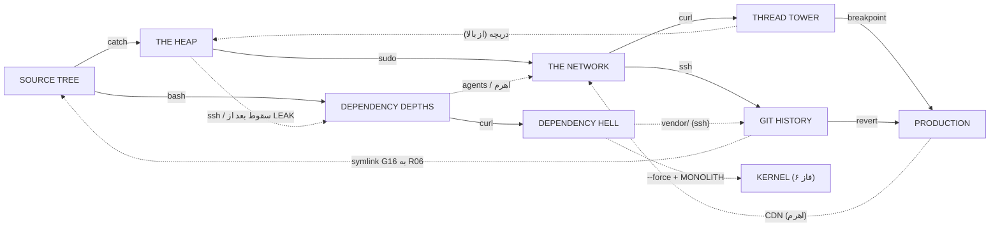

# 08 · طراحی دنیا: فاز ۴ و ۵

**نتیجه:** شش منطقه‌ی تازه (THE HEAP، THE NETWORK، THREAD TOWER، GIT HISTORY، DEPENDENCY HELL، PRODUCTION) با ۱۰۷ اتاق تازه، ۱۰ باس، ۲۳ اتاق مخفی و ۸ تکه‌ی حافظه‌ی تازه (روی هم ۱۶، جون تا ۹). هر منطقه حداقل به سه منطقه‌ی دیگه وصله و بعد از SOURCE TREE ترتیب بازی آزاده. Zakaria این طراحی رو ۲۰۲۶-۱۰-۱۱ تأیید کرد (تصمیم‌های D31 تا D36 در [`00-decisions.md`](00-decisions.md) بخش ۱۳)؛ پلن‌های فاز ۴ و ۵ روی همین سند ساخته می‌شن.

**فاز ۱ طراحی (۲۰۲۶-۱۰-۱۲):** ۴۴ پیشنهاد از ۴۶ تای [`09-design-pass1-proposals.md`](09-design-pass1-proposals.md) (همه جز W6 و B9) و نتیجه‌ی پنج بحث [`10-open-topics.md`](10-open-topics.md) (همه گزینه‌ی «الف») تو همین سند و JSON اومدن. چیزهایی که به یه اتاق بسته‌ان تو جدول همون منطقه نوشته شدن (با شماره‌ی پیشنهاد، مثلاً W2)؛ قانون‌های کلی تو بخش ۱۰ هستن، و تصمیم‌ها در بخش ۱۴ِ `00-decisions.md` (D37 تا D52). منبع پژوهشی هر پیشنهاد در 09 ـه.

نقشه‌ی تعاملی (همه‌ی اتاق‌ها، درها و قفل‌ها): https://claude.ai/artifact/3idnat2P5utcSquVZ7oSyp

جای همه‌ی اتاق‌ها (مختصات کاشی در دنیا) و درها با اسکریپت چک شده: هیچ دو اتاقی روی هم نیستن، هر در با درِ اتاق کناری دقیقاً هم‌ردیف (یا هم‌ستون) ـه و زیر هر در جای ایستادن هست. فقط درِ symlink (W1) عمداً کناری نیست. چک آخر (۲۰۲۶-۱۰-۱۲): ۱۲۵ اتاق (۳۷ ساخته‌شده از `rooms.json` و ۸۸ طرح)، ۱۴۵ در، بی‌خطا. داده‌ی خام: [`world-phase45.json`](world-phase45.json).

## ۱. اصول طراحی

1. **دنیای پیوسته، نه زنجیر.** هر منطقه حداقل به سه منطقه‌ی دیگه وصله. بازیکن هیچ‌وقت فقط یه راه جلوش نداره و از چند طرف به هر جا می‌رسه.
2. **اول ببین، بعد برس.** هر مانعی که یه توانایی بازش می‌کنه، قبل از گرفتن اون توانایی دیده می‌شه. بازیکن تو ذهنش نقشه‌ی «برمی‌گردم» می‌کشه.
3. **میان‌بر از طرف دور باز می‌شه.** هر منطقه یه میان‌بر داره که از سمت عمیقش باز می‌شه (اهرم، دریچه، کابل). نیمکت‌ها کنار میان‌برها هستن.
4. **هیچ رازی بدون سرنخ نیست.** هر در مخفی یه نشونه داره: پروانه، ردیف توکن، تابلوی TODO، یا جای خالی روی نقشه. راز منصفانه‌ست، نه شانسی.
5. **مکانیک = مفهوم.** مکانیک هر منطقه خودِ مفهوم برنامه‌نویسیشه: سیل حافظه‌ی HEAP، پورت‌های NETWORK، ریسه‌های TOWER، شاخه‌های GIT.
6. **دنیا عوض می‌شه.** هر باس چیزی رو تو دنیا برای همیشه تغییر می‌ده (HEAP خالی می‌شه، حلقه‌ی while شکسته می‌شه، آتش PRODUCTION خاموش می‌شه). برگشتن ارزش داره.
7. **سفر سریع فقط از ترمینال.** فقط یه نیمکت در هر منطقه «ترمینال» ـه و سفر سریع داره. بقیه‌ی نیمکت‌ها فقط ذخیره و شفا. پس میان‌برها و پیوستگی معنی دارن.
8. **co-op بدون گیر.** هر مانعی رو یه نفر تنها هم حل می‌کنه. بعضی‌ها با دو نفر سریع‌ترن (یکی کلید رو نگه می‌داره، یکی می‌دوه)، ولی هیچ پازلی همزمانی دقیق نمی‌خواد: قفل‌ها latch ان (یه بار بزنی، باز می‌مونه). هیچ سقوط یا دریچه‌ی یک‌طرفه‌ای شریک رو گیر نمی‌ندازه (بخش ۱۰.۳).
9. **ترمینال جای امنه.** بی‌دشمن، با یه لایه‌ی آروم موسیقی و صدای فن سرور که از اتاق کناری شنیده می‌شه (بخش ۱۰.۴).

### زبان سرنخ‌ها (برای درهای مخفی)

- **پروانه:** پروانه‌ها دور دیوارهای dead code می‌چرخن؛ یادِ پروانه‌ای که سال ۱۹۴۷ تو دفتر نگهداری کامپیوتر Mark II چسبوندن: «first actual case of bug being found» (L7). پروانه فقط نشونه‌ی dead code ـه.
- **ردیف توکن:** توکن‌ها یه قوس یا خط می‌سازن که به سمت یه دیوار، سقف یا کف می‌ره. توکنی که نفر اول برداشته یه سایه‌ی کم‌رنگ جا می‌ذاره تا سرنخ برای نفر دوم بمونه.
- **تابلوی TODO:** تابلوها با کامنت‌هایی مثل «// TODO: remove this wall» یا «Disallow: /backup» اشاره می‌کنن.
- **شکل نقشه:** نقشه‌ی توقف یه جای خالی نشون می‌ده که هیچ اتاقی پرش نکرده (مثل بین gc.log و free.c). جای خالی فقط سرنخ رو تأیید می‌کنه؛ هر جای خالی راز نیست.
- **رنگ و شکل ثابت موانع:** هر مانع توانایی همیشه همون شکل رو داره: لبه‌ی sudo، حلقه‌ی GET، آجر قرمز فایروال، پیستون، کلید فشاری، کف package-lock، کابل اسپاگتی، کلید شکاف.

**نردبون سرنخ (K1):** هرچی جلوتر بری، سرنخ‌ها کم‌صداتر می‌شن. ستون «لایه» در بخش ۵:

| لایه | یعنی چی | کجا |
|---|---|---|
| ۰ | مانع جلوی چشمه (وعده‌ی «برمی‌گردم»)؛ سرنخ خودِ مانعه | همه‌جا |
| ۱ | دو نشونه با هم، برای یاد دادن (مثلاً پروانه و جای خالی نقشه) | SOURCE TREE، DEPTHS و HEAP |
| ۲ | یه نشونه‌ی ریز، به‌اضافه‌ی قانونی که قبلاً یاد گرفتی | بیشتر رازهای NETWORK به بعد |
| ۳ | باید چند جا رو کنار هم بذاری: برگه‌ها، تابلوها، جای خالی نقشه | K3، K4 و پایان L6 |

- پروانه همون اندازه‌ی ساخته‌شده می‌مونه و دیوار dead code درز نمی‌گیره.
- کمک فقط انتخابیه: پلاگین `--verbose` (R12) که یه خونه‌ی پلاگین می‌گیره و فقط دور dead codeِ نزدیک خط می‌کشه، نه جواب.
- یه تنظیم «کنتراست بالا» جدا از پلاگین‌ها، برای کسی که روی گوشی نمی‌بینه. فقط دیدن رو آسون می‌کنه.
- هر درِ مخفی تو JSON فیلدهای `clue`، `reward` و `layer` داره، تا سازنده یکدست بسازه.

## ۲. نقشه‌ی کلی

| منطقه | مسیر | ساعت | فاز | ورودی | باس → جایزه | اتاق |
|---|---|---|---|---|---|---|
| THE HEAP | `/proc/heap` | 04:20 | 4A | از R11 (پشت دروازه‌ی catch) | THE LEAK (آرنای H09) → sudo | 16 |
| THE NETWORK | `/net` | 04:47 | 4B | از HEAP (H11، با sudo) یا از DEPTHS (D07، با agents) | WEB CRAWLER (N09) → curl؛ THE FIREWALL (N15) → ssh؛ THE REVIEWER #2 (کف هاب، اختیاری) | 21 |
| THREAD TOWER | `/dev/threads` | 05:12 | 5A | از NETWORK (airgap، با curl) | RACE CONDITION (T06) → breakpoint؛ INFINITE LOOP (T10) → opus | 18 |
| GIT HISTORY | `.git` | 05:33 | 5B | از NETWORK (22/tcp، با ssh) | REGRESSION (G12) → revert | 16 |
| DEPENDENCY HELL | `~/node_modules/**` | 03:59 | 5C | از DEPTHS (گودال D02، با curl). منطقه‌ی اختیاری | DEPENDENCY HELL (X08) → --force | 12 |
| PRODUCTION | `/var/prod` | 05:51 | 5D | از TOWER (busy_wait، با breakpoint) یا GIT (revert.sh، با revert) | THE REVIEWER #3 (P10)؛ THE MONOLITH (P12) → پایان | 17 |

**ترتیب بازی:**

- **ضروری:** NULL → REVIEWER #1 → THE LEAK (sudo) → WEB CRAWLER (curl) → [مسیر TOWER: RACE CONDITION (breakpoint) → INFINITE LOOP] یا [مسیر GIT: FIREWALL (ssh) → REGRESSION (revert)] → REVIEWER #3 → THE MONOLITH
- **اختیاری:** MERGE CONFLICT (agents)، THE REVIEWER #2، باس مسیرِ دیگه‌ی PRODUCTION، DEPENDENCY HELL (--force)
- **انتخاب‌ها:** بعد از catch: اول DEPTHS یا HEAP. تو NETWORK: اول خزنده یا فایروال. بعد از NETWORK: TOWER، GIT یا HELL به هر ترتیبی. PRODUCTION از بالا (TOWER) یا پایین (GIT).

## ۳. منطقه‌ها

### THE HEAP (`/proc/heap`، ساعت 04:20، فاز 4A)

> «حافظه‌ای که گرفته شد و هیچ‌وقت پس داده نشد.» یه محله‌ی غرق‌شده در مایع سبز نشتی: ساکت، نمور، پر از اشیای رهاشده و فلش‌هایی که به هیچ‌جا اشاره نمی‌کنن.

- **فعل اصلی:** catch (برگردوندن «اشاره‌گر» به شیرهای free()) و خوندن سطح سیل
- **سیستم امضا:** سطح سیل سه‌مرحله‌ای کل منطقه رو عوض می‌کنه: سطح ۲ (اول کار)، سطح ۱ (بعد از شیر free.c)، سطح ۰ (بعد از مرگ THE LEAK). هر سطح درهای تازه‌ای کنار چاه هاب باز می‌کنه.
- **تله‌ها:** مایع نشتی، چکه‌کن (Dripper)، پاندول، کاشی فروریز، سیل بالارونده‌ی stack_overflow.c
- **دشمن‌ها:** Slime (allocation؛ با مرگ دو تا می‌شه)، Lint، SEGFAULT (جدید: منفجر می‌شه و ترک ضخیم رو می‌شکنه)، STACK OVERFLOW (جدید: برجی از باگ‌ها که روت می‌افته)، EXCEPTION (برای catch)
- **رنگ:** نیلی تیره + فیروزه‌ای نشتی؛ آدرس‌های هگز (0x7ffd…) روی دیوارها
- **موسیقی:** w3 (آبکی و آروم) + صدای چکه؛ زیر آب صداها خفه
- **نشانه‌ها:** فانوس GC که نورش از چند اتاق پیداست؛ «لیست پیوندی» بلوک‌های شناور هاب؛ دریاچه‌ی سبز از لبه‌ی brk.c
- **صدای تابلوها:** خروجی دیباگ malloc و لاگ GC: «free(): invalid pointer»، «cannot free: still referenced by THE LEAK»
- **شکل روی نقشه:** یه بلوک فشرده با یه چاه عمیق وسطش که تا سقف DEPTHS پایین می‌ره
- **باس:** THE LEAK (آرنای H09) → sudo
- **ورودی:** از R11 (پشت دروازه‌ی catch)

**ریتم مسیر اصلی:** H01 (آرام، منظره) → H02 (آموزش) → H04 (چالش) → H03 (استراحت، هاب) → H07 (پازل) → H05 (دشمن تازه) → H06 (اوج: سیل بالارونده) → H08 (استراحت) → H09 (باس) → H10 (جایزه) → H11 (گذر)

| اتاق | اسم | اندازه | جا در دنیا | نقش | طراحی |
|---|---|---|---|---|---|
| H01 | `brk.c` | 32×16 | [768, -20] | مسیر | آستانه‌ی HEAP. از پشت دروازه‌ی catch در R11 بیرون می‌آی روی یه لبه‌ی بلند؛ زیر پات دریاچه‌ی سبز حافظه‌ست و دور، نور فانوس GC روی دیوارها می‌چرخه. یه حلقه‌ی GET بالای سرته که هنوز بهش نمی‌رسی (راز curl). |
| H02 | `malloc.c` | 194×16 | [800, -20] | مسیر | کانال اصلی (مرحله‌ی 3-1 بازی JS، ویرایش‌شده). یاد می‌ده: ریتم چکه‌کن‌ها، Slimeهایی که با مرگ دو تا می‌شن، پاندول‌ها و چاله‌های مایع. سقف یه جا ترک داره و توکن‌ها یه قوس به سمتش ساختن (راز bash). روی حوض بزرگ یه پل ریخته هست که بعدها با revert ازش رد می‌شی. |
| H04 | `dangling_ptr.c` | 122×20 | [994, -20] | مسیر | چالش قبل از هاب (3-2، کوتاه‌شده): سکوهای «اشاره‌گر معلق» که زیر پات فرو می‌ریزن، خار و Lintهای عمودی. آخرش به بالای هاب می‌رسی. بعداً یه دریچه‌ی سقفی از H10 اینجا می‌افته (میان‌بر برگشت بعد از باس). روی لبه‌ی بلند بالای خارها نقشه‌نویس `tree` نشسته: صدای تایپش میاد و تیکه‌کاغذهای `├──` تا پیشش می‌رن. نقشه‌ی HEAP رو می‌فروشه. |
| H03 | `free_list.h` | 32×60 | [1116, -15] | هاب | هاب و ترمینال HEAP: یه چاه عمیق که یه «لیست پیوندی» از بلوک‌های شناور با فلش تا ته‌اش می‌ره. نیمکت بالاست؛ پایین رو سیل پوشونده. هر بار سطح سیل پایین بیاد، درهای تازه‌ای کنار چاه پیدا می‌شن: free.c (سطح ۲)، segfault.c (سطح ۱)، core_dump و دریچه‌ی کف به D04 (سطح ۰). کنار نیمکت پروانه‌ها دور یه دیوار می‌چرخن. دیوار غربی پایین آجر فایروال به D03 ـه. ته چاه یه تابلو هست که تا سیل ۰ زیر آبه: `free() is not the same as goodbye.` (S3). |
| H13 | `use_after_free.c` | 64×14 | [1148, -20] | مخفی | راز dead code، درست کنار نیمکت هاب. اتاقی که «آزاد شده» ولی هنوز هست؛ اشیای رهاشده هنوز حرف می‌زنن («I was freed. Why can I still hear you?»). اولین دیدار با پروانه. جایزه: صندوق توکن و lore. یه ایجنت گمشده هم اینجا تو شیشه گیر افتاده (K2). |
| H07 | `free.c` | 64×16 | [1148, -6] | پازل | پازل شیر free(): یه EXCEPTION گلوله‌ی زرد («اشاره‌گر») پرت می‌کنه؛ با catch برگردونش تو دهنه‌ی شیر. سطح سیل کل HEAP از ۲ به ۱ می‌آد (غرش، و آب همه جا پایین می‌ره). دیوار شرقی dead code ـه و مستقیم به وسط stack_overflow.c باز می‌شه (میان‌بر مخفی). |
| H05 | `segfault.c` | 64×16 | [1148, 12] | مسیر | راهروی پایینی (بعد از سطح ۱). دشمن جدید SEGFAULT: سمتت می‌دوه، قرمز چشمک می‌زنه و منفجر می‌شه؛ انفجارش دیوار ترکِ خیلی ضخیم رو هم می‌شکنه. پازل: یه SEGFAULT رو تا دیوار ضخیم بکشون. |
| H15 | `core_dump` | 64×16 | [1148, 29] | مخفی | بعد از مرگ THE LEAK و تخلیه‌ی کامل (سطح ۰) پیدا می‌شه: پروسس‌های کرش‌کرده که وسط کار یخ زدن، مثل یه موزه. تکه‌ی حافظه و lore. درِ قفل یه باس اختیاری فاز ۶ (FORK BOMB) اینجاست. یه برگ دفترچه‌ی پروانه (K3). |
| H08 | `gc.log` | 64×16 | [1148, -36] | نیمکت | نیمکت قبل از باس، اتاق فانوس GC. لاگ‌های GC روی دیوار داستان رو می‌گن: «cannot free: still referenced by THE LEAK». از فاز ۴A ترمینال هم هست (سفر سریع). |
| H06 | `stack_overflow.c` | 26×64 | [1212, -29] | مسیر | صحنه‌ی امضای HEAP (3-3): وقتی پات به کف چاه می‌رسه مایع شروع به بالا اومدن می‌کنه («It is rising. Go UP»). صعود با پرش دیواری و سکوها، و STACK OVERFLOWها که روت می‌افتن. بالا به gc.log می‌رسی. بعد از مرگ LEAK دیگه بالا نمی‌آد. |
| H09 | `THE LEAK` | 24×14 | [1124, -34] | باس | آرنای THE LEAK (24×14، همون 3-B). سیل تو هر فاز بالا می‌آد و سکوهای بالا جای امنن؛ پهپاد GC گاهی رد می‌شه و زدنش سطح سیل رو یه کم پایین می‌آره. جایزه: sudo. |
| H10 | `sudoers` | 64×16 | [1060, -36] | جایزه | اتاق جایزه: آموزش پرش دوم روی لبه‌هایی که ۵ کاشی بالان و دیوار ندارن. یه دریچه در کف به H04 می‌افته (میان‌بر برگشت به هاب)، و یه دریچه‌ی سقفی که فقط از پایین و با sudo باز می‌شه به mmap.c. |
| H11 | `mmap.c` | 200×16 | [1060, -52] | مسیر | راهروی بالایی به NETWORK: لبه‌های sudo و پهپادهایی که بالای سرت شناورن. از پنجره‌ها کل HEAP زیر پاته. سقفش یه دریچه داره که فقط از بالا باز می‌شه (پای THREAD TOWER). |
| H12 | `alloca.h` | 24×14 | [920, -34] | مخفی | اتاق کوچیک بالای malloc.c (از ترک سقف). تکه‌ی حافظه. دیوار شرقیش آجر فایروال نازکه: یه راز داخل راز. |
| H16 | `memory_pool.c` | 56×14 | [944, -34] | مخفی | انبار پنهان پشت دیوار فایروال H12: صندوق توکن و پلاگین gzip (توکن‌ها ×۱.۵). |
| H14 | `heap_top` | 32×14 | [768, -34] | مخفی | بالای HEAP، با curl از حلقه‌ی H01. پلاگین sourcemap (نقشه چیزهای جمع‌نشده‌ی اتاق‌های دیده‌شده رو نشون می‌ده). |

### THE NETWORK (`/net`، ساعت 04:47، فاز 4B)

> «سیم بین ماشین‌ها.» شهر روترها: کابل‌های نوری که نور توشون می‌دوه، بسته‌هایی که مثل قطار رد می‌شن، پورت‌هایی که باز و بسته می‌شن و دیوارهای آتش.

- **فعل اصلی:** مسیریابی؛ جایزه‌ها: curl (قلاب به حلقه‌های GET) و ssh (عبور از آجر فایروال نازک)
- **سیستم امضا:** یه هاب (core_router) با دو بال: بال خزنده (شمال، WEB CRAWLER) و بال فایروال (شرق، FIREWALL). حلقه‌ی token_ring پشت هاب دو بال رو به هم وصل می‌کنه: از بالا با curl، از پایین با ssh. دو ورودی: از HEAP (sudo) و از DEPTHS (agents). airgap پرتگاه مرگ نیست: ته خلأ دهانه‌ی یک‌طرفه به eth0 ـه (W2).
- **تله‌ها:** پورت‌های زمان‌دار، تارهای لیزری خزنده، بسته‌های متحرک که می‌شه سوارشون شد (N12، S4)
- **دشمن‌ها:** SCRAPER (جدید: از قلاب‌های شبیه حلقه‌ی GET آویزونه؛ یاد می‌ده لنگرها چه شکلی‌ان)، WORM (جدید: توی دیوارهای نازک حرکت می‌کنه؛ یاد می‌ده این دیوارها قابل‌عبورن)، DDOS (جدید: گله‌ی بسته‌های ریز)، SPYWARE (جدید: چشم با لیزر ردیاب)، Drone، FIREWALL GUARD
- **رنگ:** سرمه‌ای + فیروزه‌ای و سرخابی؛ LEDهای چشمک‌زن روترها
- **موسیقی:** آهنگ جدید: الکترونیک تند با ضرب بسته‌ها
- **نشانه‌ها:** روتر مرکزی (هاب)، «شکاف هوایی» airgap به سمت برج، دیوارهای آتش با شماره‌ی پورت
- **صدای تابلوها:** کدهای HTTP، خروجی ping و traceroute، فایل robots.txt
- **شکل روی نقشه:** ستاره: هاب وسط، دو بال، یه حلقه پشتش
- **باس:** WEB CRAWLER (N09) → curl؛ THE FIREWALL (N15) → ssh؛ THE REVIEWER #2 (کف هاب، اختیاری)
- **ورودی:** از HEAP (H11، با sudo) یا از DEPTHS (D07، با agents)

**ریتم مسیر اصلی:** N01 (ورود) → N04 (سرنخ) → N05 (آموزش SCRAPER) → N08 (صعود) → N09 (باس) → N10 (جایزه) → N11 (اوج: airgap) → N03 (هاب / REVIEWER #2) → N12 (ریتم پورت‌ها) → N13 (WORM) → N14 (استراحت) → N15 (باس) → N16 (جایزه) → N17 (پایین رفتن)

| اتاق | اسم | اندازه | جا در دنیا | نقش | طراحی |
|---|---|---|---|---|---|
| N01 | `eth0` | 48×16 | [1260, -52] | دروازه | دروازه‌ی HEAP: پل فیبر نوری با بسته‌های نور، درست زیر airgap. سقفش (ستون‌های ۴ تا ۲۷) دهانه‌ی یک‌طرفه‌ی airgap ـه: هر کی از زنجیره‌ی curl بیفته، روی همین پل فرود میاد (W2). از بالا ساعت برج و سه ستونش پیداست (W4). یه دریچه در کف مستقیم به بالای هاب روتر می‌افته. |
| N04 | `robots.txt` | 32×16 | [1308, -52] | مسیر | تابلو: «User-agent: * / Disallow: /backup». سرنخ اصلی NETWORK: جایی که خزنده‌ها رو منع کرده دقیقاً جاییه که یه چیزی قایم شده. |
| N19 | `/backup` | 32×14 | [1400, -72] | مخفی | راز dead code (سرنخ robots.txt): تکه‌ی حافظه و نسخه‌ی پشتیبان یه تابلوی قدیمی. یه برگ دفترچه‌ی پروانه (K3). |
| N05 | `sitemap.xml` | 120×20 | [1340, -58] | مسیر | اتاق تارهای WEB CRAWLER: خط‌های نور مثل تار عنکبوت. SCRAPERها از قلاب‌هایی شبیه حلقه‌ی GET آویزونن. سقفش یه جا dead code ـه (/backup) و کفش یه جا (404). از اینجا خط CI در آسمان پیداست. بعد از مرگ خزنده تارها خاموش می‌شن و SCRAPERها برنمی‌گردن (W3). |
| N20 | `404` | 32×14 | [1380, -38] | مخفی | اتاقی که روی نقشه ثبت نمی‌شه: نقشه به‌جاش «404 Not Found» می‌نویسه. lore و صندوق توکن. یه ایجنت گمشده (K2). |
| N08 | `crawl_queue` | 26×72 | [1460, -110] | مسیر | چاه عمودی صف خزنده: صعود با پرش دیواری بین تارها، SCRAPERها از بالا پایین می‌آن. یه شکاف curl به token_ring باز می‌شه. یه بار WEB CRAWLER از سقف رد می‌شه، بی‌حمله (B8). بعد از مرگش قلاب SCRAPERها حلقه‌ی GET آزاد می‌شن و صعود با curl چند ثانیه‌ست (W3). |
| N09 | `WEB CRAWLER` | 24×14 | [1436, -104] | باس | آرنای WEB CRAWLER، یه‌صفحه‌ای (24×14 مثل بقیه‌ی آرناها، B2). سقف چهار «گره» داره که با خط نور به هم وصلن و عنکبوت فقط روی همین خط‌ها می‌ره؛ گره‌ی بعدی قبلش روشن می‌شه. Fetch drop: پاش رو جای تو می‌کوبه (اول سایه). BACK: به گره‌ی قبلی برمی‌گرده، فرصت بزرگ ضربه. وقتی پایین میاد یا پاش روی زمینه آسیب‌پذیره (pogo روی پا). گلوله‌های زردش رو با catch برگردونی، یه کابل تار پاره می‌شه. گره‌ای رو انتخاب می‌کنه که بالای سر کسیه که زیرش وایساده (B1). curl لازم نیست. جایزه: curl. |
| N10 | `GET.http` | 96×20 | [1340, -112] | جایزه | اتاق جایزه: آموزش curl روی حلقه‌های GET بالای شکاف‌ها، از تکی تا زنجیره‌ای. توپ‌های خزنده بعد از مرگش لنگرهای curl همین اتاق می‌شن (B2). خط CI در آسمان پیداست (W4). |
| N11 | `airgap` | 100×52 | [1240, -104] | مسیر | صحنه‌ی امضای NETWORK: «شکاف هوایی» بین ماشین‌ها. با زنجیره‌ی لنگرهای curl از روی خلأ پایین می‌ری تا پای THREAD TOWER؛ برج بالای سرته و HEAP زیر پات. ته خلأ (ستون‌های ۲۴ تا ۴۷) دهانه‌ی یک‌طرفه به eth0 ـه: افتادن یعنی فرود روی پل N01 کنار هاب، نه مرگ (W2). یه دریچه‌ی سقفی (با کابل اسپاگتی) میان‌بر برگشت از بالای برجه؛ سقوط از اون از همین دهانه تا eth0 ادامه داره. |
| N03 | `core_router` | 32×48 | [1290, -36] | هاب | هاب و ترمینال NETWORK: روتر مرکزی. بالای اتاق سکوهایی تا eth0، پایینش آرنا. وقتی با اولین توانایی NETWORK (curl یا ssh) برگردی، THE REVIEWER #2 منتظره («second review»). اگه هیچ‌وقت با توانایی به کف هاب نیای، می‌شه ازش رد شد. از اولین بار یه صندلی خالی و تابلوی `2nd review: pending` کف هاب هست (B7). نیمکت بالا امنه، با صدای فن (W7). |
| N06 | `traceroute` | 52×16 | [1238, -3] | مسیر | راه هاب به loopback، با تابلوهای hop: «1 router 2 ms… 2 * * *…». نقشه‌نویس `tree` روی یه طاقچه کنار تابلوها نشسته و hopها رو چاپ می‌کنه؛ نقشه‌ی NETWORK رو می‌فروشه. |
| N07 | `ttl` | 24×32 | [1260, 13] | مسیر | چاه عمودی بین loopback و traceroute؛ فقط با پرش دیواری (بدون sudo، چون بازیکنی که از DEPTHS می‌آد شاید sudo نداشته باشه). |
| N02 | `loopback` | 48×16 | [1236, 45] | دروازه | در پشتی DEPTHS: از D07 (پشت دروازه‌ی agents در D06) به اینجا. یه اهرم دروازه‌ی D06 رو از این طرف هم باز می‌کنه، تا حلقه‌ی SOURCE TREE ← HEAP ← NETWORK ← DEPTHS برای هر ترتیبی بسته بشه. |
| N12 | `port_scan` | 64×16 | [1322, -2] | مسیر | سواری روی بسته (S4): هر ۴ ثانیه یه «بسته» (سکوی متحرک ۴کاشی) از غرب به شرق می‌ره و سه درِ پورت (22، 80، 443) دقیقاً وقتی بسته می‌رسه باز می‌شن. سوار بشی امن و تماشایی رد می‌شی (فقط DDOSها رو بزن)؛ پیاده هم می‌شه، ولی زمان پورت‌ها رو باید خودت بگیری. ساعت پورت از ساعت اتاق میزبانه و پورت هیچ‌وقت روی بدن کسی بسته نمی‌شه. بعد از FIREWALL پورت‌ها باز می‌مونن (W3). |
| N13 | `iptables` | 80×24 | [1386, -12] | مسیر | دشمن جدید WORM که توی دیوارهای نازک حرکت می‌کنه. آجرهای فایروال همه جا که هنوز ازشون رد نمی‌شی (vista). کفش یه جا ترک داره (honeypot). سایه‌ی سپر FIREWALL پشت یه پنجره پیداست (B8). |
| N21 | `honeypot` | 48×16 | [1400, 12] | مخفی | طعمه: یه گنج پشت شیشه. وارد که بشی درها قفل می‌شن و موج DDOS می‌آد. جایزه: پلاگین rate_limit (گلوله‌های دشمن کندتر). |
| N14 | `dmz` | 32×16 | [1466, -4] | نیمکت | نیمکت قبل از FIREWALL. سقفش آجر فایروال token_ring ـه. روی یه صفحه یه پیام فرستاده‌نشده: `unsent: I could use a hand` (L2). |
| N15 | `FIREWALL` | 24×14 | [1498, -2] | باس | آرنای THE FIREWALL: سپر جلوش؛ فقط از پشت یا وقتی سپر رو پرت کرده آسیب می‌خوره. چهار «پورت» روی دیوار که بستنشون سپر رو می‌اندازه؛ هر چهارمین فرصت ضربه، ضدحمله می‌کنه (rate limiter). دو دیوار نازک فایروال (۱×۳) تو آرناست که باس تو فاز ۲ ازشون رد می‌شه، یعنی ssh رو قبل از دادنش نشون می‌ده؛ «port scan» سه خطه و یکیش همیشه باز می‌مونه (B3). سپرش رو سمت کسی می‌چرخونه که آخر زده (B1). جایزه: ssh. |
| N16 | `ssh_tunnel` | 40×16 | [1522, -6] | جایزه | اتاق جایزه: آموزش ssh (رو به دیوار نازک ۰.۳ ثانیه بمون تا رد بشی). دیوار شرقی به 22/tcp باز می‌شه. |
| N17 | `22/tcp` | 26×82 | [1562, -6] | مسیر | چاه پورت ssh به سمت پایین (GIT HISTORY). وسط چاه یه درِ بی‌دستگیره به شرق هست که از طرف PRODUCTION باز می‌شه (CDN). جواب پیام N14 اینجاست: `200 OK. I missed you too.` (L2). |
| N18 | `token_ring` | 24×76 | [1486, -80] | حلقه | حلقه‌ی دور هاب: بسته‌ها روی یه مسیر دایره‌ای می‌چرخن. ورودی بالا با curl، ورودی پایین با ssh؛ با هر دو، دو بال NETWORK بی‌واسطه به هم وصل می‌شن. |

### THREAD TOWER (`/dev/threads`، ساعت 05:12، فاز 5A)

> «همه‌ی ریسه‌ها با هم اجرا می‌شن.» برج ساعت برنجی با چرخ‌دنده و تیک‌تاک؛ سه ریسه‌ی عمودی موازی که گاهی با هم می‌دوَن و گاهی منتظر هم می‌مونن.

- **فعل اصلی:** زمان‌بندی و هم‌گامی؛ جایزه‌ها: breakpoint (فریز) و opus
- **سیستم امضا:** fork/join (S5): سه ریسه‌ی عمودی (thread_0/1/2) که دو طبقه‌ی افقی قطعشون می‌کنه. برای رفتن بالاتر از طبقه‌ی میانی باید دو ریسه از سه تا «join» بشن: دونفره هر کدوم یه ریسه رو می‌ره و بالا به هم می‌رسن؛ تنهایی دو ریسه رو پشت سر هم می‌ری و چاه yield() برت می‌گردونه پایین. درهای mutex، اتاق while(true) که تموم نمی‌شه، آرنای RACE CONDITION دقیقاً «بین دو ریسه».
- **تله‌ها:** بلوک‌های await (نصف وقت هستن)، چرخ‌دنده‌ی ثابت و غلتان، پاندول، پیستون busy-wait
- **دشمن‌ها:** Racer، Heisenbug (فقط وقتی نگاهش نمی‌کنی حرکت می‌کنه)، Gear، Drone
- **رنگ:** برنجی و ماسه‌ای، نور گرم
- **موسیقی:** w4 با تیک‌تاک ساعت
- **نشانه‌ها:** ساعت بزرگ scheduler.c بالای برج، سه ستون برج که از airgap دیده می‌شن
- **صدای تابلوها:** thread dump و پیام‌های همزمانی: «waiting on lock 0x2a…»
- **شکل روی نقشه:** سه ستون بلند با طبقه‌های افقی (خودِ نقشه شبیه یه برجه)
- **باس:** RACE CONDITION (T06) → breakpoint؛ INFINITE LOOP (T10) → opus
- **ورودی:** از NETWORK (airgap، با curl)

**ریتم مسیر اصلی:** T01 (استراحت) → T02 (ریتم await) → ریسه‌ی اول (TA1، TB1 یا TC1) → T04 (استراحت میانی) → T17 (yield) → ریسه‌ی دوم → T04 (join) → TB2 (mutex) → T06 (باس) → TC2 (جایزه + صعود) → T08 (ترمینال) → T09 (پازل حلقه) → T10 (باس) → T11 (جایزه) → T16 (میان‌بر)

| اتاق | اسم | اندازه | جا در دنیا | نقش | طراحی |
|---|---|---|---|---|---|
| T01 | `pthread_create.c` | 64×20 | [1176, -72] | نیمکت | پای برج و نیمکت. از airgap می‌رسی و برای اولین بار سه ریسه‌ی برج رو بالای سرت می‌بینی. نقشه‌نویس `tree` روی یه لبه‌ی کناری نشسته و برج رو می‌کشه؛ نقشه‌ی TOWER رو می‌فروشه. |
| T02 | `async_await.ts` | 86×20 | [1090, -72] | مسیر | طبقه‌ی پایه (4-1، کوتاه‌شده): بلوک‌های await که نصف وقت هستن. یه دریچه در کف که فقط از بالا باز می‌شه به mmap.c (میان‌بر TOWER ↔ HEAP). خروجی چاه yield() از سقفش می‌افته (ستون‌های ۴۰ تا ۴۳). بعد از RACE CONDITION بلوک‌های await ثابت می‌شن (W3). |
| TA1 | `thread_0.c` | 26×44 | [1090, -116] | مسیر | ریسه‌ی ۰، پایین: بلوک‌های چشمکی (async) در صعود عمودی. رسیدن به T04 از اینجا فلگ `thread:0` رو می‌ذاره (S5). بعد از RACE CONDITION بلوک‌ها ثابت می‌شن (W3). |
| TB1 | `thread_1.c` | 26×44 | [1138, -116] | مسیر | ریسه‌ی ۱، پایین: Heisenbugها که فقط وقتی نگاهشون نمی‌کنی حرکت می‌کنن. یه دیوار ترک‌دار به heisenbug.log. رسیدن به T04 از اینجا فلگ `thread:1` رو می‌ذاره (S5). |
| TC1 | `thread_2.c` | 26×44 | [1190, -116] | مسیر | ریسه‌ی ۲، پایین: چرخ‌دنده‌های ثابت و غلتان؛ زمان‌بندی. رسیدن به T04 از اینجا فلگ `thread:2` رو می‌ذاره (S5). |
| T15 | `heisenbug.log` | 26×14 | [1164, -110] | مخفی | اتاق چالش اختیاری: چند Heisenbug که باید با نگاه کردن نگهشون داری تا از یه راهروی باریک رد بشی. جایزه: پلاگین hot_path (dash با ضربه به دشمن دوباره پر می‌شه). یه ایجنت گمشده (K2). |
| T04 | `race_condition.go` | 150×20 | [1090, -136] | مسیر | طبقه‌ی میانی (4-2، کوتاه‌شده) که هر سه ریسه رو قطع می‌کنه: Racerها و نیمکت وسط برج. fork/join (S5): راه بالا (TA2 و TB2) فقط وقتی باز می‌شه که دو ریسه از سه تا «join» شده باشن. سوراخ ریسه‌ها تو کف درپوش یک‌طرفه دارن: بالا میای، پایین نمی‌افتی. برگشت به پایه فقط از چاه yield() (T17). تابلو: `single core detected: running threads one by one`. دو ریسه‌ی RACE CONDITION تو پس‌زمینه می‌دَون (B8). |
| T17 | `yield()` | 22×44 | [1116, -116] | میان‌بر | چاه یک‌طرفه‌ی yield() بین ریسه‌ی ۰ و ۱ (S5): از دهانه‌ی کف T04 می‌افتی و روی کف T02 فرود میای تا ریسه‌ی بعدی رو شروع کنی. دهانه‌ی T04 یه تابلوی `yield()` داره که کسی اتفاقی نیفته. از پایین بسته‌ست. |
| TA2 | `deadlock.rs` | 26×62 | [1090, -198] | مسیر | ریسه‌ی ۰، بالا (4-3): صعود با sudo. یه دیوار dead code به volatile.h. |
| TB2 | `mutex.c` | 26×62 | [1138, -198] | مسیر | ریسه‌ی ۱، بالا: درهای mutex که فقط تا وقتی کلید فشرده‌ست بازن. تنها: کلید رو بزن و بدو؛ دو نفره: یکی نگه داره. درِ آرنای RACE CONDITION پایین همین ریسه‌ست. |
| TC2 | `semaphore.h` | 26×62 | [1190, -198] | جایزه | ریسه‌ی ۲، بالا (بعد از RACE CONDITION): آموزش breakpoint روی پیستون‌ها و سکوهای متحرک؛ لبه‌های sudo. بالاش به while_true.js می‌رسه. |
| T06 | `RACE CONDITION` | 26×14 | [1164, -150] | باس | آرنای RACE CONDITION، دقیقاً بین ریسه‌ی ۱ و ۲ (B4): دو ریسه اول READ می‌کنن (یه شبح از جای تو ثبت می‌شه)، بعد WRITE (همون‌جا ضربه). وسط آرنا یه قفل mutex ـه: بزنیش، دو WRITE بعدی پشت سر هم می‌شن نه همزمان؛ تنها، قفل ۶ ثانیه باز می‌مونه. اگه دو گلوله‌ی زردشون به هم بخوره «lost update» (انفجار، با هشدار). فاز ۲: زدن یکی اون یکی رو تندتر می‌کنه. جایزه: breakpoint. |
| T14 | `volatile.h` | 24×14 | [1066, -170] | مخفی | راز dead code کنار ریسه‌ی ۰: تکه‌ی حافظه. یه برگ دفترچه‌ی پروانه (K3). |
| T08 | `scheduler.c` | 76×20 | [1090, -218] | هاب | بالای برج، ترمینال: ساعت بزرگ زمان‌بند که عقربه‌هاش سکوهای چرخانن. از پنجره‌ها کل دنیا پیداست. ترمینال امن با صدای فن (W7). دو لیوان قهوه، یکی سرد: `worker 2 joined. Finally, a second opinion.` (L2). بعد از INFINITE LOOP زنگ ساعت دوباره می‌زنه (فقط نمایشی، W3). |
| T09 | `while_true.js` | 64×20 | [1166, -218] | پازل | اتاقی که تموم نمی‌شه: از شرق بیرون بری، از غرب همون اتاق برمی‌گردی؛ هر دور یه چیز کوچیک عوض می‌شه (شمارنده‌ی i روی دیوار، دشمن‌ها). باید `break;` رو پیدا کنی (کلیدی که فقط تو دور سوم پیداست) تا درِ شرقی به آرنا باز بشه. مار INFINITE LOOP پشت شیشه می‌چرخه (B8). بعد از مرگش دیگه دشمن تازه ساخته نمی‌شه (W3). |
| T10 | `INFINITE LOOP` | 24×14 | [1230, -214] | باس | آرنای INFINITE LOOP: مار حلقه‌ای که فقط دُمش آسیب می‌خوره. سه حمله با شماره‌ی ۱، ۲ و ۳، همیشه به همین ترتیب؛ آخر هر دور پنل BREAK روشن می‌شه و ۳ ثانیه فریزش می‌کنه. اگه سه دور نزنیش، پنل روشن می‌مونه و یه فلش نشونش می‌ده (B5). فاز ۲ دو مار تودرتو. تنها: دو پنل، هر کدوم ۱۰ ثانیه. جایزه: opus. |
| T11 | `busy_wait.c` | 48×20 | [1254, -218] | جایزه | اتاق جایزه‌ی opus. یه پیستون خیلی تند (busy-wait) راه شرق به PRODUCTION رو بسته؛ با breakpoint فریزش کن. کف اتاق یه دسته کابل اسپاگتیه که با opus می‌بُری (میان‌بر goto). |
| T16 | `goto` | 26×94 | [1270, -198] | میان‌بر | چاه میان‌بر از بالای برج تا airgap. بعد از بریدن کابل با opus، سقوط از بالای برج از دهانه‌ی airgap مستقیم تا eth0 ادامه داره: برگشت به NETWORK چند ثانیه‌ست (W2). |

### GIT HISTORY (`.git`، ساعت 05:33، فاز 5B)

> «هر نسخه‌ای از کد هنوز این پایین هست.» آرشیو سپیا؛ کامیت‌ها مثل سنگ‌نوشته، و نسخه‌های قدیمی اتاق‌های آشنای SOURCE TREE.

- **فعل اصلی:** نسخه‌ها؛ checkout (عوض کردن بلوک‌های + و −) و در آخر revert
- **سیستم امضا:** شاخه و merge: منطقه دو شاخه می‌شه (feature/a و feature/b) که هر کدوم یه کلید دارن؛ درِ merge فقط با هر دو باز می‌شه. پازل git bisect. خودِ نقشه‌ی منطقه یه git graph ـه. git log پلکان G02 تاریخچه‌ی شبِ خود بازیکنه (S6)، و ته منطقه یه symlink به اولین اتاق مخفی بازی برمی‌گرده (W1).
- **تله‌ها:** پل‌های فروریز، بلوک‌های diff (سبز = هست، قرمز = نیست) که با اهرم checkout جابه‌جا می‌شن
- **دشمن‌ها:** ZOMBIE PROCESS، POLYMORPHIC (جدید: با هر ضربه نوعش عوض می‌شه)، نسخه‌های قدیمی دشمن‌های SOURCE TREE (Bug v0.1)
- **رنگ:** سپیا و قهوه‌ای + سبز (+) و قرمز (−)
- **موسیقی:** موتیف‌های w1، آهسته‌تر و گاهی برعکس
- **نشانه‌ها:** نمودار git روی دیوارها، تگ‌ها مثل پرچم (v0.1، v1.0)، آسانسور rollback
- **صدای تابلوها:** پیام کامیت‌ها و blame: «Clawd, 3 days ago: fix typo»
- **شکل روی نقشه:** یه git graph: خط اصلی، دو شاخه، merge، و پایین رفتن به گذشته
- **باس:** REGRESSION (G12) → revert
- **ورودی:** از NETWORK (22/tcp، با ssh)

**ریتم مسیر اصلی:** G01 (ورود) → G02 (lore) → G03 (هاب، انتخاب شاخه) → G04 (پازل checkout) → G09 (کلید A) → G06 (دشمن‌های قدیمی) → G07 (پازل bisect) → G08 (merge) → G11 (استراحت) → G12 (باس) → G13 (جایزه) → G14 (پازل آخر)

| اتاق | اسم | اندازه | جا در دنیا | نقش | طراحی |
|---|---|---|---|---|---|
| G01 | `HEAD` | 48×16 | [1540, 76] | دروازه | ورودی و نیمکت: «HEAD -> main». زیر پات زنجیره‌ی کامیت‌ها پایین می‌ره؛ شرقش ماشین‌آلات آسانسور rollback پیداست. |
| G02 | `git_log` | 140×24 | [1400, 80] | مسیر | پلکان کامیت‌ها، git log شبِ خودت (S6): هر سکو یه کامیته و متنش از کارهای خودت ساخته می‌شه (`fix: NULL pointer dereference — Clawd, 02:51`)؛ باس اختیاری‌ای که نزدی `# TODO` ـه، و کاری که دونفره کردی `Co-authored-by: Clawd #2` داره. دو کامیت قدیمی سرنخ checkout ان: `b02: add stash door` و `b03: remove stash door (oops)` (K4). نقشه‌نویس `tree` روی یه کامیت کناری `git log --graph` چاپ می‌کنه و نقشه‌ی GIT رو می‌فروشه. یه کف ترک‌دار به old/hello_world.py. |
| G16 | `old/hello_world.py` | 46×24 | [1404, 104] | مخفی | راز: نسخه‌ی سپیای اتاق اول بازی «سه کامیت پیش»، با یه تابلوی حذف‌شده («TODO: add a boss») و دو مکان‌نما روی صفحه (L2). پلاگین و یه برگ دفترچه‌ی پروانه (K3). ته شرقیش یه در هست که symlink به R06 ـه: ازش رد بشی، سر از اولین اتاق مخفی بازی درمیاری (W1). |
| G03 | `branch` | 40×40 | [1360, 96] | هاب | هاب و ترمینال GIT: شاخه می‌شه. غرب feature/a، پایین feature/b؛ هر دو آخر به merge می‌رسن. |
| G04 | `feature/a` | 90×20 | [1270, 104] | مسیر | اهرم checkout با سه نسخه: b01، b02 و b03 (HEAD) (K4). بلوک‌های سبز (+) و قرمز (−) با هر نسخه جاشون عوض می‌شه؛ مسیر اصلی با HEAD حل می‌شه. با b02 درِ سقفی stash@{0} باز می‌شه؛ نسخه‌ی غلط فقط `sealed at b03` نشون می‌ده. دیوار غربیش آجر فایروال به vendor/ (DEPENDENCY HELL). |
| G05 | `stash@{0}` | 40×14 | [1270, 90] | مخفی | راز: چیزی که یکی stash کرد و یادش رفت. با checkout b02 باز می‌شه، نه dead code (K4). پلاگین nohup (یه بار ضربه‌ی کشنده رو با ۱ جون رد می‌کنی، تا نیمکت بعدی). یه ایجنت گمشده (K2). |
| G09 | `checkout` | 30×60 | [1270, 124] | مسیر | چاه پایین feature/a با پازل checkout وسط سقوط. کلید شاخه‌ی A. |
| G06 | `feature/b` | 90×20 | [1360, 136] | مسیر | شاخه‌ی دوم: ZOMBIE PROCESSها و نسخه‌های قدیمی دشمن‌های اول (Bug v0.1). بعد از REGRESSION، Bug v0.1ها می‌رن (W3). |
| G07 | `bisect` | 64×48 | [1450, 128] | پازل | پازل git bisect: هر دوراهی یه انتخاب good/bad؛ انتخاب غلط برت می‌گردونه نصفه‌ی قبل. سرنخ‌ها روی تابلوها. کلید شاخه‌ی B. |
| G08 | `merge` | 60×24 | [1300, 170] | پازل | اتاق merge: دو در از دو شاخه. خروجی پایینی فقط با هر دو کلید باز می‌شه («Merge branch feature/a»). |
| G10 | `cherry-pick` | 154×16 | [1360, 176] | مسیر | راهرو از bisect به merge؛ یه «کامیت» (صندوق) رو می‌چینی. |
| G11 | `regression_test` | 40×16 | [1300, 194] | نیمکت | نیمکت قبل از REGRESSION. سایه‌ی REGRESSION تو آینه ادات رو درمیاره (B8). |
| G12 | `REGRESSION` | 24×14 | [1340, 196] | باس | آرنای REGRESSION: سایه‌ای که ۵ ثانیه‌ی آخر حرکتت رو تکرار می‌کنه؛ فاز ۲ دو سایه (تو co-op سایه‌ی هر دو بازیکن). هر یه‌سومِ جون یه «باگ قدیمی» برمی‌گرده: حمله‌ی امضای یه باس قبلی به رنگ سپیا (باران NULL، نوارهای MERGE، موج LEAK). یه کنسول TEST وسط آرناست که همون باگ رو برای این دور پاک می‌کنه (B6). جایزه: revert. |
| G13 | `reflog` | 60×20 | [1364, 192] | جایزه | اتاق جایزه: آموزش revert (نشانگر بذار، بعد برگرد بهش). یه کلید فشاری که نشانگر روش در رو باز نگه می‌داره. |
| G14 | `revert.sh` | 188×20 | [1424, 192] | مسیر | پازل آخر GIT: پل‌های فروریز و کلیدهای فشاری با هم. ته اتاق آسانسور rollback به PRODUCTION. یه کف package-lock هم داره. |
| G15 | `initial_commit` | 40×16 | [1460, 212] | مخفی | راز --force: عمیق‌ترین نقطه‌ی GIT، «Initial commit». تکه‌ی حافظه و lore (اولین باری که پروانه دیده شد). «Panel F»: چهار کلید که ترتیبشون از دفترچه‌ی پروانه میاد (K3). یه سکو زیر دهانه‌ی سقف، برای برگشت به G14 (W5). |

### DEPENDENCY HELL (`~/node_modules/**`، ساعت 03:59، فاز 5C)

> «node_modules تا ته.» جعبه داخل جعبه، نسخه‌هایی که با هم دعوا دارن، وابستگی‌هایی که به خودشون برمی‌گردن.

- **فعل اصلی:** باز کردن بسته‌ها و شکستن چرخه؛ جایزه: --force
- **سیستم امضا:** اتاق‌های دوقلوی peer deps (هر کدوم نصف کلید)، حلقه‌ی عمودی circular_dep، اتاق تودرتو که الگوش کوچیک‌تر تکرار می‌شه. نسخه‌ی B-side (S7): اتاق‌ها نسخه‌ی سخت‌تر ایده‌های DEPTHS ان، با شروع دوباره‌ی کوتاه و جایزه‌ی غیرضروری؛ ورودی هشدار «اختیاری» داره و آخرش یه کنج آروم در vendor/ ـه.
- **تله‌ها:** بسته‌هایی که باز می‌شن، کف‌های package-lock (فعلاً نشکن)
- **دشمن‌ها:** Mimic، Noodle، Logger، FORK، RANSOMWARE (جدید: «بسته‌ی مخرب» که dash رو چند ثانیه قفل می‌کنه و فرار می‌کنه)
- **رنگ:** قهوه‌ای و نارنجی DEPTHS + بنفش سمی
- **موسیقی:** w2 تیره‌تر و آهسته‌تر
- **نشانه‌ها:** یادبود left-pad، چاه بسته‌ها
- **صدای تابلوها:** «npm WARN deprecated…»، «ERESOLVE unable to resolve dependency tree»
- **شکل روی نقشه:** پله‌پله پایین، با جعبه‌های تودرتو
- **باس:** DEPENDENCY HELL (X08) → --force
- **ورودی:** از DEPTHS (گودال D02، با curl). منطقه‌ی اختیاری

**ریتم مسیر اصلی:** X01 (ورود) → X02 (دوقلو) → X04 (هاب) → X05 (پازل حلقه) → X06 (تودرتو) → X07 (استراحت) → X08 (باس) → X09 (جایزه)

| اتاق | اسم | اندازه | جا در دنیا | نقش | طراحی |
|---|---|---|---|---|---|
| X01 | `npm_install --deep` | 26×60 | [952, 21] | دروازه | ورودی: از یه طاقچه زیر لبه‌ی گودال D02 (فقط با تاب خوردن روی curl) پایین می‌افتی تو چاه بسته‌ها. کف چاه بسته‌ست تا peer depها حل بشن. تابلوی هشدار: `npm WARN optional: you can leave anytime` (S7). یه زنجیره‌ی حلقه‌ی GET تا دهانه‌ی سقف برمی‌گرده به D02، پس گیر نمی‌کنی (W5). نقشه‌نویس `tree` روی یه طاقچه `npm ls` بی‌پایان چاپ می‌کنه و نقشه‌ی HELL رو می‌فروشه. |
| X02 | `peer_deps@1` | 62×20 | [890, 61] | پازل | دوقلوی چپ (v1): آینه‌ی X03. نصف کلید. |
| X03 | `peer_deps@2` | 62×20 | [978, 61] | پازل | دوقلوی راست (v2): آینه‌ی X02. نصف دیگه‌ی کلید. وقتی هر دو حل بشن، کف چاه باز می‌شه. |
| X13 | `.cache` | 62×14 | [890, 81] | مخفی | راز dead code غرب left-pad: تکه‌ی حافظه. یه ایجنت گمشده (K2) و یه برگ دفترچه‌ی پروانه (K3). |
| X04 | `left-pad` | 40×20 | [952, 81] | هاب | هاب و ترمینال: یادبود «۱۱ خطی که اینترنت رو شکست». نیمکت. ترمینال امن با صدای فن (W7). |
| X05 | `circular_dep` | 26×56 | [992, 81] | پازل | وابستگی دایره‌ای: از ته اتاق بیفتی، از بالای همون اتاق می‌افتی (حلقه‌ی عمودی)، تا وقتی با کلید dedupe چرخه رو بشکنی؛ بعد درِ شرقی باز می‌شه. |
| X06 | `node_modules/node_modules` | 108×20 | [1018, 117] | مسیر | اتاق تودرتو: همون الگو سه بار کوچیک‌تر تکرار می‌شه. Mimicها و RANSOMWARE. جعبه‌های DEPENDENCY HELL تو پس‌زمینه می‌ریزن (B8). بعد از مرگ باس جعبه‌های تودرتو صاف می‌شن و راه X04 تا X09 مستقیمه (W3). |
| X07 | `package-lock.json` | 40×20 | [1126, 124] | نیمکت | نیمکت قبل از باس؛ کف‌های package-lock همه جا (هنوز نمی‌شکنی). |
| X08 | `DEPENDENCY HELL` | 24×14 | [1166, 128] | باس | آرنای DEPENDENCY HELL: بسته پرت می‌کنه که باز می‌شه و دشمن یا بسته‌ی کوچیک‌تر ازش درمی‌آد؛ جعبه‌های خالی روی هم سکو می‌شن؛ اینکه کدوم «allocation» زنده بمونه حمله‌ی بعدی رو تعیین می‌کنه. جایزه: --force. |
| X09 | `--force` | 48×20 | [1190, 124] | جایزه | اتاق جایزه: آموزش slam (کف package-lock رو از دو کاشی بالاتر بشکن). یه دریچه‌ی سقفی (sudo، فقط از پایین) به vendor/. کفش یه قفل کرنل داره که تا مرگ MONOLITH باز نمی‌شه. |
| X12 | `vendor/` | 144×20 | [1126, 104] | میان‌بر | راهروی «node_modules رو کامیت کردن!»: از DEPENDENCY HELL تا GIT (دیوار فایروال، ssh). از طرف GIT فقط تا بالای دریچه‌ی X09 می‌رسی؛ نور آرنا از لای توری پیداست. یه کنج آروم و بی‌دشمن با یه ترمینال قدیمی و گرم که پشت شیشه نقشه‌ی اولین اتاق بازی رو نشون می‌ده (S7). |
| X11 | `/boot` | 48×16 | [1190, 144] | دروازه | (فاز ۶) دروازه‌ی KERNEL: مُهر شده تا MONOLITH بمیره و --force داشته باشی. |

### PRODUCTION (`/var/prod`، ساعت 05:51، فاز 5D)

> «سرورهای زنده، جمعه‌شب. همه جا آتیشه. This is fine.» قفسه‌های سوزان، آژیر قرمز، داشبوردهای قرمز.

- **فعل اصلی:** فشار و زمان؛ رسیدن به deploy
- **سیستم امضا:** دو ورودی که به هاب load_balancer می‌رسن: از بالا خط CI/CD در آسمان (از بالای TOWER)، از پایین آسانسور rollback (از GIT). پنج چراغ release تو هاب نشون می‌دن هر منطقه چه سهمی تو این deploy داشته (S9). پایان: REVIEWER #3، فرار DEADLINE (سخت، بخش P11)، نیمکت دونفره، THE MONOLITH.
- **تله‌ها:** فواره‌ی آتش، هشدارهایی که وضعیت اتاق رو عوض می‌کنن، نوار نقاله، دیوار ددلاین
- **دشمن‌ها:** Drone (پهپاد hotfix)، BLOATWARE (جدید: بزرگ و کند و پرجون)، DDOS
- **رنگ:** قرمز، مشکی، نارنجی آتش
- **موسیقی:** w5، بعد final
- **نشانه‌ها:** خط CI در آسمان (از NETWORK دیده می‌شه)، load balancer، تابلوی «This is fine»، سرخیِ آتش در افق که از R09 و R10 پیداست (W4)
- **صدای تابلوها:** هشدارهای incident: «SEV-1: checkout is down»
- **شکل روی نقشه:** یه نوار در آسمان، یه خوشه‌ی بلند، و یه خط فرار به شرق
- **باس:** THE REVIEWER #3 (P10)؛ THE MONOLITH (P12) → پایان
- **ورودی:** از TOWER (busy_wait، با breakpoint) یا GIT (revert.sh، با revert)

**ریتم مسیر اصلی:** P01 (نقاله) → P02 (تست‌ها) → P03 (منظره) → P04 (استراحت) → P05 (پایین رفتن) → P06 (هاب) → P09 (آتش) → P10 (باس) → P11 (اوج: فرار) → P12 (باس نهایی) → P13 (پایان)

| اتاق | اسم | اندازه | جا در دنیا | نقش | طراحی |
|---|---|---|---|---|---|
| P01 | `build.yml` | 100×20 | [1302, -218] | مسیر | اولین مرحله‌ی خط CI/CD در آسمان: نوار نقاله‌ی build. اگه ضربه بخوری «build failed» و به اول همین مرحله برمی‌گردی. |
| P02 | `test.yml` | 100×24 | [1402, -212] | مسیر | مرحله‌ی تست: سه دروازه‌ی unit، integration و e2e، هر کدوم یه چالش کوتاه. |
| P03 | `deploy.yml` | 88×36 | [1502, -204] | مسیر | مرحله‌ی deploy: نوار نقاله‌ها پایین می‌رن به سمت PRODUCTION؛ کل NETWORK و HEAP زیر پاته. فن و رک غول‌پیکر MONOLITH تو پس‌زمینه پیداست (B8). |
| P04 | `staging` | 40×20 | [1590, -190] | نیمکت | نیمکت؛ دروازه‌ی بالایی خوشه‌ی PRODUCTION. |
| P05 | `release_queue` | 26×100 | [1630, -190] | مسیر | چاه پایین‌رونده به هاب، با لنگرهای curl و لبه‌های sudo. دیوار غربیش dead code ـه. |
| P16 | `backup.tar.gz` | 24×14 | [1606, -150] | مخفی | راز dead code: تکه‌ی حافظه. یه برگ دفترچه‌ی پروانه (K3). |
| P06 | `load_balancer` | 48×32 | [1656, -104] | هاب | هاب و ترمینال PRODUCTION: سکوهایی که مثل load balancer تو رو بین چند مسیر پخش می‌کنن. هر دو ورودی PRODUCTION اینجا به هم می‌رسن. پنج چراغ release روی دیوار: `heap freed`، `network online`، `threads joined`، `history merged`، `deps resolved`؛ همه که روشن بشن یه پلاگین کوچیک می‌دن، ولی قفل نیستن (S9). نقشه‌نویس `tree` روی یه سکوی کناری نقشه‌ی PRODUCTION رو می‌فروشه. فن MONOLITH پشت شیشه پیداست (B8). |
| P08 | `incident.log` | 26×80 | [1638, -72] | مسیر | چاه پایینی: هشدارها (آژیر قرمز) هر چند ثانیه وضعیت اتاق رو عوض می‌کنن (فواره‌های آتش روشن و خاموش). یه آژیر دائمی هست که با breakpoint ساکتش می‌کنی (راز). |
| P18 | `pagerduty.log` | 26×74 | [1638, 8] | مسیر | نیمه‌ی پایینی چاه، با نیمکت. درِ CDN (به NETWORK) و بالای آسانسور rollback اینجاست. |
| P17 | `on_call` | 32×14 | [1664, -30] | مخفی | راز breakpoint: پلاگین on_call (سفر سریع از هر نیمکت، نه فقط ترمینال‌ها). صندلی خالی آنکال و pagerی که هنوز می‌لرزه (L2)، و یه ایجنت گمشده (K2). |
| P15 | `cdn` | 50×16 | [1588, 20] | میان‌بر | میان‌بر به NETWORK: اهرمش این طرفه؛ وقتی کشیدیش، درِ بی‌دستگیره‌ی 22/tcp باز می‌شه. |
| P07 | `rollback.sh` | 26×174 | [1612, 40] | دروازه | آسانسور طولانی rollback: از ته GIT HISTORY تا وسط PRODUCTION سوارش می‌شی. |
| P09 | `hotfix_friday.sh` | 225×18 | [1704, -96] | مسیر | (5-1) فواره‌های آتش، پهپادها و تابلوی «This is fine». نیمکت آخرش. بعد از REVIEWER #3 آژیرها و فواره‌ها خاموش می‌شن (W3). |
| P10 | `THE REVIEWER #3` | 24×14 | [1929, -94] | باس | آرنای THE REVIEWER #3: بازبینی نهایی قبل از deploy. همه‌ی حرکت‌های قبلیش، تندتر، به‌علاوه‌ی یه حرکت تازه که catch رو امتحان می‌کنه. اگه نزدیک بشی و پشت‌سرهم بزنی گارد می‌گیره (B1). آخرش «LGTM ✓ ship it» می‌گه و می‌ره کنار درِ deploy (B7). |
| P11 | `deadline` | 160×24 | [1953, -104] | مسیر | فرار DEADLINE (S8). اولش یه بالکن آرومه که کل مسیر رو از بالا نشون می‌ده. آژیر فقط وقتی شروع می‌شه که هر دو روی «deploy pad» باشن. بعد دیوار قرمز ددلاین با سرعت ثابت و تند از پشت میاد و منتظر کسی نمی‌مونه؛ وسط راه کنج امن نیست. گیر افتادن یعنی شروع دوباره از pad (حدود یه دقیقه). دونفره: کسی که گیر بیفته زمین می‌خوره و فقط وقتی شریکش به نیمکت برسه بلند می‌شه؛ اگه هر دو گیر بیفتن، از pad. مسیر فقط حرکت‌های آشنا داره، بی‌دقت فریمی. آخرش نیمکت دونفره؛ مردن پیش MONOLITH یعنی برگشت به همین نیمکت، نه فرار دوباره. |
| P12 | `THE MONOLITH` | 24×14 | [2113, -96] | باس | آرنای باس نهایی THE MONOLITH: هر فاز یه توانایی می‌خواد؛ فاز آخر «refactor»: به چهار میکروسرویس تقسیم می‌شه. |
| P13 | `exit_0` | 32×16 | [2137, -100] | پایان | پایان: 06:00، «343 tests passing • 1 moth relocated • exit code 0». REVIEWER #3 کنار درِ deploy تأیید می‌ده (B7). اگه شاهدهای داستان دونفره یا دفترچه‌ی پروانه رو پیدا کرده باشی، دو مکان‌نما کنار هم میان: `Room for one more.` (L6). |

### اتاق‌های مخفی تازه در مناطق ساخته‌شده

| اتاق | اسم | اندازه | جا در دنیا | طراحی |
|---|---|---|---|---|
| R12 | `.vscode/` | 32×14 | [276, -16] | بالای R02 (با sudo از بالای چاه R02): پلاگین --verbose (دیوارهای dead code نزدیک برق می‌زنن). یه راز اول بازی که بقیه‌ی رازها رو پیدا می‌کنه. |
| R13 | `tests/` | 32×14 | [40, -14] | بالای R01: کلید catch پشت شیشه که از همون صفحه‌ی اول بازی پیداست؛ یه EXCEPTION کنارشه. تکه‌ی حافظه. |
| R14 | `.gitignore` | 40×14 | [150, 16] | زیر R01 (کف package-lock نزدیک آخر R01، --force): «فایل‌هایی که نادیده گرفتی». پلاگین. یه سکو زیر دهانه، برای برگشت به R01 (W5). |
| R15 | `docker-compose.yml` | 40×14 | [460, -14] | بالای R03 (کلید شکاف agents): انبار. پلاگین. |
| R16 | `cron.d/` | 32×14 | [624, -14] | بالای R07 (پیستون، breakpoint): لونه‌ی CRON (باس اختیاری فاز ۶)، درِ قفل. |
| R17 | `pre-commit` | 40×14 | [560, 16] | زیر R04 (کلید فشاری؛ با نشانگر revert باز می‌مونه). پلاگین. |
| R18 | `spaghetti.js` | 40×14 | [420, 16] | زیر R03 (کابل اسپاگتی، opus). پلاگین. یه ایجنت گمشده (K2). |

## ۴. همه‌ی درهای تازه

ستون «ردیف/ستون در دنیا»: برای درهای شرق و غرب، ردیف‌های y در دنیا؛ برای درهای بالا و پایین، ستون‌های x. ردیف محلی هر اتاق = عدد دنیا منهای جای اتاق.

| از | سمت | به | ردیف/ستون در دنیا | چی بازش می‌کنه | یادداشت |
|---|---|---|---|---|---|
| R11 | شرق | H01 | -11..-8 | catch (کلید/دروازه‌ی زرد) |  |
| H01 | شرق | H02 | -11..-8 | باز |  |
| H02 | شرق | H04 | -11..-8 | باز |  |
| H04 | شرق | H03 | -11..-8 | باز |  |
| H03 | شرق | H13 | -11..-8 | dead code (در مخفی) |  |
| H03 | شرق | H07 | 3..6 | باز |  |
| H03 | شرق | H05 | 21..24 | سطح سیل ۱ |  |
| H03 | شرق | H15 | 38..41 | سطح سیل ۰ (بعد از LEAK) |  |
| H03 | غرب | D03 | 38..41 | ssh (آجر فایروال نازک) |  |
| H03 | پایین | D04 | 1130..1133 | سطح سیل ۰ (بعد از LEAK) | drop |
| H05 | شرق | H06 | 21..24 | باز |  |
| H07 | شرق | H06 | 3..6 | dead code (در مخفی) |  |
| H08 | شرق | H06 | -27..-24 | باز |  |
| H08 | غرب | H09 | -27..-24 | درِ آرنا (قفل وسط مبارزه) |  |
| H09 | غرب | H10 | -27..-24 | بعد از کشتن باس |  |
| H10 | پایین | H04 | 1100..1103 | یک‌طرفه (سقوط) |  |
| H10 | بالا | H11 | 1110..1113 | sudo (لبه‌ی بلند) | hatch |
| H01 | بالا | H14 | 784..787 | curl (حلقه‌ی GET) |  |
| H02 | بالا | H12 | 930..933 | bash (دیوار ترک‌دار) |  |
| H12 | شرق | H16 | -27..-24 | ssh (آجر فایروال نازک) |  |
| H11 | شرق | N01 | -43..-40 | باز |  |
| N01 | پایین | N03 | 1294..1297 | باز |  |
| N01 | شرق | N04 | -43..-40 | باز |  |
| N05 | بالا | N19 | 1410..1413 | dead code (در مخفی) |  |
| N04 | شرق | N05 | -43..-40 | باز |  |
| N05 | پایین | N20 | 1392..1395 | dead code (در مخفی) |  |
| N05 | شرق | N08 | -43..-40 | باز |  |
| N09 | شرق | N08 | -97..-94 | درِ آرنا (قفل وسط مبارزه) |  |
| N10 | شرق | N09 | -97..-94 | بعد از کشتن باس |  |
| N10 | غرب | N11 | -97..-94 | باز |  |
| N08 | شرق | N18 | -60..-57 | curl (حلقه‌ی GET) |  |
| N18 | پایین | N14 | 1490..1493 | ssh (آجر فایروال نازک) |  |
| N03 | غرب | N06 | 5..8 | باز |  |
| N06 | پایین | N07 | 1264..1267 | باز |  |
| N07 | پایین | N02 | 1264..1267 | باز |  |
| N02 | غرب | D07 | 54..57 | agents (کلید شکاف) | lever |
| N03 | شرق | N12 | 5..8 | باز |  |
| N12 | شرق | N13 | 5..8 | باز |  |
| N13 | پایین | N21 | 1420..1423 | bash (دیوار ترک‌دار) |  |
| N13 | شرق | N14 | 5..8 | باز |  |
| N14 | شرق | N15 | 5..8 | درِ آرنا (قفل وسط مبارزه) |  |
| N15 | شرق | N16 | 5..8 | بعد از کشتن باس |  |
| N16 | شرق | N17 | 1..4 | ssh (آجر فایروال نازک) |  |
| N11 | غرب | T01 | -63..-60 | curl (حلقه‌ی GET) |  |
| T01 | غرب | T02 | -63..-60 | باز |  |
| T02 | پایین | H11 | 1120..1123 | اهرم (از یه طرف باز می‌شه) | trapdoor |
| T02 | بالا | TA1 | 1100..1103 | باز |  |
| T02 | بالا | TB1 | 1148..1151 | باز |  |
| T01 | بالا | TC1 | 1200..1203 | باز |  |
| TB1 | شرق | T15 | -103..-100 | bash (دیوار ترک‌دار) |  |
| TA1 | بالا | T04 | 1100..1103 | باز |  |
| TB1 | بالا | T04 | 1148..1151 | باز |  |
| TC1 | بالا | T04 | 1200..1203 | باز |  |
| T04 | پایین | T17 | 1130..1133 | باز | چاه yield() |
| T17 | پایین | T02 | 1130..1133 | یک‌طرفه (سقوط) |  |
| T04 | بالا | TA2 | 1100..1103 | join (۲ ریسه از ۳) | و sudo (لبه‌ی بلند) |
| T04 | بالا | TB2 | 1148..1151 | join (۲ ریسه از ۳) |  |
| TB2 | شرق | T06 | -143..-140 | درِ آرنا (قفل وسط مبارزه) |  |
| T06 | شرق | TC2 | -143..-140 | بعد از کشتن باس |  |
| TA2 | غرب | T14 | -163..-160 | dead code (در مخفی) |  |
| TA2 | بالا | T08 | 1100..1103 | باز |  |
| TB2 | بالا | T08 | 1148..1151 | mutex (کلید نگه‌داشتنی) |  |
| TC2 | بالا | T09 | 1196..1199 | breakpoint (فریز) |  |
| T08 | شرق | T09 | -211..-208 | باز |  |
| T09 | شرق | همون اتاق (حلقه) | -207..-204 | حلقه (به همون اتاق) |  |
| T09 | شرق | T10 | -207..-204 | بعد از break |  |
| T10 | شرق | T11 | -207..-204 | بعد از کشتن باس |  |
| T11 | پایین | T16 | 1278..1281 | opus (کابل اسپاگتی) |  |
| T16 | پایین | N11 | 1280..1283 | یک‌طرفه (سقوط) |  |
| T11 | شرق | P01 | -211..-208 | breakpoint (فریز) |  |
| P01 | شرق | P02 | -205..-202 | باز |  |
| P02 | شرق | P03 | -195..-192 | باز |  |
| P03 | شرق | P04 | -181..-178 | باز |  |
| P04 | شرق | P05 | -181..-178 | باز |  |
| P05 | غرب | P16 | -143..-140 | dead code (در مخفی) |  |
| P05 | شرق | P06 | -97..-94 | باز |  |
| P06 | پایین | P08 | 1658..1661 | باز |  |
| P08 | شرق | P17 | -23..-20 | breakpoint (فریز) |  |
| P15 | غرب | N17 | 27..30 | اهرم (از یه طرف باز می‌شه) |  |
| P15 | شرق | P18 | 27..30 | باز |  |
| P08 | پایین | P18 | 1648..1651 | باز |  |
| P07 | شرق | P18 | 47..50 | باز |  |
| P06 | شرق | P09 | -87..-84 | باز |  |
| P09 | شرق | P10 | -87..-84 | درِ آرنا (قفل وسط مبارزه) |  |
| P10 | شرق | P11 | -87..-84 | بعد از کشتن باس |  |
| P11 | شرق | P12 | -89..-86 | درِ آرنا (قفل وسط مبارزه) |  |
| P12 | شرق | P13 | -89..-86 | بعد از کشتن باس |  |
| N17 | پایین | G01 | 1566..1569 | باز |  |
| G01 | غرب | G02 | 85..88 | باز |  |
| G02 | پایین | G16 | 1420..1423 | bash (دیوار ترک‌دار) |  |
| G02 | غرب | G03 | 99..102 | باز |  |
| G03 | غرب | G04 | 113..116 | باز |  |
| G04 | بالا | G05 | 1280..1283 | checkout b02 (راز دانشی) | نسخه‌ی b02 |
| G04 | پایین | G09 | 1280..1283 | باز |  |
| G03 | پایین | G06 | 1376..1379 | باز |  |
| G06 | شرق | G07 | 145..148 | باز |  |
| G09 | شرق | G08 | 175..178 | باز |  |
| G08 | شرق | G10 | 181..184 | باز |  |
| G07 | پایین | G10 | 1480..1483 | باز |  |
| G08 | پایین | G11 | 1316..1319 | دو کلید با هم |  |
| G11 | شرق | G12 | 203..206 | درِ آرنا (قفل وسط مبارزه) |  |
| G12 | شرق | G13 | 203..206 | بعد از کشتن باس |  |
| G13 | شرق | G14 | 199..202 | باز |  |
| G14 | پایین | G15 | 1470..1473 | --force (کف package-lock) |  |
| G14 | شرق | P07 | 203..206 | revert (نشانگر + کلید فشاری) |  |
| D02 | پایین | X01 | 960..963 | curl (حلقه‌ی GET) |  |
| X02 | شرق | X01 | 72..75 | باز |  |
| X01 | شرق | X03 | 72..75 | باز |  |
| X01 | پایین | X04 | 962..965 | دو کلید با هم |  |
| X13 | شرق | X04 | 88..91 | dead code (در مخفی) |  |
| X04 | شرق | X05 | 92..95 | باز |  |
| X05 | پایین | همون اتاق (حلقه) | 1002..1005 | حلقه (به همون اتاق) |  |
| X05 | شرق | X06 | 128..131 | بعد از break |  |
| X06 | شرق | X07 | 128..131 | باز |  |
| X07 | شرق | X08 | 135..138 | درِ آرنا (قفل وسط مبارزه) |  |
| X08 | شرق | X09 | 135..138 | بعد از کشتن باس |  |
| X09 | بالا | X12 | 1220..1223 | sudo (لبه‌ی بلند) | hatch |
| X12 | شرق | G04 | 113..116 | ssh (آجر فایروال نازک) |  |
| X09 | پایین | X11 | 1210..1213 | --force (کف package-lock) | after THE MONOLITH |
| R02 | بالا | R12 | 290..293 | sudo (لبه‌ی بلند) |  |
| R01 | بالا | R13 | 54..57 | catch (کلید/دروازه‌ی زرد) |  |
| R01 | پایین | R14 | 168..171 | --force (کف package-lock) |  |
| R03 | بالا | R15 | 476..479 | agents (کلید شکاف) |  |
| R07 | بالا | R16 | 636..639 | breakpoint (فریز) |  |
| R04 | پایین | R17 | 576..579 | revert (نشانگر + کلید فشاری) |  |
| R03 | پایین | R18 | 436..439 | opus (کابل اسپاگتی) |  |
| N11 | پایین | N01 | 1264..1287 | یک‌طرفه (سقوط) | دهانه‌ی airgap |
| G16 | شرق | R06 | 121..124 (R06: 9..12) | symlink (از طرف GIT باز می‌شه) | در دور، نه کناری |

## ۵. درهای مخفی و رازها

| از | به | سرنخ | چی بازش می‌کنه | جایزه | لایه |
|---|---|---|---|---|---|
| H03 | H13 `use_after_free.c` | پروانه‌ها کنار نیمکت هاب؛ روی نقشه بین gc.log و free.c جای خالی | dead code (در مخفی) | توکن + lore + اولین پروانه + ایجنت (K2) | ۱ |
| H07 | H06 `stack_overflow.c` | پروانه + جریان هوا از دیوار | dead code (در مخفی) | میان‌بر مخفی به وسط stack_overflow.c | ۱ |
| H02 | H12 `alloca.h` | قوس توکن‌ها به سمت ترک سقف | bash (دیوار ترک‌دار) | تکه‌ی حافظه | ۱ |
| H12 | H16 `memory_pool.c` | برق گنج از لای آجر فایروال (راز داخل راز) | ssh (آجر فایروال نازک) | پلاگین gzip | ۰ |
| H01 | H14 `heap_top` | حلقه‌ی GET از همون اولین لحظه‌ی HEAP پیداست | curl (حلقه‌ی GET) | پلاگین sourcemap | ۰ |
| N05 | N19 `/backup` | فقط تابلوی robots.txt: «Disallow: /backup» (بی‌پروانه) | dead code (در مخفی) | تکه‌ی حافظه + برگ دفترچه (K3) | ۲ |
| N05 | N20 `404` | یه پروانه زیر سکو؛ این اتاق روی نقشه «404» می‌شه | dead code (در مخفی) | lore + توکن + ایجنت (K2) | ۲ |
| N13 | N21 `honeypot` | گنج پشت شیشه، کف ترک‌دار (طعمه، عمداً پیدا) | bash (دیوار ترک‌دار) | چالش DDOS، بعد پلاگین rate_limit | ۰ |
| TB1 | T15 `heisenbug.log` | Heisenbugی که پشت دیوار ترک‌دار یخ زده | bash (دیوار ترک‌دار) | چالش، بعد پلاگین hot_path + ایجنت (K2) | ۰ |
| TA2 | T14 `volatile.h` | یه پروانه وسط صعود | dead code (در مخفی) | تکه‌ی حافظه + برگ دفترچه (K3) | ۲ |
| G02 | G16 `old/hello_world.py` | نور سپیا از لای کف ترک‌دار | bash (دیوار ترک‌دار) | lore + پلاگین + برگ دفترچه (K3) + symlink به خونه (W1) | ۰ |
| G04 | G05 `stash@{0}` | کامیت‌های b02 و b03 تو git_log + تابلوی «git stash list: 1 entry» کنار اهرم | checkout b02 (راز دانشی) | پلاگین nohup + ایجنت (K2) | ۳ |
| G14 | G15 `initial_commit` | کف package-lock با برچسب «initial» | --force (کف package-lock) | تکه‌ی حافظه + lore + Panel F (K3) | ۰ |
| X04 | X13 `.cache` | یه پروانه کنار یادبود left-pad | dead code (در مخفی) | تکه‌ی حافظه + ایجنت (K2) + برگ دفترچه (K3) | ۲ |
| P05 | P16 `backup.tar.gz` | یه پروانه وسط سقوط | dead code (در مخفی) | تکه‌ی حافظه + برگ دفترچه (K3) | ۲ |
| P08 | P17 `on_call` | آژیری که هیچ‌وقت خاموش نمی‌شه | breakpoint (فریز) | پلاگین on_call + ایجنت (K2) | ۲ |
| R02 | R12 `.vscode/` | لبه‌ی بلند بالای چاه R02 با علامت sudo | sudo (لبه‌ی بلند) | پلاگین --verbose | ۰ |
| R01 | R13 `tests/` | کلید پشت شیشه از صفحه‌ی اول بازی | catch (کلید/دروازه‌ی زرد) | تکه‌ی حافظه | ۰ |
| R01 | R14 `.gitignore` | کف package-lock نزدیک آخر R01 | --force (کف package-lock) | پلاگین | ۰ |
| R03 | R15 `docker-compose.yml` | کلید شکاف تو دیوار سقف R03 | agents (کلید شکاف) | پلاگین | ۰ |
| R07 | R16 `cron.d/` | پیستونی که راهروی بالا رو له می‌کنه | breakpoint (فریز) | درِ CRON (فاز ۶) | ۰ |
| R04 | R17 `pre-commit` | کلید فشاری که در رو فقط تا وقتی روشی باز نگه می‌داره | revert (نشانگر + کلید فشاری) | پلاگین | ۰ |
| R03 | R18 `spaghetti.js` | دسته کابل اسپاگتی پشت یه طاقچه | opus (کابل اسپاگتی) | پلاگین + ایجنت (K2) | ۰ |
| H15، N19، T14، G16، X13، P16 | G15 «Panel F» | شش برگ دفترچه‌ی پروانه؛ هر برگ یه ساعت و یه relay داره، و ترتیب ساعت‌ها ترتیب چهار کلید رو می‌ده | ترتیب درست کلیدها | پروانه‌ی همراه (تزئینی) + یه خط در پایان (L6) | ۳ |

## ۶. حلقه‌ها و میان‌برها

- **حلقه‌ی بزرگ:** SOURCE TREE → HEAP → (sudo) → NETWORK → (در پشتی) → DEPTHS → R09 → SOURCE TREE. فرقی نمی‌کنه اول DEPTHS رو بری یا HEAP رو: اهرم N02 و دریچه‌ی H10 حلقه رو از هر دو طرف می‌بندن.
- **HEAP ↔ DEPTHS:** سه اتصال: دریچه‌ی کف هاب به D04 (بعد از LEAK، یک‌طرفه)، دیوار فایروال هاب به D03 (ssh)، و سقف D04 که قبلش ازش آب می‌چکه (vista).
- **token ring:** پشت هاب NETWORK: بال خزنده ↔ بال فایروال (curl از بالا، ssh از پایین).
- **TOWER ↔ HEAP و NETWORK:** دریچه‌ی کف T02 به mmap.c (از بالا باز می‌شه) و چاه goto از بالای برج تا airgap (با opus).
- **GIT ↔ DEPENDENCY HELL:** راهروی vendor/: «یکی node_modules رو کامیت کرده». ssh از طرف GIT، و دریچه‌ی X09 از طرف HELL.
- **PRODUCTION ↔ NETWORK:** میان‌بر CDN: اهرمش تو PRODUCTION ـه و درِ بی‌دستگیره‌ی 22/tcp رو باز می‌کنه.
- **حلقه‌ی پایانی:** TOWER → (CI در آسمان) → PRODUCTION → (آسانسور rollback) → GIT → NETWORK → TOWER. دو راه برای رسیدن به PRODUCTION، و برگشت از راه دیگه.
- **DEPTHS ↔ DEPENDENCY HELL:** گودال D02 با curl به پایین؛ برگشت از ترمینال left-pad یا از vendor/ به GIT، یا با زنجیره‌ی حلقه‌ی GET از X01 به D02 (W5).
- **GIT ↔ SOURCE TREE (symlink، W1):** دقیقه‌ی پنجم بازی تو R06 یه درِ بسته با تابلوی `ln: ../.git/old: broken symlink` می‌بینی. ساعت‌ها بعد، ته GIT، تو نسخه‌ی سپیای اتاق اول (G16) تا ته می‌دوی، از درِ شرقی رد می‌شی و سر از R06 درمیاری. در از طرف GIT باز می‌شه (فلگ `link:src`)، بعدش دوطرفه‌ست. تنها درِ بازی که کنار اتاقش نیست؛ موتور جای بازیکن رو با ردیف‌های محلی در حساب می‌کنه، پس همین الان کار می‌کنه. روی نقشه یه خط‌چین با آیکون لینک.
- **airgap به eth0 (W2):** هر کی از زنجیره‌ی curl در N11 بیفته، از دهانه‌ی ته خلأ روی پل N01 فرود میاد، کنار دریچه‌ی هاب. بعد از خزنده هم همین سقوط کوتاه‌ترین راه برگشت به هابه. سقوط از چاه goto (T16) هم از همین دهانه تا eth0 ادامه داره.
- **yield() در برج (S5):** چاه یک‌طرفه‌ی T17 از کف T04 به T02، تا بعد از یه ریسه برگردی پایین و ریسه‌ی دوم رو شروع کنی.

## ۷. تغییرات در اتاق‌های ساخته‌شده

**از طرح ۲۰۲۶-۱۰-۱۱** (اونایی که «ساخته شد» دارن، تو فاز ۴A ساخته شدن):

- **R01 `hello_world.py`:** یه EXCEPTION و کلید catch پشت شیشه (R13 بالا، ساخته شد)، کف package-lock نزدیک آخرش (R14 پایین).
- **R02 `branching_out.js`:** لبه‌ی sudo بالای چاه به R12 (ساخته شد).
- **R03 `the_linter.rb`:** کلید شکاف agents تو سقف (R15، ساخته شد) و کابل اسپاگتی (R18 پایین).
- **R04 `pre_boss.sh`:** کلید فشاری revert (R17 پایین).
- **R07 `bash.sh`:** پیستون breakpoint (R16 بالا).
- **R11 `try_catch.js`:** درِ پایانی «/proc/heap» برداشته می‌شه؛ دیوار شرقی (پشت دروازه‌ی catch) در واقعی به HEAP می‌شه (ساخته شد).
- **D02 `left_pad.js`:** طاقچه‌ی curl تو گودال، ورودی DEPENDENCY HELL.
- **D03 `version_hell.lock`:** دیوار شرقی کنار نیمکت، آجر فایروال (ssh) به هاب HEAP (ساخته شد).
- **D04 `package.json`:** توری سقف که قبل از LEAK ازش آب می‌چکه و بعدش دریچه‌ی سقوط از HEAP می‌شه (ساخته شد).
- **D06 `symlink.sh`:** درِ پایانی «/net» برداشته می‌شه؛ دروازه‌ی agents حالا راه NETWORK ـه و یه اهرم از طرف شرق هم بازش می‌کنه.
- **D07 `.npmrc`:** دیوار شرقی در واقعی به NETWORK (loopback) می‌شه.

**از فاز ۱ طراحی (۲۰۲۶-۱۰-۱۲)**، هر کدوم جدا. تنها تغییر شکل، چهار کاشی دیوار R06 ـه؛ بقیه یه شیء، متن، نقاشی یا صداست:

| # | جا | تغییر | پیشنهاد | هزینه |
|---|---|---|---|---|
| ۱ | R06 `.secret` | ۴ کاشی دیوار غربی (ستون ۰، ردیف‌های ۹ تا ۱۲) می‌شن درِ `R06:W`، قفل تا فلگ `link:src`؛ تابلوی `ln: ../.git/old: broken symlink` | W1 | کم |
| ۲ | R06، R01، R08 | تابلوی دوم R06: `// TODO: remove this room.`، یه چراغ نارنجی خاموش و دو صندلی. بعد از MONOLITH: تابلو `— Not tonight.` می‌گیره، چراغ روشن می‌شه، آسمون SOURCE TREE طلوعه و README تو R08 یه خط تازه داره | S1، L2 | کم |
| ۳ | D04 `package.json` | چکه‌ی سبز بی‌آزار زیر توری سقف تو یه سطل، با تابلوی `leak detected: please bring a bucket`؛ فقط وقتی سیل HEAP بیشتر از ۰ ـه | S2 | کم |
| ۴ | H03 `free_list.h` | یه تابلو ته چاه (ردیف ۵۶): `free() is not the same as goodbye.`؛ فقط بعد از سیل ۰ بهش می‌رسی | S3 | کم |
| ۵ | پس‌زمینه‌ی w1، w2 و w3 | سایه‌ی برج و ساعتش، خط CI، فانوس GC، سرخی افق PRODUCTION | W4 | متوسط |
| ۶ | H13 و D07 | یه ایجنت گمشده تو شیشه (هر کدوم یه کاشی) | K2 | کم |
| ۷ | R08 `README.md` | ایجنت‌های نجات‌یافته دور نیمکت و `contributors: n/8` (بی‌تغییر کاشی) | K2 | کم |
| ۸ | R08، D04، H03، H08 | صدای فن ترمینال و یه لایه‌ی آروم موسیقی؛ ترمینال بی‌دشمن | W7 | کم |
| ۹ | H15 `core_dump` | یه برگ دفترچه‌ی پروانه | K3 | کم |
| ۱۰ | D07 `.npmrc` | صحنه: یه package وصله‌خورده با جای دست، تابلوی `abandoned does not mean unloved` | L2 | کم |
| ۱۱ | R08 `README.md` | نقشه‌نویس `tree` کنار README (ردیف ۱۲)؛ نقشه‌ی SOURCE TREE رو مجانی می‌ده | نقشه | کم |
| ۱۲ | D01 `npm_install.sh` | `tree` روی لبه‌ی بالای اولین دیوار ترک‌دار (ردیف ۴، ستون‌های ۱۸ تا ۲۱؛ با پرش و bash رو به بالا) و تیکه‌کاغذهای `├──` از کف تا اونجا | نقشه | کم |
| ۱۳ | H04 `dangling_ptr.c` | `tree` روی لبه‌ی بلند بالای خارها (ردیف ۸، ستون‌های ۴۴ تا ۴۷) و تیکه‌کاغذ | نقشه | کم |
| ۱۴ | نقشه‌ی pause | از «خودکار» به مدل `tree` (بخش ۱۰.۷): نقشه‌ی خریده‌شده، commit موقع استراحت، زوم منطقه و دنیا، درها، P1 و P2، «؟»، پنجره‌ی محلی که شریک رو pause نمی‌کنه | M1 تا M10 | متوسط (فقط UI) |

پیشنهاد اول K1 (پروانه‌ی بزرگ‌تر و درز روی H03 و H07) انتخاب نشد؛ پروانه همون‌طور که ساخته شده می‌مونه.

## ۸. چیزهایی که موتور لازم داره

- **درهای بالا و پایین (N/S):** الان فقط درهای چپ و راست داریم. برای HEAP، TOWER، GIT و رازهای کف و سقف لازمه: عبور از سقف با یه کم سرعت رو به بالا تا به لبه برسی، و سقوط از کف. (ساخته شد در ۴A.)
- **دیوار dead code:** کاشی‌ای که شبیه دیواره ولی ازش رد می‌شی؛ وقتی رد شدی محو می‌شه و برای همیشه پیدا می‌مونه (flag). پروانه‌ها دورش.
- **سطح سیل منطقه‌ای:** یه عدد برای کل HEAP (۲، ۱، ۰) که مایع اتاق‌ها و درهای «سطح سیل» ازش ساخته می‌شه (وضعیت، نه رویداد؛ برای مهمون هم).
- **سیل بالارونده:** stack_overflow.c و فرار DEADLINE: یه خط خطر که با سرعت ثابت بالا یا جلو می‌آد.
- **اهرم، دریچه، در یک‌طرفه:** دری که فقط از یه طرف باز می‌شه و بعدش برای همیشه بازه.
- **حلقه (wrap) و در شرطی:** دری که به خود اتاق برمی‌گرده تا یه flag (مثل break) روشن بشه، بعد به اتاق دیگه.
- **اهرم checkout:** سه نسخه (b01، b02، b03) از دو گروه کاشی (+ و −)؛ نسخه‌ی b02 درِ G05 رو هم باز می‌کنه (K4).
- **نوار نقاله و آسانسور:** برای CI/CD و rollback.
- **توانایی‌های تازه:** curl، ssh، breakpoint، revert، --force و موانعشون (حلقه‌ی GET، آجر فایروال، پیستون، کلید فشاری، کف package-lock)؛ opus هم کابل اسپاگتی.
- **نیمکت ترمینال:** فلگ «ترمینال» برای نیمکت‌ها؛ سفر سریع فقط بین ترمینال‌ها (پلاگین on_call این محدودیت رو برمی‌داره).
- **اتاق بیرون از نقشه:** اتاقی که روی نقشه ثبت نمی‌شه (404).

**از فاز ۱ طراحی (۲۰۲۶-۱۰-۱۲):**

- **درِ symlink (W1):** یه جفت درِ شرق و غرب که کنار هم نیستن. جا دادن بازیکن همین الان با ردیف‌های محلی درِ مقصد کار می‌کنه؛ فقط اسکریپت چک باید معافش کنه و نقشه یه خط‌چین بکشه.
- **تابلو با متن وابسته به فلگ (S1، S6):** متن تابلو از فلگ‌ها و تاریخچه‌ی بازی ساخته می‌شه (باس‌هایی که زدی، co-op).
- **شرط فلگ برای کاشی و افکت (W3، S2):** بلوک چشمکیِ ثابت، پورت باز، جعبه‌ی صاف، چکه‌ی بی‌آزار. فقط وقتی اتاق دوباره ساخته بشه یا کسی روی اون خونه‌ها نباشه.
- **قفل «k از n فلگ» (S5):** مثلاً `until:2of:thread:0,thread:1,thread:2`. فلگ‌ها با `sets` روی درها گذاشته می‌شن (هست).
- **سکوی متحرکی که از اول شروع می‌کنه، و درِ زمان‌دار با ساعت اتاق میزبان (S4).**
- **فرار DEADLINE (S8):** دیوار از ساعت مشترکِ شروع فرار حساب می‌شه (هر دستگاه خودش می‌کشه)؛ ready pad برای هر دو؛ نقطه‌ی شروع دوباره روی pad، نه نیمکت؛ کسی که گیر بیفته تا رسیدن شریک به نیمکت زمین می‌مونه.
- **ایجنت گمشده (K2):** یه آیتم تو شیشه با بیپ و حباب «…»، شمارنده در R08، و خونه‌ی پلاگین چهارم و پنجم.
- **دفترچه‌ی پروانه و Panel F (K3).**
- **نقشه‌نویس `tree` و نقشه‌ی خریدنی (M1 تا M10):** فروش نقشه‌ی منطقه، اتاق‌های «staged» و «committed»، زوم منطقه و دنیا، شکاف درها، نشونه‌ی P1 و P2، «؟» برای مانع‌های دیده‌شده، خط changelog در ترمینال، سنجاق، پینگ، قانون 404، سفر به ترمینال منطقه‌ی شریک، و نقشه به‌شکل پنجره‌ی محلی.
- **قرارداد باس (B1):** برنامه‌ی حمله از میزبان با هشدار زمان‌دار، و قانون ۸: تصمیم از رفتار نیم‌ثانیه‌ی اخیر، نه از دکمه.
- **دفترچه‌ی لاگ (L3) و خاطره‌ی تکه‌های حافظه (L4).**
- **تنظیم «کنتراست بالا» (K1)،** جدا از پلاگین‌ها.

## ۹. تصمیم‌های تأییدشده (۲۰۲۶-۱۰-۱۱)

1. درهای بالا و پایین (N/S) به موتور اضافه می‌شه؛ برج، چاه‌ها و رازهای کف و سقف به این بسته‌ان.
2. سفر سریع فقط بین ترمینال‌ها: R08، D04، H03، N03، T08، G03، X04، P06 (یکی در هر منطقه). پلاگین on_call این محدودیت رو برمی‌داره.
3. میان‌بر opus از بالای برج به airgap (T16 goto)؛ برج به SOURCE TREE از راه دریچه‌ی HEAP و ترمینال‌ها وصله.
4. THE REVIEWER #2 فقط وقتی با curl یا ssh به کف هاب NETWORK برگردی ظاهر می‌شه (اختیاری)؛ DEPENDENCY HELL منطقه‌ی اختیاریه.
5. تکه‌های حافظه: ۸ تای تازه (روی هم ۱۶) تا جون به ۹ برسه.
6. دشمن‌های تازه: SEGFAULT، STACK OVERFLOW، SCRAPER، WORM، DDOS، SPYWARE، POLYMORPHIC، RANSOMWARE، BLOATWARE.

## ۱۰. فاز ۱ طراحی (۲۰۲۶-۱۰-۱۲): قانون‌های کلی

این بخش قانون‌هایی رو داره که به یه اتاق بسته نیستن؛ تغییر هر اتاق تو جدول منطقه‌ش اومده. منبع پژوهشی هر شماره در [`09-design-pass1-proposals.md`](09-design-pass1-proposals.md) ـه.

انتخاب نشد: **W6** (اتاق‌های دراز همون‌طور که طراحی شدن می‌مونن، با همون سختی) و **B9** (MONOLITH همون طرح P12).

### ۱۰.۱ هر باس یه مسیر رو عوض می‌کنه (W3)

| باس | چی عوض می‌شه | اتاق‌ها |
|---|---|---|
| THE LEAK | سیل HEAP به ۰ می‌رسه؛ درهای سطح ۰ و دریچه‌ی D04 باز (ساخته شده) | H03، H05، H06، H15، D04 |
| WEB CRAWLER | تارهای N05 و N08 خاموش؛ SCRAPERها برنمی‌گردن و قلاب‌هاشون حلقه‌ی GET آزاد می‌شن؛ N08 با curl چند ثانیه‌ست | N05، N08، N10 |
| THE FIREWALL | پورت‌های N12 باز می‌مونن؛ هاب تا dmz آزاد | N12 |
| RACE CONDITION | بلوک‌های چشمکی ثابت می‌شن («scheduler پایدار») | T02، TA1 |
| INFINITE LOOP | T09 دیگه دشمن تازه نمی‌سازه؛ زنگ ساعت T08 دوباره می‌زنه (نمایشی) | T09، T08 |
| REGRESSION | Bug v0.1ها می‌رن؛ کامیتت تو git_log ثبت می‌شه | G06، G02 |
| DEPENDENCY HELL | جعبه‌های تودرتو صاف می‌شن؛ X04 تا X09 مستقیم | X06 |
| THE REVIEWER #3 | آژیرها و فواره‌های آتش خاموش | P09 |
| THE MONOLITH | طلوع در همه‌ی منطقه‌ها؛ آتش PRODUCTION خاموش؛ تابلوهای SOURCE TREE عوض می‌شن (S1) | همه |

- **قانون co-op:** تغییر وقتی اعمال می‌شه که اتاق دوباره ساخته بشه یا کسی روی اون خونه‌ها نباشه. هیچ‌وقت زیر پای شریک کاشی سفت نمی‌شه یا کف ناپدید نمی‌شه.
- قفل `until:boss:X` روی درها همین الان هست؛ برای کاشی یه شرط فلگ کوچیک لازمه (بخش ۸).

### ۱۰.۲ نشونه‌های دور (W4)

روی صفحه‌ی کوچیک گوشی، بدون باز کردن نقشه می‌فهمی کجایی. یه لایه‌ی پس‌زمینه‌ی تازه‌ست و روی شبکه اثری نداره.

- **ساعت scheduler.c و سه ستون برج:** از H01، H11، N01، N11.
- **خط CI در آسمان:** از N05، N08، N10، T08.
- **فانوس GC:** از H02، H04.
- **سرخیِ آتش PRODUCTION در افق:** از R09، R10.

### ۱۰.۳ قانون یک‌طرفه‌ها برای co-op (W5)

هر سقوط، دریچه یا آسانسور یک‌طرفه:

1. پایینش با توانایی‌های همون لحظه یه راه بیرون داره؛
2. تا نفر دوم رد نشده بسته نمی‌شه؛
3. روی نقشه یک‌طرفه نشون داده می‌شه.

| یک‌طرفه | فرود | راه بیرون |
|---|---|---|
| H10 به H04 (دریچه، ساخته شد) | H04 | هاب H03 و H02 |
| H03 به D04 (سیل ۰، ساخته شد) | D04 | ترمینال و همه‌ی درهای DEPTHS |
| D03 (فقط رو به پایین، D21) | D04 | ترمینال |
| T02 به H11 (دریچه‌ی اهرمی) | H11 | eth0 (N01)؛ دریچه‌ی H10 هم، اگه قبلاً از پایین باز شده باشه |
| T16 به N11 و N01 (goto) | N01 | هاب N03، H11 و N04 |
| N11 به N01 (دهانه‌ی airgap) | N01 | هاب N03، H11 و N04 |
| T17 به T02 (yield) | T02 | ریسه‌های ۰ و ۱، و T01 (ریسه‌ی ۲) |
| X09 به X12 (دریچه از پایین با sudo) | X12 | GIT (ssh)، یا برگشت از همون دریچه که دیگه بازه |
| D02 به X01 (ورودی HELL) | X01 | **تازه:** زنجیره‌ی حلقه‌ی GET تا دهانه‌ی سقف و D02؛ قبلاً تا حل دوقلوها راهی نبود |
| G14 به G15 (کف --force) | G15 | **تازه:** سکو زیر دهانه، برگشت به G14 |
| R01 به R14 (کف --force) | R14 | **تازه:** سکو زیر دهانه، برگشت به R01 |

اسکریپت چک هم برای هر سقوط یک‌طرفه نگاه می‌کنه که اتاق فرود درِ دیگه‌ای داشته باشه.

### ۱۰.۴ ترمینال‌ها (W7)

ترمینال‌ها: R08، D04، H03، H08، N03، T08، G03، X04، P06. (H08 تو فاز ۴A ترمینال شد تا سفر از نیمکت قبل از باس هم کار کنه؛ پس HEAP دو ترمینال داره.)

- بی‌دشمن. آرنای REVIEWER #2 کف هاب N03 ـه، دور از نیمکت بالا.
- یه لایه‌ی آروم موسیقی، و صدای فن سرور که از اتاق کناری کم‌کم شنیده می‌شه.
- صدا فقط کمکیه؛ هیچ‌چیز فقط به صدا وابسته نیست.

### ۱۰.۵ لحظه‌های امضا (S1 تا S9)

| # | کجا | چی |
|---|---|---|
| S1 | R06، R01، R08 | `// TODO: remove this room.` از اول بازی؛ بعد از MONOLITH جواب می‌گیره: `— Not tonight.` (بخش ۷) |
| S2 | D04 | چکه‌ی بی‌آزار HEAP تو سطل، تا وقتی سیل هست (بخش ۷) |
| S3 | H03 | تابلوی ته چاه که فقط بعد از سیل ۰ پیداست (بخش ۷) |
| S4 | N12 | سواری روی بسته؛ جای «یکی پورت رو نگه داره» |
| S5 | T04، T17 | fork/join: دو ریسه از سه تا |
| S6 | G02 | git log شبِ خود بازیکن |
| S7 | X01، X12 | HELL نسخه‌ی B-side، با هشدار اول و کنج آروم آخر |
| S8 | P11 | فرار سخت (گزینه‌ی «الف» از `10-open-topics.md`) |
| S9 | P06 | پنج چراغ release، پلاگین کوچیک، قفل نیست |

**S8 با جزئیات:**

- ترتیب: REVIEWER #3 در P10، بعد فرار P11، بعد نیمکت دونفره ته P11، بعد MONOLITH در P12.
- دیوار DEADLINE با سرعت ثابت و تند میاد و منتظر کسی نمی‌مونه. وسط راه کنج امن نیست. گیر افتادن یعنی شروع دوباره از deploy pad (حدود یه دقیقه)، نه مبارزه‌ی REVIEWER از اول.
- دونفره: کسی که گیر بیفته زمین می‌خوره و فقط وقتی شریکش به نیمکت برسه بلند می‌شه. هر دو گیر بیفتن: از pad.
- می‌مونن: بالکن پیش‌نمایش، شروع وقتی هر دو روی pad باشن، و ایستادن فن قبل از MONOLITH.
- مردن جلوی MONOLITH یعنی برگشت به نیمکت ته P11، نه فرار دوباره.
- انصاف: جای دیوار از ساعت مشترکِ شروع فرار حساب می‌شه و هر کس بدن خودش رو چک می‌کنه، پس پینگ ضرر نمی‌زنه. مسیر فقط حرکت‌های آشنا داره که روی گوشی مطمئنن؛ سختی از سرعت و حفظ مسیره، نه از دقت فریمی.
- این عمداً از پیشنهاد پ۸ (فرار با checkpoint) سخت‌تره، چون Zakaria پایانی می‌خواد که بیشتر آدم‌ها بار اول تمومش نکنن. اگه تو تست بازیکن‌ها ول کردن، یه checkpoint وسط راه (گزینه‌ی «ج») آماده‌ست.

### ۱۰.۶ رازها: ایجنت‌ها، دفترچه و checkout (K2 تا K4)

- **ایجنت‌های گمشده (K2):** هشت ایجنت تو شیشه، یکی در هر منطقه: R18، D07، H13، N20، T15، G05، X13، P17. بیپ می‌زنن و حباب «…» دارن (صدا و تصویر). با یه ضربه آزاد می‌شن و می‌رن پیش README تو R08 (`contributors: n/8`). با ۴ تا یه خونه‌ی پلاگین اضافه، با ۸ تا یکی دیگه (D25 از ۳ به ۵)، و همه‌شون تو صحنه‌ی پایان هستن. نجات برای هر دو نفر حساب می‌شه.
- **دفترچه‌ی پروانه (K3، لایه‌ی ۳، اختیاری):** شش برگ «دفتر نگهداری» در H15، N19، T14، G16، X13، P16. هر برگ یه ساعت و یه relay داره؛ به ترتیب ساعت، ترتیب زدن چهار کلید «Panel F» تو G15 رو می‌ده. جایزه: پروانه‌ی همراه (تزئینی) و یه خط اضافه در پایان (L6). برگ‌ها مشترکن و تنها هم حل می‌شه؛ پایان اصلی و جون بهش وابسته نیستن.
- **checkout b02 (K4، لایه‌ی ۳):** اهرم G04 سه نسخه داره (b01، b02، b03 = HEAD) و مسیر اصلی با HEAD حل می‌شه. تو G02 کامیت‌ها می‌گن `b02: add stash door` و `b03: remove stash door (oops)`. با b02 درِ سقفی G05 باز می‌شه؛ نسخه‌ی غلط فقط `sealed at b03` نشون می‌ده. از اول قابل حله، بی‌تایپ.

### ۱۰.۷ نقشه: نقشه‌نویس `tree` (M1 تا M10)

نقشه خودبه‌خود باز نمی‌شه؛ باید پیداش کنی، مثل Cornifer تو Hollow Knight (گزینه‌ی «الف» از `10-open-topics.md`).

- **`tree`:** یه daemon کوچیک با یه پرینتر، به اسم دستور `tree` لینوکس که درخت پوشه‌ها رو چاپ می‌کنه. تو هر منطقه کمی بیرون از مسیر اصلی می‌شینه. صدای تایپش میاد و تیکه‌کاغذهای `├──` و `└──` روی زمین تا پیشش می‌رن؛ سرنخ فقط صدا نیست.
- **نقشه‌ی منطقه رو با توکن می‌فروشه:** طرح همه‌ی اتاق‌های عادی اون منطقه، بدون رازها (M8). جای خودت و شریکت روی نقشه همیشه رایگانه. هر کدوم بخره، برای هر دو حساب می‌شه.
- **قبل از خریدن:** اون منطقه نقشه نداره. ولی اسم منطقه و اتاقِ شریک همیشه به‌صورت متن دیده می‌شه (M3: `P2 · /net · N03`)، و سفر به ترمینال منطقه‌ی شریک (M10) کار می‌کنه؛ پس هیچ‌وقت همدیگه رو گم نمی‌کنید. (پ۷ برای co-op نقشه‌ی خودکار رو بهتر می‌دونه؛ این دو قانون جواب همون نگرانیه.)
- **commit:** اینکه کجاها رفتی، درها و «؟»ها فقط وقتی روی نقشه کشیده می‌شن که روی نیمکت یا ترمینال استراحت کنی (مثل Quill). استراحت هر کدوم برای هر دو commit می‌کنه.
- **M9 (Download index)** تو همین ادغام شد.

| منطقه | اتاق | جا | قیمت |
|---|---|---|---|
| SOURCE TREE | R08 (ساخته‌شده) | کنار README و نیمکت (ردیف ۱۲) | مجانی |
| DEPTHS | D01 (ساخته‌شده) | روی لبه‌ی بالای اولین دیوار ترک‌دار (ردیف ۴، ستون‌های ۱۸ تا ۲۱) | ۴۰ توکن |
| HEAP | H04 (ساخته‌شده) | روی لبه‌ی بلند بالای خارها (ردیف ۸، ستون‌های ۴۴ تا ۴۷) | ۴۰ توکن |
| NETWORK | N06 | طاقچه‌ی کنار تابلوهای hop | ۴۰ توکن |
| TOWER | T01 | لبه‌ی کناری پای برج | ۴۰ توکن |
| GIT | G02 | یه کامیت کناری پلکان | ۴۰ توکن |
| HELL | X01 | طاقچه‌ی وسط چاه | ۴۰ توکن |
| PRODUCTION | P06 | سکوی کناری هاب | ۴۰ توکن |

قیمت‌ها موقتن و بعد از تست اقتصاد توکن عوض می‌شن.

**بقیه‌ی نقشه:**

- **M1:** وقتی باز می‌شه، منطقه‌ی فعلی با زوم جزئیات؛ یه دکمه برای دنیا. هر منطقه رنگ کم‌رنگ خودش و اسم مسیرش (`/net`). جابه‌جایی با کشیدن انگشت و دکمه‌های + و −. ترمینال و نیمکت دو آیکون جدا.
- **M2:** هر درِ دیده‌شده یه شکاف تو مرز اتاق؛ درِ که مقصدش رو ندیدی یه زائده‌ی کوتاه «…». درِ مخفی تا کشف نشده نشون داده نمی‌شه.
- **M3:** P1 دایره با «1»، P2 لوزی با «2»، رنگ جدا، بی‌چشمک. شریک تو 404: `P2 · unindexed`.
- **M4:** نقشه یه پنجره‌ی محلیه، مثل منوی نیمکت: بدنت ورودی نمی‌گیره ولی دنیا ادامه داره و شریک pause نمی‌شه. شریک یه آیکون «map» بالای سرت می‌بینه.
- **M5 (گزینه‌ی «الف»):** مانعی که دیدی فقط یه «؟» کوچیک و بی‌اسم روی نقشه می‌گیره. وقتی توانایی تازه می‌گیری، اولین استراحت تو ترمینال یه خط changelog مرموز نشون می‌ده که فقط اسم منطقه‌ها رو می‌گه، نه اتاق و نه تعداد؛ مثلاً `changelog: something in /heap now answers to curl`. بازیکن خودش باید یادش بیاد کدوم «؟» چی بوده.
- **M6:** سنجاق: TODO، ؟، HELP و توانایی، با صاحب (P1 یا P2)، حداکثر ۲۴ تا. دکمه‌ی Back هیچ‌وقت سنجاق نمی‌ذاره.
- **M7:** پینگ روی یه اتاق یا در: «برو اینجا / صبر کن / کمک / نگاه کن»، ۶ ثانیه برای هر دو.
- **M8:** اتاق مخفی فقط بعد از کشف روی نقشه میاد. 404 هیچ‌وقت: نه شکل، نه مرز، نه شمارنده، نه پینگ. دو شمارنده‌ی جدا: «اتاق‌ها» و «تکه‌ها»؛ مخرج کل فقط بعد از ترمینال یا پایان نشون داده می‌شه.
- **M10:** تو لیست Travel یه خط `→ P2 (/net)`: به ترمینال منطقه‌ی شریک، اگه قبلاً اونجا استراحت کرده باشی. هر کس خودش رو جابه‌جا می‌کنه؛ احضار نیست. D32 دست نمی‌خوره.

### ۱۰.۸ باس‌ها (B1 تا B8)

**قرارداد مشترک (B1)** برای WEB CRAWLER، FIREWALL، REVIEWER #2 و #3، RACE CONDITION، INFINITE LOOP، REGRESSION، DEPENDENCY HELL و MONOLITH:

1. هر حمله اول «برنامه»ش رو اعلام می‌کنه: هدف، و محدوده‌ی روی زمین. بعد از قفل، هدف عوض نمی‌شه. اگه مهمان دیر بگیره، حمله برای همه عقب می‌افته.
2. هشدار = شکل + نقش روی زمین + نشونه‌ی هدف، نه فقط چشمک یا رنگ. زرد همیشه یعنی catch.
3. جای امن حداقل ۴ کاشیه (دو بدن جا بشن).
4. فرصت ضربه ≥ زمان رسیدن + یه ضربه + حاشیه (حدود ۱ ثانیه به بالا).
5. هر مکانیک دونفره نسخه‌ی تنها داره؛ اگه شریک بیفته یا قطع بشه، از دور بعد تنها می‌شه.
6. هیچ باسی توانایی جایزه‌ی خودش رو لازم نداره.
7. یه ضربه فقط یه بار آسیب می‌زنه.
8. **باس هوشمند (گزینه‌ی «الف»): کار تو رو می‌خونه، نه دکمه‌ت رو.** به کاری که بازیکن واقعاً کرده واکنش نشون می‌ده: فاصله، حمله‌ی پشت‌سرهم، heal، جای ایستادن، آخرین حمله، و اینکه کی آخر زده. هر تصمیمش نشونه‌ی خودش رو داره (ژست، صدا و متن) و اون‌قدر طول می‌کشه که مهمونِ با پینگ هم ببینه. تصمیم از رفتار نیم‌ثانیه‌ی اخیر میاد، نه از لحظه‌ی زدن دکمه. هدف حداقل یه حمله‌ی کامل و recovery ثابت می‌مونه.

نمونه‌های قانون ۸: REVIEWER #2 و #3 به ضربه‌ی پشت‌سرهم از نزدیک گارد می‌گیرن (REVIEWER #1 همین الان گارد «CHANGES REQUESTED?» داره، D28)؛ FIREWALL سپر رو سمت آخرین ضربه‌زن می‌چرخونه؛ CRAWLER گره‌ی بالای سر کسی رو انتخاب می‌کنه که زیرش وایساده؛ REGRESSION عادتت رو کپی می‌کنه (pogo زیاد، خار روی سرش)؛ MONOLITH وقتی heal می‌کنی با یه wind-up واضح میاد سراغت.

بقیه تو جدول اتاق‌ها: B2 در N09، B3 در N15، B4 در T06، B5 در T10، B6 در G12، B7 در N03 و P10 و P13.

**REVIEWER #2 (B7، N03، اختیاری):** «بازبینی دومرحله‌ای»: به آخرین نوع حمله‌ای که زدی جواب می‌ده (آیکونش رو نشون می‌ده)؛ Approve / Reject: لوزی زرد (catch) و ضربدر خاکستری (بپر)؛ Cross-comment: یکی رو نشونه می‌گیره، اون یکی از پشت می‌زنه. جون حداکثر ۱٫۲ برابر #1. جایزه: پلاگین «review cache».

**دیدن باس قبل از نبرد (B8):** CRAWLER از سقف N08 رد می‌شه؛ سایه‌ی سپر FIREWALL پشت پنجره‌ی N13؛ دو ریسه‌ی RACE CONDITION تو پس‌زمینه‌ی T04؛ مار INFINITE LOOP پشت شیشه‌ی T09؛ سایه‌ی REGRESSION تو آینه‌ی G11؛ جعبه‌های DEPENDENCY HELL تو پس‌زمینه‌ی X06؛ فن و رک MONOLITH از P03 و P06.

### ۱۰.۹ داستان (L1 تا L7)

- **ستون داستان (L1)** روی همون خط‌های صداگذاری‌شده‌ی JS (02:47، release سپیده‌دم، build شش ساعته قرمزه، «Fix it. Please.»):
  - **F2، مسیر اصلی:** refactor امشب کد قدیمی‌ای رو پاک کرد که «بار» نگه می‌داشت، و dependencyها هم خودکار آپدیت شدن. باس‌ها نشونه‌ی همین خرابی‌ان. MONOLITH همون هسته‌ی قدیمیه («It was... load bearing»).
  - **F1، اختیاری:** این پروژه یه بازی دونفره‌ی قدیمیه که توسعه‌دهنده با یه دوستِ دور ساخته؛ امشب داره درستش می‌کنه تا دوباره با هم بازی کنن (`README: keep the little orange one`، `unsent: I could use a hand`، `200 OK. I missed you too.`، `commit: add room for one more`).
  - **F3، پایان:** پروانه همون پروانه‌ی دفتر ۱۹۴۷ ـه. Clawd جابه‌جاش می‌کنه، نه لهش (`1 moth relocated` تو P13).
  - هر حقیقت سه شکل داره: یه تصویر یا شیء، یه خط لاگ، و یه کار. اسم‌ها خیالی‌ان. ساعت منطقه‌ها روایی‌ان، نه تایمر.
- **صحنه‌ی جرم هر منطقه (L2):** R06 (دو صندلی و چراغ)، D07 (package وصله‌خورده)، H15 (موزه‌ی پروسس‌ها)، N14 و N17 (پیام و جوابش)، T08 (دو لیوان قهوه)، G16 (دو مکان‌نما)، X04 (یادبود left-pad)، P17 (صندلی خالی آنکال).
- **دفترچه‌ی لاگ (L3):** هر تابلو و سندی که خوندی ذخیره می‌شه؛ تو ترمینال و منوی pause، صفحه‌ی «Logs» با فونت بزرگ و بر اساس منطقه. پیدا کردن مشترکه، خوندن محلی.
- **خاطره‌ی تکه‌ها (L4):** هر کدوم از ۱۶ تکه یه خط از اون شب نشون می‌ده (`02:51 — the first build failed`) و «تکه‌ی ۳ از ۴».
- **صدای منطقه‌ها (L5):** سیستم (خشک)، نگه‌دارنده (کامنت کوتاه)، کارگر (یه نیاز کوچیک). شوخی به چیزی که روی صفحه‌ست وصله و یه‌بار مصرفه. `You're absolutely right!` فقط یه بار، آخر بازی، جلوی دستور حذف: `Not about this.`
- **پایان با عمق اختیاری (L6):** پایان پایه کامله. با شاهدهای F1 یا دفترچه‌ی پروانه: دو مکان‌نما کنار هم و `Room for one more.` شرطش ۱۰۰٪ نیست.
- **جمله‌ی ۱۹۴۷ (L7):** «باگ اول» دقیق نیست؛ دفتر ۱۹۴۷ نوشته `first actual case of bug being found`. تو همه‌ی متن‌ها همین.
