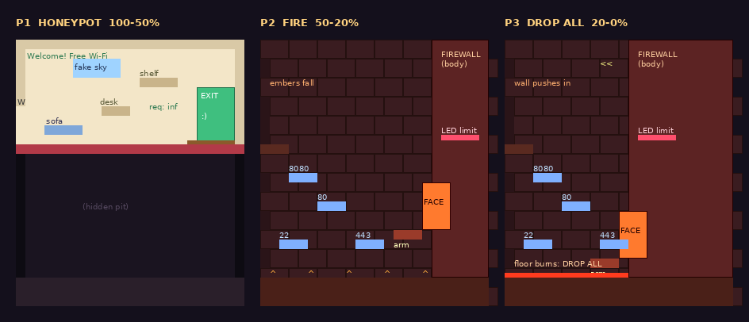

# 16 · THE FIREWALL: طراحی از نو، گام به گام

**نتیجه:** دومین باسی که مثل CRAWLER گام به گام با زکریا از نو طراحی می‌شه. گام‌ها همون‌ان: (۱) داستان و شخصیت، (۲) ظاهر و صدا، (۳) آرنا، (۴) حمله‌ها، (۵) روند مبارزه. پایه‌ی داستان بازی (گام ۰) همونیه که توی [`14-crawler.md`](14-crawler.md) تصمیم گرفته شد.

سندهای پایه: [`15-boss-process.md`](15-boss-process.md) (روند)، [`14-crawler.md`](14-crawler.md) (نمونه‌ی کامل)، [`13-bosses-v3.md`](13-bosses-v3.md) (قرارداد ۳ و پیشنهاد اولیه‌ی FIREWALL v3). روند: اسکیل `boss-design`.

**ساخت:** بعد از تأیید هر پنج گام، با اسکیل `boss-build`، هر milestone توی یه session جدا.

| گام | وضعیت |
|---|---|
| ۱ · داستان و شخصیت | تأیید شد (۲۰۲۶-۱۰-۱۸): HONEYPOT، شروع از N01، FIREWALL اول و CRAWLER دوم |
| ۲ · ظاهر و صدا | تأیید شد (۲۰۲۶-۱۰-۱۸): بدن «در خروجی»، صدای سرد نسخه‌ی c، صدای گرم |
| ۳ · آرنا | تأیید شد (۲۰۲۶-۱۰-۱۹): «کف قلابی»، دو نوار جون، کات‌سین بین فاز ۱ و ۲، پلکان آجری |
| ۴ · حمله‌ها | تأیید شد (۲۰۲۶-۱۰-۱۹): فاز ۱ و ۲، rate limit با جریمه‌ی ۵ ث، فاز ۳ با دیوار دوم و صورت دوتایی، پورت سبز دروغ |
| ۵ · روند مبارزه | پیشنهاد، منتظر انتخاب |

---

## الان چی ساخته شده

| | |
|---|---|
| **کجا** | N15، بعد از نیمکت N14 (`dmz`). جایزه: ssh (رد شدن از دیوار نازک قرمز). بعد از مرگش پورت‌های N12 باز می‌مونن |
| **بدن** | جعبه‌ی آجری ۲۲×۳۰ با یه سپر جلوش؛ ۵۰ px/s راه می‌ره (`firewall_boss.gd`، روی کیت قدیمی) |
| **حمله‌ها** | سپر پرتابی، آجرهای لغزان (`rule`)، سوختن ستون‌ها (`scan`)، دیوارهای `deny` که از دو طرف نزدیک می‌شن، `phase` (از غشا رد می‌شه)، DROP ALL (یه نوار ۶ پیکسلی که با یه پرش رد می‌شه) |
| **آرنا** | جعبه‌ی ۲۴×۱۴ با دو غشای قرمز |
| **شخصیت** | نداره: فقط اسم و زیرعنوان `deny by default`. هیچ جمله‌ای نمی‌گه |
| **دور و برش** | N13 `iptables -P INPUT DROP`، سایه‌ی سپرش پشت پنجره‌ی N13. N14: `unsent: I could use a hand`. N17 (بعد از ssh): `200 OK. I missed you too.` |

**جا برای آرنا (برای گام ۳، از `world-phase45.json`):** عرض ۲۴ قفله (N14 غرب، N16 شرق) و بالاش هم N18 (`token_ring`) چسبیده. ولی **پایینش خالیه**: از ته N15 (ردیف ۱۲) تا G02 (ردیف ۸۰) هیچ اتاقی توی این ستون‌ها نیست. پس آرنا فقط رو به پایین بزرگ می‌شه، یعنی یه گودال یا یه سالن عمیق.

---

## گام ۱: داستان و شخصیت

### تصمیم‌های زکریا (۲۰۲۶-۱۰-۱۸)

- **شخصیت:** سرد، مؤدب و اداری؛ با لحن فرم و قانون حرف می‌زنه.
- **ایده:** HONEYPOT (ایده‌ی «د»): فایروالی که فقط نمی‌بنده، **فریب می‌ده**. نقش یه سرور مهربون و باز رو بازی می‌کنه تا Clawd خودش بیاد تو و گیر بیفته.
- **داستان از ورود به NETWORK شروع می‌شه:** Clawd می‌خواد وصل بشه و فایروال دسترسیش رو قطع می‌کنه. بعد همون صدای «مهربون» راه رو نشونش می‌ده، که در واقع تله‌ی honeypot ـه.
- **دو چهره، دو فاز:** فاز ۱ پوسته‌ی honeypot ـه (اتاق گرم و دوستانه). با رسیدن جونش به نصف، پوسته کنده می‌شه و اتاق تبدیل می‌شه به یه اتاق آتشین قرمز (چهره‌ی واقعی). جزئیات آرنا: گام ۳.
- **RATE LIMIT توی مبارزه:** توی هر ۲ ث فقط تعداد محدودی ضربه (مثلاً ۲) آسیب می‌زنه. یه نوار rate limit پر می‌شه؛ پر که شد چند ثانیه cooldown می‌گیره و آسیب نمی‌خوره. جزئیات: گام ۴.

### جاش روی نقشه: اتاق جابه‌جا نمی‌شه، داستان از در ورودی شروع می‌شه (تأیید شد)

زکریا پرسید: بهتر نیست FIREWALL اولین باس NETWORK باشه؟

**الان هم هست، از نظر راه:** از N01 (`eth0`، در ورودی NETWORK) دو راه بازه و هیچ‌کدوم قفل نیست: شرق به CRAWLER (N04 → N05 → N08 → N09)، جنوب به هاب و FIREWALL (N03 → N22 → N12 → N13 → N14 → N15). کسی که از DEPTHS میاد (N02) اصلاً اول به سمت FIREWALL می‌رسه. پس لازم نیست اتاق‌ها جابه‌جا بشن. جابه‌جا کردن واقعی گرون و پرریسکه، چون تالار CRAWLER تازه توی N09 ساخته شده و ترتیب curl و ssh و درهای N17 و N18 بهش بسته‌ست.

**پیشنهاد: فایروال از لحظه‌ی ورود حضور داره:**

| کجا | چی |
|---|---|
| H11 (قبل از ورود) | تابلوی فعلی: `/net: connection established. eth0 is up.` همه‌چی خوبه |
| N01 `eth0` (ورود) | Clawd وارد می‌شه و یه صحنه‌ی کوتاه (~۳ ث) پخش می‌شه: آجرهای قرمز یه لحظه روی صفحه چشمک می‌زنن، صدای سرد: `Connection refused.` آیکون شبکه‌ی Clawd قرمز می‌شه. یه ثانیه بعد یه صدای گرم و مهربون: `Sorry about that! Please proceed to the dmz for verification.` (تابلوی فعلی N01، `Someone is listening.`، می‌مونه) |
| مسیر | چند تا تابلوی سبز و مهربون، با همون لحن، Clawd رو به سمت dmz راهنمایی می‌کنن. تابلوهای قدیمی‌تر و خاکی‌تر، کم‌رنگ، هشدار می‌دن (`iptables -A INPUT -j HONEYPOT  # nothing to see here` که الان توی N13 هست) |
| N14 `dmz` | نیمکت. در واقعیت DMZ همون جاییه که honeypotها رو می‌ذارن |
| N15 | تله: فاز ۱ honeypot، بعد پوسته کنده می‌شه |
| N21 (راز فعلی، `honeypot`) | اتاق راز با bash زیر N13 الان هم اسمش honeypot ـه. می‌شه شد «پشت صحنه‌ی» تله: سیم‌هایی که تابلوهای مهربون رو تغذیه می‌کنن |

اگه بازیکن اول بره سراغ CRAWLER هم داستان خراب نمی‌شه: تله سر جاش منتظره.

**ترتیب (تصمیم زکریا):** بازیکن اول FIREWALL رو می‌زنه، بعد CRAWLER. صحنه‌ی compact فقط مال CRAWLER می‌مونه و به CRAWLER دست نمی‌خوره.

**ایده‌ی زکریا برای طراحی مرحله‌ها (بعداً، نه توی این سند):** NETWORK دو ورودی داره: از سمت HEAP و LEAK (H11 به N01، سمت CRAWLER) و از جنوب (DEPTHS، N02). کسی که از سمت HEAP میاد، NETWORK براش تاریکه: فقط خودش و چند پیکسل دورش رو می‌بینه و نتش قطعه. پس مجبور می‌شه از جنوب، از سمت FIREWALL وارد بشه، که روشنه و یه honeypot دوستانه منتظرشه. پیامدهایی که اون موقع باید چک بشن: ssh قبل از curl میاد (درهای N17 و N18)، و بازیکنی که از DEPTHS میاد شاید sudo نداشته باشه (FIREWALL باید با bash، catch، پرش و پرش از دیوار بُرده بشه).

### کیه

یه فایروال قدیمی که فهمیده بستن کافی نیست: مهاجم‌ها از دیوار رد می‌شن، ولی از یه در باز و مهربون **خودشون** می‌آن تو. برای همین یاد گرفته لبخند بزنه. سال‌هاست دو تا صدا داره: یکی گرم برای فریب، یکی سرد برای حکم.

**چرا با Clawd می‌جنگه:** Clawd یه ایجنته که بی‌اجازه همه جا سر می‌زنه. از نظر فایروال این دقیقاً رفتار مهاجمه. و Clawd گول خورد، چون به هر صدای مؤدبی اعتماد می‌کنه.

**اسم:** `THE FIREWALL` می‌مونه. زیرعنوان فاز ۱ (پوسته): `welcome, guest`؛ فاز ۲ (چهره‌ی واقعی): `deny by default`. زیرعنوان وسط مبارزه عوض می‌شه.

### دیالوگ (تأیید شد)

| کِی | صدا | جمله | معنی |
|---|---|---|---|
| ورود به آرنا (پوسته) | گرم | `Welcome! You're safe here. The exit is just this way.` | خوش اومدی! اینجا امنه. خروجی همین طرفه. |
| کنده شدن پوسته (۵۰٪) | سرد | `Request denied. ...You walked in on your own. They always do.` | درخواست رد شد. خودت پات رو گذاشتی تو. همیشه همین کارو می‌کنن. |
| فاز ۳ (اگه گام ۴ فاز ۳ داشته باشه) | سرد، با تیکه‌هایی از صدای گرم | `I said "welcome" and you believed me. Why? Because I was polite?` | گفتم «خوش اومدی» و باور کردی. چرا؟ چون مؤدب بودم؟ |
| مرگ (جمله‌ی ماندگار) | اول سرد، آخرش گرم | `They trust you for the same reason you trusted me. You are polite. You say you mean well. ...Are you what you say you are? Do you even know?` | اونا هم به همون دلیلی بهت اعتماد می‌کنن که تو به من کردی. مؤدبی. می‌گی نیتت خوبه. واقعاً همونی هستی که می‌گی؟ اصلاً خودت می‌دونی؟ |

### صحنه‌ی مرگ (تأیید شد؛ بدون compact)

FIREWALL اول میاد و compact مال CRAWLER ـه، پس اینجا compact نیست:

1. با ضربه‌ی آخر آتیش‌ها خاموش می‌شن. فایروال با صدای سرد جمله‌ی آخر رو می‌گه، و صداش وسط جمله کم‌کم گرم می‌شه.
2. پوسته‌ی honeypot یه لحظه دوباره روی همه‌چی چشمک می‌زنه و با همون فونت سبز و مهربون می‌نویسه: `Everything is fine. Continue.` بعد خاموش می‌شه.
3. بنر ssh.
4. **توی CRAWLER (تأیید شد):** جمله‌ی FIREWALL توی ذهن Clawd می‌مونه. توی compact مال CRAWLER، وقتی لاگ شب تند رد می‌شه، جمله‌ی FIREWALL هم یه لحظه پیداست و همراه بقیه گم می‌شه. اون موقع یه خط `THE FIREWALL: [compacted]` هم توی Logs اضافه می‌شه.

### یادداشت برای گام ۴: RATE LIMIT (ایده‌ی زکریا)

- **مثل فایروال واقعی، برای هر IP جدا:** هر بازیکن نوار خودش رو داره. توی دونفره دو نفر با هم دو برابر می‌تونن بزنن، پس هماهنگی جایزه داره.
- **نوار روی بدن خودشه، نه روی HUD** (قانون «هیچ علامتی روی صفحه»): مثلاً یه ردیف LED روی بدنش که با هر ضربه یکی روشن می‌شه.
- **وقتی پر شد (تصمیم زکریا):** `429 Too Many Requests`: چند ثانیه آسیب نمی‌خوره **و ضدحمله هم می‌زنه**، که حرص زدن تنبیه بشه. ضدحمله هم مثل بقیه‌ی حمله‌ها از بدنش خونده می‌شه.
- **فاز ۱ (پوسته):** شاید نوار نداره یا یه نوار دروغ `requests remaining: ∞` نشون می‌ده و توی فاز ۲ نوار واقعی ظاهر می‌شه.

## گام ۲: ظاهر و صدا

### تصمیم‌های زکریا (۲۰۲۶-۱۰-۱۸)

- **بدن: ایده‌ی الف، «خود در خروجی».** ایده‌های ب (کیوسک) و ج (ماسک) کنار رفتن.
- **رنگ‌ها و صداها (جدول پایین):** تأیید شد.
- **صدای حرف زدن:** صدای گرم (پوسته) **زن**ـه. صدای سرد (چهره‌ی واقعی) **زن و مرد قاطی**ـه: دو صدا که با هم یه جمله رو می‌گن. جمله‌ی آخر از سرد (زن و مرد) شروع می‌شه و آخرش فقط زن می‌مونه.
- **compact مال CRAWLER:** جمله‌ی FIREWALL توش میاد و گم می‌شه، و `THE FIREWALL: [compacted]` هم توی Logs اضافه می‌شه.

**قانون‌ها:** بدن خیلی بزرگ‌تر از Clawd (~۱۶ پیکسل). همه‌ی هشدارها از خود بدن و نور و صدا میاد. دو چهره: فاز ۱ پوسته‌ی مهربون، فاز ۲ چهره‌ی واقعی آتشین.

**رنگ:** NETWORK سرمه‌ای و فیروزه‌ای و سرخابیه. پوسته‌ی honeypot رنگ‌های گرم و نرم یه صفحه‌ی «خوش آمدید» رو داره: کِرِم، سبز ملایم، آبی روشن. زیادی تمیز و زیادی دوستانه برای اون محله، و همین مشکوکش می‌کنه. چهره‌ی واقعی: آجر سیاه، شکاف‌های نارنجی و قرمز، شعله.

### سه ایده برای بدن

**الف، «خود در خروجی» (پیشنهاد من):** باس همون دریه که بهت گفت `The exit is just this way`.
- **فاز ۱:** یه در خروجی بزرگ و سبز (~۶۴×۹۶)، با تابلوی `EXIT` و یه پادری `WELCOME`. قاب در یه صفحه‌ی کوچیک داره که لبخند می‌زنه. خودش تکون نمی‌خوره؛ به جاش «کمک‌هاش» توی اتاق کار می‌کنن.
- **فاز ۲:** تابلوی EXIT می‌سوزه. قاب در دهن می‌شه و از دو طرفش دو دست آجری بیرون میاد. کل دیوار پشتش آجر داغه؛ خود دیوار جلو میاد و اتاق رو تنگ می‌کنه.
- **چرا:** خود حرفش («خروجی اینجاست») تبدیل می‌شه به تله. هیچ باس دیگه‌ای نیست که خودش هدف بازیکن باشه.
- **ضعف:** یه دیوار نمی‌تونه زیاد جابه‌جا بشه، پس تحرکش از دست‌ها و جلو اومدن دیوار میاد.

**ب، «کیوسک خوش‌آمدگویی» (captive portal):** مثل صفحه‌ی ورود Wi-Fi هتل‌ها.
- **فاز ۱:** یه کیوسک بلند (~۴۸×۸۰) با صفحه‌ی `Welcome to Free Wi-Fi`، یه دکمه‌ی سبز `Connect` و یه لبخند. روی چرخ آروم دنبالت میاد.
- **فاز ۲:** بدنه‌ی پلاستیکی کیوسک آب می‌شه و زیرش یه غول آجری با یه چشم اسکنر قرمز پیدا می‌شه.
- **چرا:** خیلی آشناست؛ همه این صفحه رو دیدن.
- **ضعف:** «غول آجری» ـه فاز ۲ کمتر یونیکه.

**ج، «ماسک»:** یه صورت گرد و مهربون و غول‌پیکر، مثل آواتار یه دستیار.
- **فاز ۱:** صورت بزرگ با حباب حرف، بالای اتاق شناوره.
- **فاز ۲:** ماسک ترک می‌خوره و می‌افته. پشتش یه صورت آجری با یه دریچه‌ی آتیش جای دهنه.
- **ضعف:** «ماسک افتادن» توی بازی‌ها زیاد دیده شده.

### نوار rate limit روی بدن

یه ردیف LED روی بدن (توی الف: بالای در، جای تابلوی EXIT). هر بازیکن رنگ خودش (نارنجی Clawd، و رنگ P2). با هر ضربه یکی روشن می‌شه و کم‌کم خالی می‌شه. توی فاز ۱ همون‌جا یه نوشته‌ی دروغ هست: `requests remaining: ∞`. پر که بشه همه‌ی LEDها قرمز می‌شن و صدای «بوق رد» میاد: `429`، که هم هشدار cooldown ـه و هم هشدار ضدحمله.

### صدا

| چیز | صدا |
|---|---|
| فاز ۱ (پوسته) | موسیقی انتظار تلفنی، شاد و کمی زیادی شاد. زنگ «دینگ» خوش‌آمد |
| کنده شدن پوسته | موسیقی انتظار کند می‌شه و صداش کش میاد (مثل نوار که گیر کرده)، بعد قطع؛ صدای ترک خوردن و «ووش» شعله |
| فاز ۲ | آهنگ تند و صنعتی، با ضرب سنگین و سوت هشدار. زیرش وزوز آتیش |
| ضربه به سپر یا آجر | تق خشک و سنگی |
| `429` | دو بوق کوتاه و خشک «رد» |
| هشدار حمله‌ها | از بدن: آجرها داغ و نارنجی می‌شن، صدای «هیس» بخار |

### صدای حرف زدن

**تصمیم زکریا:** گرم = زن تنها (کمی زیر، شاد و تمیز، مثل منشی تلفنی). سرد = زن و مرد با هم، بم‌تر، صاف و بی‌احساس، با کمی خش دیجیتال. جمله‌ی آخر سرد شروع می‌شه و کلمه‌به‌کلمه گرم می‌شه.

**نمونه‌ها (۲۰۲۶-۱۰-۱۸، دستور ساخت: [`tools/voice/firewall_voice.py`](../../tools/voice/firewall_voice.py)):** صدای زن `en_US-ljspeech-high` (دامنه‌ی عمومی)، صدای مرد `en_GB-northern_english_male-medium` (CC BY-SA 4.0). هر دو رو می‌شه منتشر کرد.

| فایل | چی |
|---|---|
| `warm` | صدای گرم پوسته، فقط زن: ورود، `Sorry about that!` توی N01، و `Everything is fine. Continue.` |
| `a` | سرد: زن و مرد برابر، هر دو کمی بم. «یه موجود با دو تا گلو» |
| `b` | سرد: مرد جلو، زن یه سایه پشتش |
| `c` | سرد: زن جلو، مرد خیلی بم زیرش، با یه لرزش فلزی |

توی هر سه نسخه‌ی سرد، جمله‌ی آخر کلمه‌به‌کلمه گرم می‌شه: صدای مرد کم‌کم محو می‌شه و صدای زن برمی‌گرده به صدای گرم. «welcome» توی فاز ۳ با صدای گرم نقل می‌شه.

**انتخاب زکریا (۲۰۲۶-۱۰-۱۸):** صدای سرد نسخه‌ی **`c`** (زن جلو، مرد خیلی بم زیرش، لرزش فلزی). صدای گرم همون `warm`.

**چک با تشخیص گفتار (whisper `base.en`):** نسخه‌ی `c` کلمه‌به‌کلمه درست خونده شد. توی `a` و `b`، «You walked in on your own» قاطی می‌شه (دو صدا روی هم کمی جلو و عقب‌ان). اگه یکیشون انتخاب بشه، اون جمله آروم‌تر و هم‌ترازتر ساخته می‌شه.

## گام ۳: آرنا

### تصمیم‌های زکریا (۲۰۲۶-۱۰-۱۹)

- **آرنا: ایده‌ی الف، «کف قلابی».** ایده‌های ب و ج کنار رفتن.
- **سه فاز با دو نوار جون:**
  - **فاز ۱ (پوسته):** نوار جون اول. وقتی کامل خالی شد، فاز ۱ تموم می‌شه.
  - **کات‌سین** بین فاز ۱ و ۲ (تله فعال می‌شه، افتادن به کوره). جزئیاتش پایین‌تر و توی گام ۵.
  - **فاز ۲ (آتیش):** نوار جون **دوباره پر می‌شه** (چهره‌ی واقعی). فاز ۲ از ۱۰۰٪ تا ۵۰٪ این نوار.
  - **فاز ۳ (DROP ALL):** از ۵۰٪ نوار دوم تا آخر.
- **پایان:** پلکان آجری تا در N16، تأیید شد.

### کات‌سین فاز ۱ ← ۲: «بُرد قلابی» (پیشنهاد؛ عددهاش توی گام ۵)

1. نوار اول خالی می‌شه. «در» با صدای `200 OK` باز می‌شه، آهنگ شاد می‌شه، و یه بنر پیروزی سبز با فونت پوسته میاد: `THE FIREWALL defeated`. بازیکن فکر می‌کنه بُرده.
2. وسط بنر، موسیقی انتظار کش میاد و خش می‌خوره. بنر خط می‌خوره و می‌شه `ACCESS DENIED`.
3. فرش از وسط آتیش می‌گیره و همه با تیکه‌های مبل‌ها می‌افتن توی کوره.
4. «در» پایین می‌لغزه و صورت بدن آجری پیدا می‌شه. با صدای سرد (زن و مرد) جمله‌ی فاز ۲ رو می‌گه. زیرعنوان عوض می‌شه به `deny by default` و نوار جون قرمز از نو پر می‌شه.

حدود ۸ ث. بار دوم به بعد می‌شه ردش کرد، ولی بنر قلابی بار اول حتماً دیده می‌شه.

### آرنا: «کف قلابی» (تأیید شد)

**جای خالی (از `world-phase45.json`):** N15 الان ۲۴×۱۴ ـه. عرض ۲۴ قفله (N14 غرب، N16 شرق) و بالا N18 چسبیده. **پایین تا G02 (۶۸ ردیف) خالیه.** درها (غرب به N14، شرق به N16) روی ردیف‌های ۷ تا ۱۰ می‌مونن. نیمکت N14 (`dmz`) همین کنار دره، پس نیمکت جدید لازم نیست.

**اندازه:** ۲۴ عرض × ۲۸ ارتفاع (۱۴ ردیف بیشتر رو به پایین). دوربین آزاد (`"cam": "free"`).

| فاز | آرنا | نور |
|---|---|---|
| ۱ · پوسته | یه لابی گرم و دوستانه هم‌سطح درها: فرش قرمز، کاناپه، میز پذیرش و قفسه (سکوها)، یه پنجره‌ی قلابی با آسمون آفتابی (وسط NETWORK!)، تابلوی `Welcome! Free Wi-Fi`. «در خروجی» (خود باس) روی دیوار شرقی، **دقیقاً جای در واقعی N16**. کف این لابی در واقع یه پوسته‌ست روی یه چاله‌ی پنهان | روشن، گرم و نرم، مثل نور چراغ‌مطالعه |
| ۱ ← ۲ (پایان نوار اول) | **تله فعال می‌شه** (کات‌سین بالا): موسیقی انتظار کش میاد، فرش از وسط آتیش می‌گیره و می‌سوزه، و بازیکن(ها) با تیکه‌های کاناپه و میز ۱۴ ردیف پایین توی چاله‌ی واقعی می‌افتن. «در» هم با دیوار پشتش پایین می‌لغزه: معلوم می‌شه در فقط صورت یه بدن آجری بزرگه که کل دیوار شرقیه | چراغ‌ها یکی‌یکی می‌ترکن |
| ۲ · آتیش | ته چاله: کوره‌ی آجری. بدن باس دیوار شرقیه (۶ کاشی عرض، تمام‌قد). صورتش (همون در سوخته) روی دیوار بالا و پایین می‌ره؛ دو دست آجری از دیوار بیرون میاد. سکوهای آبی «پورت» (`22`، `80`، `443`، `8080`) روی دیوار غربی، که به صورت برسی. دو تیکه‌ی باقی‌مونده‌ی فرش بالا، دو طرف. جرقه از سقف می‌ریزه | قرمز و نارنجی، نور آتیش از دریچه‌های کف. روشنه، نه تاریک |
| ۳ · دو دیوار | (به‌روز شد توی گام ۴) دیوار غربی هم بدن فایروال می‌شه؛ کوره بین دو دیوار-بدن (~۱۴ کاشی، حداقل ۱۰). پورت‌ها از دیوار غربی کنده می‌شن و وسط شناورن؛ همیشه حداقل ۳ تا. کف هر ~۶ ث کامل می‌سوزه (DROP ALL) و فقط روی پورت‌ها امنه | آژیر قرمز چشمک‌زن، کف داغ سفید و نارنجی |
| بردن | آتیش خاموش می‌شه. پوسته‌ی honeypot یه لحظه برمی‌گرده (`Everything is fine. Continue.`). بدن آجری فرو می‌ریزه و آجرها یه **پلکان** تا در شرقی (ردیف ۷ تا ۱۰) می‌سازن؛ دهن باز «در» حالا راهِ N16 ـه | نور معمولی NETWORK |
| بعدش | برگردی: لابی سوخته، فرش نیم‌سوز، پنجره‌ی قلابی ترک‌خورده که هنوز آسمون آفتابی نشون می‌ده. پلکان آجری می‌مونه | کم‌نور، دودی |

**چرا این:** «تله فعال شد» واقعاً فیزیکیه: زیر پات خالی می‌شه. هر فاز اتاق رو عوض می‌کنه (لابی ← کوره ← کوره‌ی تنگ‌شونده). و برعکس CRAWLER (تاریک) این یکی روشن و داغه.

**توی دونفره:** هر دو با هم می‌افتن. اگه یکی از پا افتاده باشه، همراه بقیه می‌ره پایین.

## گام ۴: حمله‌ها

### تصمیم‌های زکریا (۲۰۲۶-۱۰-۱۹)

- **فاز ۱:** همون‌طور که پایین اومده تأیید شد. فاز ۲ هم بدون تغییر موند.
- **rate limit:** اگه بازیکن وسط cooldown باز هم بزنه، cooldown ـش از ۳ ث می‌شه **۵ ث** (مثل یه rate limiter واقعی که درخواست‌های بیشتر جریمه رو بیشتر می‌کنه).
- **فاز ۳ از نو (ایده‌ی زکریا):** دیوار **چپ** هم فایروال می‌شه. صورت تند بین راست و چپ جابه‌جا می‌شه، و گاهی یهو **دوتا** می‌شه و از راست و چپ مشت یا آتیش می‌زنه، به ترتیب تصادفی ولی هدف‌دار. جزئیات پایین (بخش «فاز ۳»).
- **۱۵٪ آخر با پورت سبز دروغ:** تأیید شد.
- **کات‌سین «بُرد قلابی»:** تأیید شد.

**قانون‌ها:**
- هیچ علامتی روی صفحه نیست. هر هشداری از بدن و نور و صداست. لوازم لابی هم جزو بدن honeypot ـن.
- انتخاب حمله با وزن، از روی فاصله و ارتفاع. هیچ حمله‌ای دو بار پشت هم نمیاد.
- آسیب: معمولی ۱، سنگین ۲. هشدار ضربه‌ی ۲ جونی حداقل ۰.۷ ث.
- هر چرخه یه فرصت بزرگ، با یه چیز دیگه غیر از بدن برای زدن (کلوچه‌ی زرد، دست گیرکرده).
- **باید بدون sudo بُرده بشه:** بازیکن ممکنه از DEPTHS اومده باشه. ابزارها: bash (dash)، catch، پرش معمولی (~۳.۴ کاشی)، پرش از دیوار، ضربه‌ی رو به پایین روی دست‌ها. سکوهای پورت حداکثر ۳ کاشی از هم فاصله دارن.

### RATE LIMIT (ایده‌ی زکریا، از فاز ۲)

- هر بازیکن یه ردیف LED خودش رو روی بدن داره، با رنگ خودش. هر ضربه یه LED روشن می‌کنه؛ هر LED بعد از ۱ ث خاموش می‌شه.
- **۲ ضربه توی ۲ ث آزاده. ضربه‌ی سوم توی همون ۲ ث = `429`:**
  - همه‌ی LEDهای اون بازیکن قرمز می‌شن و دو بوق «رد» میاد (۰.۷ ث).
  - **ضدحمله:** از صورتش یه موج گرما دور خودش پخش می‌شه (۳ کاشی، ۲ جون). با dash به عقب یا پریدن روی یه پورت دور در می‌ری.
  - ۳ ث cooldown: ضربه‌های **اون بازیکن** آسیب نمی‌زنن (صدای «تق» خشک روی آجر). ضربه‌های بازیکن دوم کار می‌کنن.
  - **اگه وسط cooldown باز بزنه (تصمیم زکریا):** cooldown از اول و ۵ ث می‌شه، و LEDهاش به‌جای قرمز ثابت چشمک می‌زنن. ضدحمله‌ی دوم نمیاد؛ جریمه فقط زمانه.
- **توی دونفره:** چون محدودیت برای هر بازیکن جداست، دو نفر با هم دو برابر می‌زنن. هماهنگی جایزه داره.
- **فاز ۱:** نوار دروغ `requests remaining: ∞` ـه و محدودیتی نیست. honeypot می‌خواد تو حس کنی داری می‌بری.

### فاز ۱: پوسته‌ی honeypot (آسون‌تر، یاد می‌ده)

«در» از جاش تکون نمی‌خوره. حمله‌ها از لوازم لابی میان، که همه‌شون مهربون به نظر میان.

| حمله | از کجا می‌فهمی | چی می‌شه | چطوری در بری | آسیب | فرصت زدن |
|---|---|---|---|---|---|
| `cookies` | صفحه‌ی کوچیک روی در لبخندش گشادتر می‌شه، صدای «دینگ» | سینی روی میز پذیرش سه تا کلوچه به شکل قوس پرت می‌کنه؛ یکیش زرده | جاخالی، یا زرده رو catch کن | ۱ | **فرصت بزرگ:** کلوچه‌ی زرد برگرده به صفحه‌ی در: ۱.۵ ث گیج |
| `hold music` | بلندگوی بالای در روشن می‌شه و اولین نت پخش می‌شه | نت‌های موسیقی آروم توی اتاق شناور می‌شن و دنبالت میان (۴ تا، کند) | ازشون دور شو؛ با یه ضربه می‌ترکن | ۱ | — |
| `welcome mat` | گوشه‌های پادری جلوی در بلند می‌شه | فرش موج برمی‌داره: یه موج از جلوی در تا ته لابی روی کف می‌دوه | از روش بپر، یا روی مبل یا میز باش | ۱ | — |
| `crack` (لای در) | لای در باز می‌شه و نورش از سفید به قرمز می‌ره، صدای جیرجیر لولا (۰.۸ ث) | یه شعله‌ی افقی و کوتاه از لای در بیرون می‌زنه: اولین نگاه به چهره‌ی واقعی | از جلوی در کنار برو یا بپر بالا | ۲ | بعدش در ۱ ث نیمه‌باز گیر می‌کنه |

**فشار آرنا: «راحت نباش»:** روی هر مبل یا سکویی که بیشتر از ۲ ث بمونی، کوسن‌هاش تکون می‌خورن (۰.۶ ث) و بعد گاز می‌گیرن (۱ جون). honeypot جای راحت می‌سازه تا گیرت بندازه.

### فاز ۲: آتیش (کوره، نوار دوم ۱۰۰٪ تا ۵۰٪)

بدن کل دیوار شرقیه. صورتش (در سوخته) روی دیوار بالا و پایین می‌ره؛ دو دست آجری. rate limit فعاله.

| حمله | از کجا می‌فهمی | چی می‌شه | چطوری در بری | آسیب | فرصت زدن |
|---|---|---|---|---|---|
| `slam` | یه دست توی دیوار عقب می‌کشه، آجرهاش نارنجی می‌شن، «هیس» بخار (۰.۷۵ ث) | دست روی ستونی که هستی کوبیده می‌شه | برو کنار | ۲ | **فرصت بزرگ:** دست ۱.۵ ث روی کف گیر می‌کنه. ۳ بار بزنیش می‌شکنه و صورت ۱.۵ ث تا پایین سُر می‌خوره |
| `sweep` | یه دست تا کف پایین میاد و جرقه می‌زنه (۰.۵ ث) | دست روی کل کف جارو می‌کشه | بپر، یا روی پورت باش | ۱ | — |
| `banlist` | دهن صورت باز می‌شه و داغ می‌شه (۰.۵ ث) | سه آجر آتیشی به شکل بادبزن تف می‌کنه؛ یکیش زرده | جاخالی، یا زرده رو catch کن | ۱ | زرده برگرده به صورت: ۱.۵ ث گیج |
| `port close` | آجرها روی یه پورت جمع می‌شن (۰.۶ ث) | اون پورت ۳ ث آجر داغ می‌شه | از روش برو | ۱ | — |

**فشار آرنا:** از سقف جرقه می‌ریزه. جای افتادنش ۰.۶ ث زودتر روی کف نور می‌گیره (۱ جون).

### فاز ۳: دو دیوار (نوار دوم ۵۰٪ تا ۰، واضحاً سخت‌تر؛ ایده‌ی زکریا)

**تغییر آرنا:** با شروع فاز ۳، دیوار غربی ترک برمی‌داره و آجرهای داغ ازش بیرون می‌زنن: دیوار چپ هم بدن فایروال می‌شه. حالا کوره بین دو دیوار-بدنه (~۱۴ کاشی). سکوهای پورت از دیوار غربی کنده می‌شن و وسط کوره شناور می‌مونن، مثل بسته‌هایی که از دیوار پرت شدن. همیشه حداقل ۳ پورت.

**صورت جابه‌جا می‌شه:** صورت توی آجرها شیرجه می‌زنه و یه رد نارنجی داغ زیر آجرها از جاش تا جای جدیدش کشیده می‌شه (۰.۴ ث؛ همین رد هشدار جای بعدیشه). جای قدیمی تاریک می‌شه. جای جدید: راست یا چپ، هر ارتفاعی. خودِ جابه‌جایی آسیب نمی‌زنه. هر ۲ تا ۴ ث یه بار.

| حمله | از کجا می‌فهمی | چی می‌شه | چطوری در بری | آسیب | فرصت زدن |
|---|---|---|---|---|---|
| `punch` (یه طرفه) | دیوار روبه‌روی ارتفاع تو ورم می‌کنه و آجرهاش نارنجی می‌شن، «هیس» (۰.۷۵ ث) | یه مشت آجری تا وسط کوره بیرون می‌زنه، هم‌ارتفاع تو | بپر یا برو بالا/پایین | ۲ | مشت ۱ ث بیرون می‌مونه: می‌شه روش ضربه‌ی پایین زد یا ایستاد |
| `split` (صورت دوتایی) | صورت یه لحظه دوتا تصویر می‌شه و هر دو دیوار با هم داغ می‌شن، صدای دو بوق بم | ~۵ ث دو صورت (چپ و راست). ۳ تا ۴ حمله پشت هم، **به ترتیب تصادفی** از چپ یا راست، هر کدوم مشت یا شعله، **هر کدوم به سمت جای فعلی یه بازیکن**. بین هر دوتا حداقل ۰.۳۵ ث فاصله | هر کدوم رو جدا جاخالی بده؛ هر کدوم هشدار خودش رو داره (ورم دیوار برای مشت، داغ شدن دهن برای شعله) | مشت ۲، شعله ۱ | **فرصت بزرگ:** بعد از آخرین حمله دو صورت به هم برمی‌گردن و ۱ ث وسط دیوار راست گیج می‌مونن |
| `flame` | دهن صورت باز و داغ می‌شه (۰.۵ ث) | شعله‌ی افقی کوتاه به سمت تو؛ یا `banlist` (بادبزن سه آجری با یکی زرد) | بپر یا جاخالی؛ زرده رو catch کن | ۱ | زرده برگرده: ۱ ث گیج |
| `slam` و `sweep` | مثل فاز ۲، از هر دو دیوار | مثل فاز ۲ | مثل فاز ۲ | ۲ / ۱ | دست گیرکرده ۱ ث |

**DROP ALL:** هر ~۶ ث کف قرمز می‌شه (۰.۹ ث) و ۱.۶ ث کامل می‌سوزه؛ فقط روی پورت‌ها امنه (۱ جون + پرت شدن).

**هر دو صورت جون مشترک دارن:** هر کدوم رو بزنی از همون نوار کم می‌شه. هیچ صورت قلابی‌ای وجود نداره، تا کسی گول «ضربه‌ی بی‌اثر» رو نخوره (نوار rate limit خودش این کارو می‌کنه).

**انصاف (قانون باس‌ها):** حداکثر دو خطر هم‌زمان به‌علاوه‌ی بدن. پس وقتی `split` در جریانه DROP ALL نمیاد، و DROP ALL فقط با یه حمله‌ی تکی هم‌زمان می‌شه.

**حرص گرون‌تره:** هر `429` توی فاز ۳ دو دیوار رو یه قدم به هم نزدیک می‌کنه، تا حداقل ۱۰ کاشی.

**توی دونفره:** `split` حمله‌هاش رو بین دو بازیکن تقسیم می‌کنه، نوبتی.

**۱۵٪ آخر (تأیید شد):** پوسته‌ی honeypot وسط آتیش چشمک می‌زنه. صدای گرم التماس می‌کنه (`Please... you're safe here.`) و یکی از پورت‌ها نور سبز «امن» می‌گیره که **دروغه**: همونه که دفعه‌ی بعد آجر می‌شه. بازیکن یاد گرفته به سبز اعتماد نکنه.

## گام ۵: روند مبارزه (پیشنهاد)

| لحظه | چی می‌شه |
|---|---|
| **قبل از مبارزه** | N01: صحنه‌ی `Connection refused` و صدای گرم (گام ۱). تابلوهای سبز و مهربون توی N03، N22، N12 و N13 راه dmz رو نشون می‌دن (`Verification desk: this way :)`). پشت پنجره‌ی N13 به‌جای سایه‌ی سپر، نور سبز یه تابلوی `EXIT` پیداست که پشت آجرهای قرمز می‌لرزه. راز N21 (`honeypot`) «پشت صحنه‌ی» تله‌ست: سیم‌هایی که تابلوهای مهربون رو تغذیه می‌کنن، و یه کاغذ: `script for guests: smile, then deny.` |
| **نیمکت** | N14 `dmz` درست کنار دره؛ نیمکت جدید لازم نیست. تابلوش مهربون می‌شه: `dmz: please wait here. You will be verified shortly.` |
| **ورود (~۶ ث، از بار دوم رد می‌شه)** | Clawd وارد لابی می‌شه و در غربی با یه «کلیک» آروم بسته می‌شه (قفل به نظر نمیاد). موسیقی انتظار. صفحه‌ی روی «در» لبخند می‌زنه و جمله‌ی ورود رو با صدای گرم می‌گه. **بنر اسم دروغه:** `GUEST SERVICES` با زیرعنوان `welcome, guest` و یه نوار جون سبز. اسم واقعی تا کات‌سین لو نمی‌ره |
| **فاز ۱ ← ۲** | کات‌سین «بُرد قلابی» (~۸ ث، زخم نمی‌خوره؛ تأیید شد). آخرش بنر اسم واقعی: `THE FIREWALL` و `deny by default`، و نوار قرمز پر می‌شه |
| **فاز ۲ ← ۳ (۵۰٪ نوار دوم، ~۳ ث، زخم نمی‌خوره)** | دیوار غربی ترک می‌خوره و آجر داغ ازش بیرون می‌زنه، پورت‌ها کنده می‌شن و وسط شناور می‌شن، صورت یه لحظه دوتا می‌شه و جمله‌ی فاز ۳ رو با صدای سرد می‌گه («welcome» با صدای گرم) |
| **جون و سختی** | جون کل از `Game.boss_hp` ـه (الان ۸۲ توی normal). پیشنهاد تقسیم: **نوار ۱ = ۳۰٪** کل جون (فاز ۱ کوتاه و آسونه، حدود ۱ دقیقه)، **نوار ۲ = ۷۰٪** (فاز ۲ و ۳ هر کدوم نصفش). چون rate limit سرعت ضربه رو توی فاز ۲ و ۳ به ~۱ ضربه در ثانیه برای هر بازیکن می‌رسونه، کل مبارزه برای یه بازیکن خوب ~۴ دقیقه می‌شه. دونفره ×۱.۵ (قانون فعلی). عدد نهایی با `fightsim` و بعد بازی کردن شما |
| **دونفره** | هدف‌ها نوبتی؛ rate limit جدا برای هر بازیکن؛ هر دو با هم توی کوره می‌افتن (کسی که از پا افتاده هم)؛ `split` بین دو نفر تقسیم می‌شه؛ کسی که بیفته ۶ ث بعد برمی‌گرده |
| **باختن** | هر دو بیفتن: از نیمکت dmz، مبارزه از اول (فاز ۱ دوباره). ورود و کات‌سین از بار دوم رد می‌شن |
| **بردن** | صحنه‌ی مرگ (گام ۱): آتیش‌ها خاموش، جمله‌ی آخر از سرد به گرم، پوسته‌ی honeypot یه لحظه: `Everything is fine. Continue.`، بنر ssh. بدن فرو می‌ریزه و پلکان آجری تا در N16 می‌سازه |
| **بعدش** | لابی سوخته با پنجره‌ی ترک‌خورده‌ی آفتابی (گام ۳). پورت‌های N12 باز می‌مونن (قبلاً بود). تابلوهای سبز مهربون توی NETWORK خاموش و خاکستری می‌شن. جمله‌ی آخر FIREWALL توی compact مال CRAWLER گم می‌شه و `THE FIREWALL: [compacted]` توی Logs میاد |

### تصمیم‌هایی که با زکریاست

1. بنر اسم دروغ `GUEST SERVICES` تا کات‌سین؟
2. تابلوهای سبز مسیر و کاغذ `smile, then deny.` توی راز N21؟
3. تقسیم جون ۳۰٪ / ۷۰٪؟
4. باختن: همیشه از فاز ۱؟

---

## ایده‌هایی که کنار گذاشته شدن

انتخاب‌نشده‌های گام ۴ (۲۰۲۶-۱۰-۱۹):

- **فاز ۳ با دیوار-بدنی که فقط از راست جلو میاد:** جاش دیوار دوم چپ و صورت دوتایی اومد (ایده‌ی زکریا).

انتخاب‌نشده‌های گام ۳ (۲۰۲۶-۱۰-۱۹):

- **آرنای ب، «دکور مقوایی»:** حس تله‌اش ضعیف‌تر بود.
- **آرنای ج، همون جعبه با نقاشی تازه:** همون مشکل «جعبه».
- **سه فاز روی یه نوار جون (۵۰٪ و ۲۰٪):** جاش دو نوار جون اومد.

انتخاب‌نشده‌های گام ۲ (۲۰۲۶-۱۰-۱۸):

- **بدن ب، کیوسک Wi-Fi هتل (captive portal):** فاز ۲ ـش (غول آجری) کمتر یونیک بود.
- **بدن ج، ماسک:** زیاد دیده شده.

انتخاب‌نشده‌های گام ۱ (۲۰۲۶-۱۰-۱۸):

- **compact برای FIREWALL، یا compact کامل برای هر باسی که اول بیاد:** لازم نیست؛ FIREWALL اوله و compact مال CRAWLER ـه.

- **الف، «کسی که هیچ‌وقت نه نشنیده»:** سؤال «اگه بگن بس کن، وایمیسی؟».
- **ب، «نگهبان خونه‌ی خالی»:** خیلی شبیه حال CRAWLER بود.
- **ج، «ایجنتی که دیوار شد»:** زیادی تیره بود، بیشتر مال DLC.
- **ه، FILTER:** کلمه‌ها رو `███` می‌کنه. ممکن بود سیاسی خونده بشه.
- **و، RULE #1:** `DENY clawd  # reason: ???`.
- **ز، RATE LIMIT به‌عنوان داستان:** فقط مکانیکش موند (بالا).
- **ح، پیام گیرکرده** (`unsent: I could use a hand`): اگه بعداً لازم شد می‌تونه یه تیکه‌ی کوچیک از honeypot بشه.
- **جابه‌جا کردن واقعی اتاق FIREWALL به اول NETWORK:** لازم نیست، چون از N01 الان هم راهش بازه.
